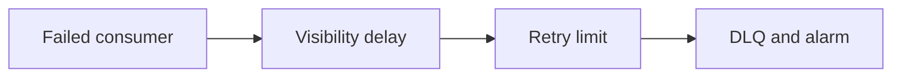

# Amazon SQS (message queue)

History: see [CHANGELOG.md](../CHANGELOG.md) or run `pnpm docs:history`

Area: AWS Compute · Status: ✅ built in repository; live AWS acceptance is separate

## 1. In one line

SQS buffers independently retryable work. Email and tickets have separate standard queues/DLQs, SSE-SQS and partial-batch mappings. Email visibility is 60 s, tickets 180 s; both redrive after 3 receives.

## 2. Real-life comparison

A durable work tray keeps the task after the customer leaves; a completed stamp identifies a repeat.

## 3. Picture it

## 4. Where in our code

- Anchor: `infra/src/jobs/queues.ts` — `createJobQueues`; follow the numbered comments at this boundary.

`apps/worker/src/batch.ts` returns batchItemFailures; `backoff.ts` sets delay; `infra/src/jobs/queue-trigger.ts` sets worker mapping. `pnpm jobs:dlq` lists local failures; redrive is an explicit owner operation after a fix. Runbook §3.12 has AWS diagnostics; no live alarm drill has been claimed.

## 5. See it yourself

Run `pnpm jobs:dlq` and inspect the asserted outcome described above.

Failure thought experiment: Does an empty queue mean email was delivered? No; inspect completion/provider outcomes too. Do not change a live stack to demonstrate it.

## 6. How it connects

Uses the [current system](../00-big-picture.md); gives a concrete decision to the [scenario](../guides/interview-scenarios.md#dlq-failure) and [explorer tour](../guides/infra-explorer.html?tour=failing-email).

## 7. Our settings and WHY

SQS buffers independently retryable work. Email and tickets have separate standard queues/DLQs, SSE-SQS and partial-batch mappings. Email visibility is 60 s, tickets 180 s; both redrive after 3 receives. Durable failure evidence is better than silently dropping work.

## 8. Trade-offs

Too-short visibility can overlap work; too-large visibility delays recovery. Reserved Lambda concurrency and mapping maximumConcurrency must agree or throttling can consume receives.

## 9. Alternatives and when to choose them

10x: oldest-message age and redrive rate limits. 100x: separate poison-message classes, sampling and SLO-driven alarms.

## 10. What breaks and how we notice

Does an empty queue mean email was delivered? No; inspect completion/provider outcomes too.

## 11. Reach / Allowed / Password

Prove the network path separately from the scoped IAM action and the runtime credential. [Every IAM badge](../guides/infra-build-along.md#every-iam-badge-who--what--attached) shows trust, permissions and attachment. No AWS endpoint needs an inbound SG simply because a non-VPC Lambda calls it.

## 12. Cost

Existing resource/usage costs are detailed in the corresponding infra guide chapter. No new resources were deployed by this documentation change. Historical phase costs are illustrative snapshots, not a current quote; inspect billing and current regional pricing before a capacity decision.

## 13. Interview answers at 3 levels

- **Simple:** SQS buffers independently retryable work.
- **Senior:** Find the booking/correlation id, follow structured logs, inspect queue age and failed attempts, then DLQ and alarm. Fix the root cause before redrive. Visibility timeout hides an in-flight message; it is not deletion. Partial-batch reporting retries only failed records. A poison message should not block all useful work.
- **Lead:** 10x: oldest-message age and redrive rate limits. 100x: separate poison-message classes, sampling and SLO-driven alarms.

## 14. Follow-up questions with answers

Does an empty queue mean email was delivered? No; inspect completion/provider outcomes too.

What should happen before redrive? **Fix the failure cause.**

## 15. Say it in 30 seconds

Find the booking/correlation id, follow structured logs, inspect queue age and failed attempts, then DLQ and alarm. Fix the root cause before redrive. Visibility timeout hides an in-flight message; it is not deletion. Partial-batch reporting retries only failed records. A poison message should not block all useful work.

## 16. Status and production work

Repository implementation and local evidence are described above. Live AWS/CI execution remains owner acceptance. 10x: oldest-message age and redrive rate limits. 100x: separate poison-message classes, sampling and SLO-driven alarms.

## Where it appears in the story

- [app-story: 9c. Side path: outbox, fan-out and recoverable work](../app-story.md#9c-side-path-outbox-fan-out-and-recoverable-work)
