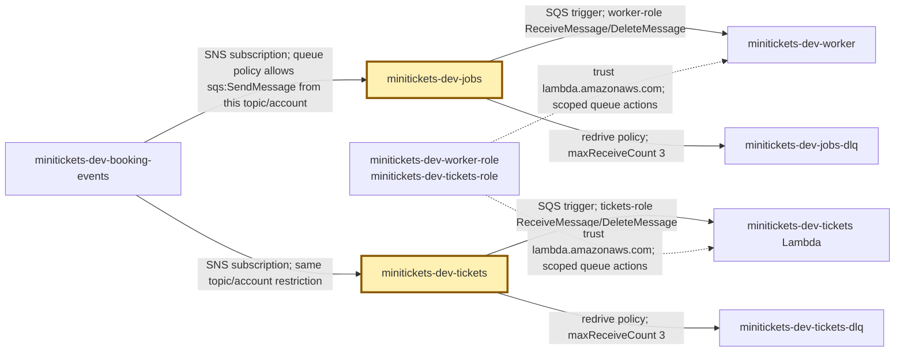
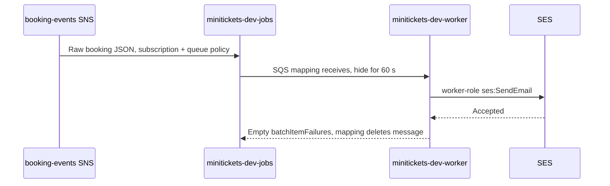

# SQS: the city work trays

History: see [CHANGELOG.md](../CHANGELOG.md) or run `pnpm docs:history`

Area: AWS Compute · Status: ✅ built in repository; live AWS acceptance is separate
<!-- interview-card: v1 -->

## 1. In one line

A MiniTickets booking leaves two [SQS](../glossary.md#sqs) messages: durable work notes, one for email and one for tickets.

## 2. Where it sits

[Open this piece in the city explorer](../guides/infra-explorer.html?concept=sqs#chapter=24&piece=email-queue).

## 3. How it works

## 4. What happens in MiniTickets

1. SNS copies the booking into each queue; neither consumer steals the other's work.
2. Email waits behind earlier work. A receive hides it for 60 seconds, without deleting it.
3. The worker reports only failed records; Lambda deletes successful ones.
4. Email failures wait 10, 40, then 120 seconds. Tickets keep their 180-second default.
5. After three receives without deletion, SQS can move the message to its own [DLQ](dead-letter-queue.md).

## 5. Reach / Allowed / Password

**Reach:** AWS HTTPS APIs on 443; workers run outside our VPC.

**Allowed:** SNS queue policy accepts only our topic/account; worker roles read only their queue.

**Password:** temporary role credentials; no queue password.

## 6. In our code

`infra/src/jobs/queues.ts` → `createJobQueues`; `infra/src/jobs/queue-trigger.ts` → `createQueueTrigger`.

`apps/worker/src/lambda.ts` → `handler`; `apps/worker/src/retry-later.ts` → `delayFailedMessages`.

## 7. In the AWS console

Region `us-east-1` → **SQS → Queues → minitickets-dev-jobs → Configuration / Access policy / Lambda triggers**. Check 60 seconds, three receives and the topic restriction. Repeat for `minitickets-dev-tickets`: 180 seconds.

## 8. Good / Bad

**Good:** survives worker outages; email and tickets recover separately.

**Bad:** duplicates remain possible; delayed work needs queue-age alarms.

## 9. Other choices

- Pick a direct call when the customer must wait for its answer.
- Pick a FIFO queue when work needs ordering within a named group.

## 10. Connected to

| Neighbor | Direction | What allows it | Console check |
| --- | --- | --- | --- |
| [SNS](sns.md) | in | Subscription + queue policy | SNS → topic → Subscriptions |
| [Lambda](aws-lambda.md) | out | SQS mapping + role | Lambda → function → Triggers |
| [DLQ](dead-letter-queue.md) | out | Redrive policy | SQS → queue → Dead-letter queue |

## 11. When it breaks

- Oldest age rises → mapping and worker logs → repair disabled triggers, failures or capacity.
- Duplicate email → visibility and completion logs → fix slow handling; retain deduplication.

## 12. Say it in 30 seconds

“MiniTickets puts email and ticket work in separate SQS trays. The API can finish a booking while workers catch up. Receiving hides a message; success deletes it. Failed messages retry, then enter a DLQ. Standard queues can repeat messages, so consumers must handle repeats safely.”

## 13. Likely follow-ups

**Does empty mean delivered?** No. SES acceptance and ticket readiness are separate outcomes.

**Why two queues?** Each job must reach both consumers.

## 14. Remember it

A tray holds work until someone finishes it; picking it up is not finishing it.

## 15. More detail

Settings, limits and later growth

- Anchor: `infra/src/jobs/queues.ts` — `createJobQueues`; follow the numbered comments at this boundary.

Both standard queues retain messages for four days, long-poll for 20 seconds and use SQS-managed encryption (SSE-SQS). Each DLQ retains for 14 days. Source-queue visibility is six times its Lambda timeout: email 60/10 seconds, tickets 180/30 seconds. Too short can overlap work; too long delays recovery. Email mapping uses batches up to 10 and maximum concurrency 5; tickets use 1 and 2. Partial-batch responses require `ReportBatchItemFailures` on the mapping, or successful returns could delete failures. Avoid a reserved-concurrency limit lower than the mapping's demand: throttled invokes can consume receives. Backoff has no random jitter yet.

At greater load, measure oldest age, consumer completion and provider limits before increasing concurrency. Separate permanently broken messages from temporary outages; redrive at a controlled rate after repairs. `pnpm jobs:dlq` inspects local email failures. The [runbook](../../20-deploy-day.md#312-observability-follow-one-booking-alarms-dashboard-p2) and [failure scenario](../guides/interview-scenarios.md#dlq-failure) cover diagnosis. Resource/usage charges apply; old cost figures are snapshots, not current prices. Repository/local evidence does not prove live AWS behavior or alarm delivery.

## Where it appears in the story

- [app-story: 9c. Side path: outbox, fan-out and recoverable work](../app-story.md#9c-side-path-outbox-fan-out-and-recoverable-work)
