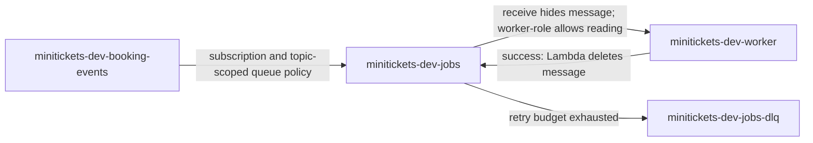

# SQS: the city work trays

History: see [CHANGELOG.md](../CHANGELOG.md) or run `pnpm docs:history`

Area: AWS Compute · Status: ✅ built in repository; live AWS acceptance is separate
<!-- interview-card: v2 -->

## 1. What is it?

[SQS](../glossary.md#sqs) holds work messages until a worker finishes them. MiniTickets uses separate queues for booking emails and ticket creation.

## 2. Why do we need it?

A booking should succeed even while email is slow. A queue lets the customer finish booking while the worker catches up, and keeps work available during a temporary worker outage.

## 3. How does it work?

1. Our SNS message distributor puts a booking copy in each worker's queue.
2. Receiving temporarily hides a message; it does not delete it.
3. Success deletes it. Failure makes it available again, then eventually moves it aside.

## 4. How do we use it in MiniTickets?

Email and ticket queues have independent workers and retry budgets. Partial-batch responses identify failed records so successful neighbors are not retried unnecessarily. Standard delivery can repeat messages, so both consumers use stable booking identities.

## 5. Interview-ready answer

“SQS separates MiniTickets booking from slower background work. Each consumer has its own queue. Receiving hides a message while it is processed; success deletes it, and failures retry before going to a repair queue. Delivery can repeat, so we design consumer behavior around stable identities rather than assuming exactly once.”

## 6. Important follow-up questions

- **Why two queues?** Email and ticket creation each need a copy. Workers sharing one queue divide its work.
- **What if visibility is too short?** Another worker may receive the message while the first still runs.
- **Does an empty queue prove delivery?** No. Check email acceptance or ticket readiness separately.
- **How do we spot stalled work?** Watch message age and consumer outcomes, then inspect triggers, errors and capacity.

## 7. Advanced details

Technical reference

### Configuration and security

The queue policies permit `sns.amazonaws.com` to call `sqs:SendMessage` only for the configured booking-events topic and source account. `minitickets-dev-worker-role` and `minitickets-dev-tickets-role` trust `lambda.amazonaws.com`; their receive/delete grants are scoped to their own source queues.

Each source queue uses `maxReceiveCount: 3`; SQS moves repeatedly received undeleted work after that budget. The email handler changes failure visibility to 10, 40 then 120 seconds; tickets retain their 180-second default. Both workers run outside the VPC and use temporary role credentials over HTTPS 443, without a queue password.

### Implementation and operational limits

- Anchor: `infra/src/jobs/queues.ts` — `createJobQueues`; follow the numbered comments at this boundary.

Both standard queues retain messages for four days, long-poll for 20 seconds and use SQS-managed encryption (SSE-SQS). Each DLQ retains for 14 days. Source-queue visibility is six times its Lambda timeout: email 60/10 seconds, tickets 180/30 seconds. Too short can overlap work; too long delays recovery. Email mapping uses batches up to 10 and maximum concurrency 5; tickets use 1 and 2. Partial-batch responses require `ReportBatchItemFailures` on the mapping, or successful returns could delete failures. Avoid a reserved-concurrency limit lower than the mapping's demand: throttled invokes can consume receives. Backoff has no random jitter yet.

At greater load, measure oldest age, consumer completion and provider limits before increasing concurrency. Separate permanently broken messages from temporary outages; redrive at a controlled rate after repairs. `pnpm jobs:dlq` inspects local email failures. The [runbook](../../20-deploy-day.md#312-observability-follow-one-booking-alarms-dashboard-p2) and [failure scenario](../guides/interview-scenarios.md#dlq-failure) cover diagnosis. Resource/usage charges apply; old cost figures are snapshots, not current prices. Repository/local evidence does not prove live AWS behavior or alarm delivery.

### Source references

`infra/src/jobs/queues.ts` → `createJobQueues`; `infra/src/jobs/queue-trigger.ts` → `createQueueTrigger`.

`apps/worker/src/lambda.ts` → `handler`; `apps/worker/src/retry-later.ts` → `delayFailedMessages`.

### Console and troubleshooting

Region `us-east-1` → **SQS → Queues → minitickets-dev-jobs → Configuration / Access policy / Lambda triggers**. Check 60 seconds, three receives and the topic restriction. Repeat for `minitickets-dev-tickets`: 180 seconds.

- Oldest age rises → mapping and worker logs → repair disabled triggers, failures or capacity.
- Duplicate email → visibility and completion logs → fix slow handling; retain deduplication.

### Trade-offs and related concepts

- Pick a direct call when the customer must wait for its answer.
- Pick a FIFO queue when work needs ordering within a named group.

| Neighbor | Direction | What allows it | Console check |
| --- | --- | --- | --- |
| [SNS](sns.md) | in | Subscription + queue policy | SNS → topic → Subscriptions |
| [Lambda](aws-lambda.md) | out | SQS mapping + role | Lambda → function → Triggers |
| [DLQ](dead-letter-queue.md) | out | Redrive policy | SQS → queue → Dead-letter queue |

[Open this piece in the city explorer](../guides/infra-explorer.html?concept=sqs#chapter=24&piece=email-queue).

## Where it appears in the story

- [app-story: 9c. Side path: outbox, fan-out and recoverable work](../app-story.md#9c-side-path-outbox-fan-out-and-recoverable-work)

