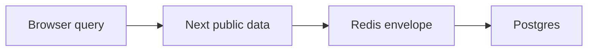

# Stale while revalidate

History: see [CHANGELOG.md](../CHANGELOG.md) or run `pnpm docs:history`

Area: Performance & Caching · Status: ✅ built in repository; live AWS acceptance is separate

## 1. In one line

SWR serves a bounded old result while refreshing. Our list soft age is 30–33 s, hard age 300 s, and failed refreshes never renew old data; search bypasses this list cache.

## 2. Real-life comparison

A dated catalogue at the ticket office: many readers can share it, but the clerk must know when a newer edition exists.

## 3. Picture it

## 4. Where in our code

- Anchor: `apps/api/src/services/events.ts` — `listUpcomingEvents`; follow the numbered comments at this boundary.

`apps/api/src/services/events.ts` applies fresh/stale/error windows and tracks in-flight refreshes. `apps/web/src/features/events/server/cached-events.ts` and `hooks/use-events.ts` add separate caches. Run `pnpm test` for fake-clock SWR/error cases. P10 disables shared HTML caching while retaining explicit public data caching.

## 5. See it yourself

Run `pnpm test` and inspect the asserted outcome described above.

Failure thought experiment: Does a successful admin write refresh all open tabs? No; they refetch on their own query policy. Do not change a live stack to demonstrate it.

## 6. How it connects

Uses the [current system](../00-big-picture.md); gives a concrete decision to the [scenario](../guides/interview-scenarios.md#swr-caches) and [explorer tour](../guides/infra-explorer.html?tour=search).

## 7. Our settings and WHY

SWR serves a bounded old result while refreshing. Our list soft age is 30–33 s, hard age 300 s, and failed refreshes never renew old data; search bypasses this list cache. Bounded stale public listings trade freshness for latency/availability.

## 8. Trade-offs

Never use stale data for authorization or seats. Long independent TTLs can compound staleness. A failing refresh must not reset old data to fresh.

## 9. Alternatives and when to choose them

10x: expose age/hit telemetry. 100x: consolidate overlapping caches and define end-to-end freshness budgets.

## 10. What breaks and how we notice

Does a successful admin write refresh all open tabs? No; they refetch on their own query policy.

## 13. Interview answers at 3 levels

- **Simple:** SWR serves a bounded old result while refreshing.
- **Senior:** SWR serves a bounded stale value while one background refresh runs; stale-if-error serves a previous good value during a bounded outage. Each cache layer has its own clock: Redis, Next public data and browser queries. Fresh at one layer does not force another layer to refetch. Seat purchase always checks the writer.
- **Lead:** 10x: expose age/hit telemetry. 100x: consolidate overlapping caches and define end-to-end freshness budgets.

## 14. Follow-up questions with answers

Does a successful admin write refresh all open tabs? No; they refetch on their own query policy.

Can stale listings authorize booking? **No.**

## 15. Say it in 30 seconds

SWR serves a bounded stale value while one background refresh runs; stale-if-error serves a previous good value during a bounded outage. Each cache layer has its own clock: Redis, Next public data and browser queries. Fresh at one layer does not force another layer to refetch. Seat purchase always checks the writer.

## 16. Status and production work

Repository implementation and local evidence are described above. Live AWS/CI execution remains owner acceptance. 10x: expose age/hit telemetry. 100x: consolidate overlapping caches and define end-to-end freshness budgets.

## Where it appears in the story

- [app-story: 10c. Public list caches and freshness](../app-story.md#10c-public-list-caches-and-freshness)
