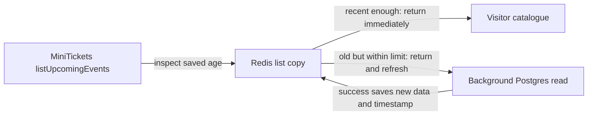

# Stale while revalidate

History: see [CHANGELOG.md](../CHANGELOG.md) or run `pnpm docs:history`

Area: Performance & Caching · Status: ✅ built in repository; live AWS acceptance is separate

<!-- interview-card: v2 -->

## 1. What is it?

Stale-while-revalidate serves an older cached result while refreshing it in the background. The old result is allowed only within a deliberate age limit.

## 2. Why do we need it?

A MiniTickets visitor can see a recent catalogue immediately instead of waiting for every refresh. A brief database problem need not hide the whole list, provided its age remains bounded.

## 3. How does it work?

1. Return a fresh copy immediately.
2. Within the stale window, return the old copy and share one refresh.
3. Stop using data past its hard limit; a failed refresh must not make it younger.

## 4. How do we use it in MiniTickets?

The legacy public list uses bounded stale serving and stale-if-error recovery. Current search bypasses that cache. Redis, Next data and browser queries have independent clocks, so a refreshed server copy does not force all open tabs to refetch.

## 5. Interview-ready answer

“MiniTickets trades a little public-list freshness for faster, more available browsing. It can return a bounded old value while refreshing, and retain a previous good value during a bounded error window. Failed refreshes never renew the old timestamp. This is suitable for browsing; buying seats and checking authorization must still use authoritative state.”

## 6. Important follow-up questions

- **How is stale-if-error different?** It permits a bounded previous good value when refresh fails, rather than hiding the failure indefinitely.
- **Can stale data approve a booking?** No. The booking transaction decides availability.
- **What is the dangerous timestamp bug?** Treating failed refresh as new data could extend staleness forever.
- **Do multiple cache layers add risk?** Yes. Their separate clocks can compound age unless the total freshness budget is understood.

## 7. Advanced details

Technical reference

### Freshness values and source

`apps/api/src/services/events.ts` applies list windows and shares in-flight refreshes. Soft age is **30–33 seconds**; hard age is **300 seconds**. Failed refreshes never reset the saved age. Current `events.search` intentionally bypasses the legacy `events.list` cache.

`apps/web/src/features/events/server/cached-events.ts` and `apps/web/src/features/events/hooks/use-events.ts` have separate data/query caching rules. P10 disables shared HTML caching while retaining explicit public-data caches. A successful admin write does not directly refresh every browser tab.

### Verification and future work

`pnpm test` includes fake-clock stale/error cases; this rewrite does not claim a new run or live AWS/CI acceptance. Never use stale copies for authorization or final seats. At greater scale expose age/hit telemetry, consolidate redundant layers if useful and define end-to-end freshness budgets rather than lengthening independent TTLs blindly.

### Code anchors

- Anchor: `apps/api/src/services/events.ts` — `listUpcomingEvents`; follow the numbered comments at this boundary.

### Related reading

[current system](../00-big-picture.md) · [scenario](../guides/interview-scenarios.md#swr-caches) · [explorer tour](../guides/infra-explorer.html?tour=search)

[Open this concept in the city explorer](../guides/infra-explorer.html?concept=stale-while-revalidate#chapter=5&piece=valkey).

## Where it appears in the story

- [app-story: 10c. Public list caches and freshness](../app-story.md#10c-public-list-caches-and-freshness)

