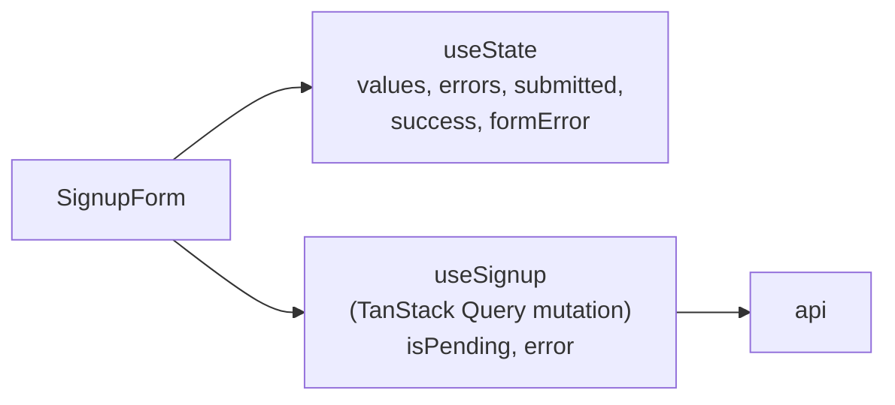

# Client state vs server state

History: see [CHANGELOG.md](../CHANGELOG.md) or run `pnpm docs:history`

Area: Frontend · Status: ✅ built · Step doc: [04 signup form](../../04-signup-form.md)

## 1. In one line

**Client state** belongs to the browser only (what you typed, is the form submitted); **server
state** is a copy of data that lives on the server (who is logged in). We keep the first in React
`useState` and the second in TanStack Query.

## 2. Real-life comparison

Your shopping list is yours (client state): you change it as you like. The shop's stock list is
theirs (server state): you can only hold a copy, and it can be out of date.

## 3. Picture it

## 4. Where in our code

- Anchor: `apps/web/src/features/auth/components/signup-form.tsx` · `SignupForm`: five `useState`s for the form, plus `useSignup()` for the server call.

Step by step:

1. `values`, `errors`, `submitted`, `success`, `formError` are client state: they exist only in
   this tab and nobody else needs them.
2. `useSignup()` holds the server interaction: `isPending` disables the button and changes its
   text to "Creating account...".
3. `useMe` / `useProfile` are pure server state: cached copies of api answers
   ([tanstack-query](tanstack-query.md)).
4. There is **no global client store** (no Redux, Zustand or context for app data). Nothing in the
   app needs one yet.

## 5. See it yourself

Install the React DevTools browser extension, open `/signup`, select `SignupForm`: you see the
`useState` hooks change as you type. The e2e test "the button is disabled while the request is
pending" (`signup.spec.ts`) checks the server-state side.

**Break it on purpose:** store `values` in a module-level variable instead of `useState`. Typing no
longer re-renders the inputs, and two forms would share it.

## 6. How it connects

- **Uses ←** React hooks; [tanstack-query](tanstack-query.md).
- **Gives →** [accessible-forms](accessible-forms.md) (errors, focus) and
  [ui-error-handling](ui-error-handling.md) (`formError`).

## 7. Our settings and WHY

Local `useState` per form; TanStack Query for anything from the api; no global store. WHY: the
smallest tool that fits; server data has its own cache rules and should not be copied into
component state.

## 8. Trade-offs

- **Pros:** obvious data flow; no store boilerplate; no "two copies of the user" bugs.
- **Cons:** each form repeats the same state shape (`LoginForm` and `SignupForm` are similar); a
  future multi-step flow may need shared client state.

## 9. Alternatives and when to choose them

- **React Hook Form / TanStack Form:** less boilerplate for many forms.
- **Zustand / Redux:** real shared client state (a cart, an editor) across distant components.
- **URL state (`useSearchParams`):** filters and pages that should survive reload and be
  shareable (we use it for `?next=`).

## 10. What breaks, and how we'd notice

- Copying server data into `useState`: it stops updating when the cache refetches.
- Lost form state on navigation: expected; it is local by design.

## 13. Interview answers at 3 levels

- **Simple:** What you type stays in the component; data from the server lives in a cache.
- **Senior:** Forms use local `useState` for values, errors and flags; api data goes through
  TanStack Query, which owns freshness and retries. We have no global store because nothing needs
  shared client state yet.
- **Lead:** Most "state management" problems are server-state problems in disguise. Separating
  them removes most of the need for a global store; I'd add one only for genuine cross-page client
  state.

## 14. Follow-up questions interviewers ask

- *When would you add Redux or Zustand?* Shared client-only state across many components, like a
  multi-step wizard or an editor.
- *Where does URL state fit?* Anything you want to bookmark or share.

## 15. Say it in 30 seconds

"We split client state and server state. Form values and errors are plain useState inside the form;
anything from the api is in TanStack Query's cache. No Redux or global store, because nothing needs
shared client state yet."

## 16. Status

✅ built.

## Where it appears in the story

- [App story: 2. TanStack Query: cache, retries, invalidation](../app-story.md#2-tanstack-query-cache-retries-invalidation)
