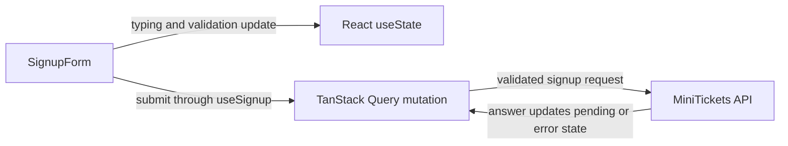

# Client state vs server state

History: see [CHANGELOG.md](../CHANGELOG.md) or run `pnpm docs:history`

Area: Frontend · Status: ✅ built · Step doc: [04 signup form](../../04-signup-form.md)
<!-- interview-card: v2 -->

## 1. What is it?

Client state is information owned by the current browser interface. Server state is a local copy of information owned by the backend, which can change elsewhere.

## 2. Why do we need it?

What someone types into MiniTickets signup is local draft state. Whether they are logged in comes from the API. Treating both as unrelated local variables makes the header and form disagree.

## 3. How does it work?

1. Keep draft values and presentation flags in the component.
2. Send operations through the feature hook.
3. Let the query library own fetched answers and request state.

## 4. How do we use it in MiniTickets?

Forms use React state for values, errors and submission feedback. Auth and catalogue hooks use TanStack Query for API data. Shareable event filters live in the URL. We have no separate global client-state store.

## 5. Interview-ready answer

“MiniTickets separates local interface state from remote data. Draft form values stay in React, while API answers live in TanStack Query with their own freshness and invalidation rules. Shareable filters belong in the URL. This avoids maintaining two independent user records and leaves a global store unnecessary until real shared client-only state appears.”

## 6. Important follow-up questions

- **Why not copy every API answer into useState?** The copy can stop following query refetches and become stale.
- **When add a global store?** For genuine shared client-only state, such as an editor or a multi-step draft.
- **Why use URL state?** It survives reloads and can be bookmarked or shared.
- **What if navigation loses form input?** Local state resets by design; persistent drafts need an explicit product requirement.

## 7. Advanced details

Technical reference

### Current reading notes

Existing auth form details below remain examples. Current catalogue filters also use URL parsing in the events page; search text has local/debounced state in its feature hook. No Redux/Zustand dependency or new store is implied.

### Implementation reference

- Anchor: `apps/web/src/features/auth/components/signup-form.tsx` · `SignupForm`: five `useState`s for the form, plus `useSignup()` for the server call.

Step by step:

1. `values`, `errors`, `submitted`, `success`, `formError` are client state: they exist only in
   this tab and nobody else needs them.
2. `useSignup()` holds the server interaction: `isPending` disables the button and changes its
   text to "Creating account...".
3. `useMe` / `useProfile` are pure server state: cached copies of api answers
   ([tanstack-query](tanstack-query.md)).
4. There is **no global client store** (no Redux, Zustand or context for app data). Nothing in the
   app needs one yet.

### Inspection and historical evidence

Install the React DevTools browser extension, open `/signup`, select `SignupForm`: you see the
`useState` hooks change as you type. The e2e test "the button is disabled while the request is
pending" (`signup.spec.ts`) checks the server-state side.

**Break it on purpose:** store `values` in a module-level variable instead of `useState`. Typing no
longer re-renders the inputs, and two forms would share it.

### Settings and reasoning

Local `useState` per form; TanStack Query for anything from the api; no global store. WHY: the
smallest tool that fits; server data has its own cache rules and should not be copied into
component state.

### Trade-offs

- **Pros:** obvious data flow; no store boilerplate; no "two copies of the user" bugs.
- **Cons:** each form repeats the same state shape (`LoginForm` and `SignupForm` are similar); a
  future multi-step flow may need shared client state.

### Alternatives and scaling

- **React Hook Form / TanStack Form:** less boilerplate for many forms.
- **Zustand / Redux:** real shared client state (a cart, an editor) across distant components.
- **URL state (`useSearchParams`):** filters and pages that should survive reload and be
  shareable (we use it for `?next=`).

### Failure diagnosis

- Copying server data into `useState`: it stops updating when the cache refetches.
- Lost form state on navigation: expected; it is local by design.

### Further questions

- *When would you add Redux or Zustand?* Shared client-only state across many components, like a
  multi-step wizard or an editor.
- *Where does URL state fit?* Anything you want to bookmark or share.

### Related reading

- [accessible-forms](accessible-forms.md)
- [ui-error-handling](ui-error-handling.md)

[Open this piece in the city explorer](../guides/infra-explorer.html?concept=state-management#chapter=0&piece=laptop-web).

## Where it appears in the story

- [App story: 2. TanStack Query: cache, retries, invalidation](../app-story.md#2-tanstack-query-cache-retries-invalidation)

