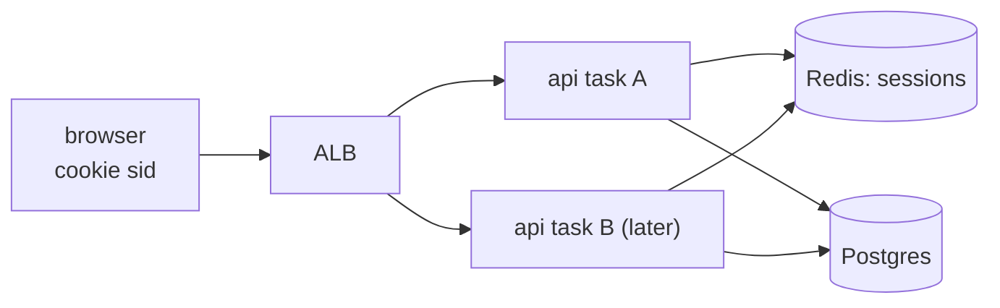

# Stateless API servers

History: see [CHANGELOG.md](../CHANGELOG.md) or run `pnpm docs:history`

Area: API · Status: ✅ built · Step doc: [07 login](../../07-login-session.md)

## 1. In one line

An api process is **stateless** when it keeps nothing a later request depends on; ours keeps
sessions in Redis and data in Postgres, so any api task can serve any request.

## 2. Real-life comparison

Bank tellers with a shared computer system: you can go to any teller, because your account is in
the system, not in one teller's drawer.

## 3. Picture it

## 4. Where in our code

- Anchor: `apps/api/src/queries/sessions.ts` · `create`, `get`, `remove`: sessions live in Redis, never in process memory.

Step by step:

1. Login writes `session:<sha256(id)>` to Redis; the browser keeps the raw id in a cookie.
2. Every request's context reads it back from Redis ([trpc-context](trpc-context.md)).
3. No in-memory caches, no local files, no sticky sessions.
4. So: a task can be replaced (deploy, Spot interruption) and the user stays logged in; we can run
   more tasks behind the ALB without changing code ([scaling](scaling.md)).

## 5. See it yourself

Locally: log in, then restart the api (`Ctrl+C` and `pnpm dev`). Reload the page: still logged in,
because the session is in Redis, not in the process that died.

**Break it on purpose:** keep sessions in a `Map` inside the api instead. Restart: everyone is
logged out. With two tasks, half the requests would be "logged out".

## 6. How it connects

- **Uses ←** [elasticache-valkey](elasticache-valkey.md) on AWS, Redis locally;
  [sessions-vs-jwt](sessions-vs-jwt.md).
- **Gives →** [scaling](scaling.md) out, [fargate-spot](fargate-spot.md) interruptions without
  logouts, [zero-downtime-deploys](zero-downtime-deploys.md).

## 7. Our settings and WHY

All state in Redis or Postgres. WHY: tasks are cattle (replaced at any time on Spot), and the ALB
picks any healthy target.

## 8. Trade-offs

- **Pros:** horizontal scaling, safe replacement, no sticky sessions.
- **Cons:** every authenticated request needs a Redis round-trip; Redis becomes a critical
  dependency (single node in dev).

## 9. Alternatives and when to choose them

- **Sticky sessions with in-memory state:** simple for one server, fragile with more.
- **Stateless tokens (JWT):** no store at all, but revocation is hard.
- **In-process caches** for read-mostly data: fine if a miss is harmless.

## 10. What breaks, and how we'd notice

- Redis down: logins and authenticated calls fail fast with 500; `/ready` 503.
- Someone adds an in-memory cache of user data: different answers per task. Hard to notice; code
  review.

## 13. Interview answers at 3 levels

- **Simple:** Any server can handle your request, because your login is stored centrally.
- **Senior:** Sessions are in Redis keyed by the hash of the cookie id, users in Postgres; the api
  process holds nothing between requests. That's why our tasks can run on Spot and be replaced, and
  why we could scale out behind the ALB without sticky sessions.
- **Lead:** Statelessness moves state into managed stores, which then need their own HA and
  capacity planning: production needs a Valkey replica with failover, since every request depends
  on it.

## 14. Follow-up questions interviewers ask

- *Do you need sticky sessions?* No: any task can read the session.
- *What about WebSockets?* Connections are stateful; you'd need a shared pub/sub to fan out
  messages.

## 15. Say it in 30 seconds

"Our api is stateless: sessions in Redis, users in Postgres, nothing in process memory. So any task
can serve any request, a Spot interruption or deploy doesn't log anyone out, and scaling out is
just more tasks behind the ALB."

## 16. Status

✅ built.
