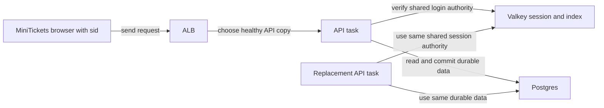

# Stateless API servers

History: see [CHANGELOG.md](../CHANGELOG.md) or run `pnpm docs:history`

Area: API · Status: ✅ built · Step doc: [07 login](../../07-login-session.md)

<!-- interview-card: v2 -->

## 1. What is it?

A stateless application server does not keep authoritative user state that a later request needs in that same process. Requests can therefore move between copies.

## 2. Why do we need it?

After a MiniTickets deployment replaces the API, users should not lose login just because their previous server disappeared. Shared session storage allows the replacement to recognize their cookie.

## 3. How does it work?

1. Store login authority and durable records outside the API process.
2. Resolve the request using those shared stores.
3. Replace a process without depending on its lost memory.

## 4. How do we use it in MiniTickets?

MiniTickets stores sessions in Redis/Valkey and durable data in Postgres. It can retain nonauthoritative in-process work-sharing state; losing that optimization must not change ownership or login authority. Current dev stores are still single copies and need their own reliability planning.

## 5. Interview-ready answer

“MiniTickets keeps authority in shared stores so a request does not depend on the API copy that handled login. That supports replacement and additional tasks without sticky sessions. Stateless does not mean no memory or no state anywhere: temporary optimizations are allowed, while sessions and durable records remain external. The shared stores then become critical dependencies whose availability must be designed separately.”

## 6. Important follow-up questions

- **Are sticky sessions required?** No. Each healthy task can read the shared session authority.
- **Can we use local caches?** For rebuildable, nonauthoritative data; not as the sole source of user authority.
- **What if Redis loses session state?** Authentication fails closed and the user may need to log in again.
- **Are WebSockets stateless?** The connection itself has state; multi-task fan-out would need an additional shared design.

## 7. Advanced details

Technical reference

### Current authority and implementation

`apps/api/src/queries/sessions.ts` stores `session:<sha256(token)>`; the browser retains the raw cookie. Request context reads Redis and requires index membership. Users/bookings live in Postgres. No client affinity is configured. Process replacement alone does not delete persisted sessions, but eviction, expiry or unavailable Redis can prevent authentication.

The old “no in-memory caches” / “nothing in memory” wording was too broad: list refresh promises and other temporary optimization state exist. Statelessness here concerns later requests’ authoritative correctness, not literal absence of memory. Losing a local optimization must be harmless.

### Failure and scaling limits

Redis failures propagate through authentication; missing authority denies access and `/ready` reports dependency failure. Do not promise a specific status for every path. An API outage can interrupt requests even if sessions survive. A restart demonstration must use an owner-approved isolated server; no owner process was restarted here.

Single-node dev Valkey is a critical dependency. Production reliability may need replicas/failover and capacity planning. JWTs reduce lookup dependence but need a revocation design; sticky in-memory sessions are fragile under replacement. WebSocket connections would need shared fan-out for cross-task messages. This rewrite claims no live interruption/HA drill.

### Code anchors

- Anchor: `apps/api/src/queries/sessions.ts` · `create`, `get`, `remove`: sessions live in Redis, never in process memory.

### Related reading

[trpc-context](trpc-context.md) · [scaling](scaling.md) · [elasticache-valkey](elasticache-valkey.md) · [sessions-vs-jwt](sessions-vs-jwt.md) · [fargate-spot](fargate-spot.md) · [zero-downtime-deploys](zero-downtime-deploys.md)

[Open this concept in the city explorer](../guides/infra-explorer.html?concept=stateless-servers#chapter=8&piece=api-task).

## Where it appears in the story

- [App story: 9. The query](../app-story.md#9-the-query)

