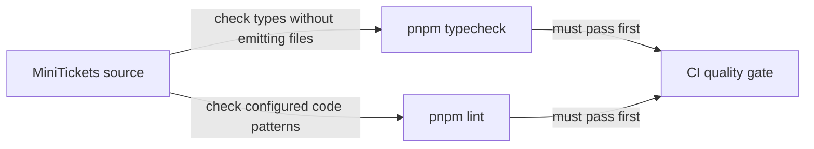

# Static checks: strict TypeScript + lint

History: see [CHANGELOG.md](../CHANGELOG.md) or run `pnpm docs:history`

Area: Testing · Status: ✅ built · Step doc: [01 setup](../../01-setup.md), [10 CI](../../10-ci.md)

<!-- interview-card: v2 -->

## 1. What is it?

Static checks examine code without running the application. TypeScript checks whether values fit their expected types; lint checks code patterns that often cause mistakes.

## 2. Why do we need it?

If the API changes an account date from text to a Date object, the web may break. Catching that mismatch before starting a server is cheaper than finding it during a user journey.

## 3. How does it work?

1. Use shared strict TypeScript settings across packages.
2. Run type and lint checks before slower tests.
3. Review what the tools cannot prove, including runtime input and architecture.

## 4. How do we use it in MiniTickets?

The workspace shares strict TypeScript configuration. The web is checked against the API’s router type, catching contract changes. ESLint applies JavaScript and TypeScript rules, plus Next.js rules for web files. Runtime inputs still need validation.

## 5. Interview-ready answer

“MiniTickets runs strict TypeScript checks across packages and scripts, then lint rules over the repository. They catch incompatible contracts and common mistakes before running the app, so they are our cheapest CI gate. Their limits matter: static types do not validate an incoming request, and our current lint configuration does not enforce every architectural rule.”

## 6. Important follow-up questions

- **Why check without emitting JavaScript?** These commands validate; the application build tools compile the code.
- **What can bypass type safety?** Unvalidated external data, unsafe casts and any can undermine guarantees.
- **Does lint enforce our layers?** No. Current configuration does not enforce import boundaries.
- **What would you add next?** Type-aware promise checks and explicit import boundaries where they justify their maintenance.

## 7. Advanced details

Technical reference

### Configuration and commands

`tsconfig.base.json` has `strict: true`, including null checks and no implicit `any`; packages extend it. `pnpm typecheck` runs `tsc --noEmit` across workspace packages and scripts. Scripts use `erasableSyntaxOnly` because Node strips their types. TypeScript stays pinned to **~5.9.3**; Next tooling uses its JavaScript compiler API.

`eslint.config.mjs` uses recommended JS/TypeScript rules and Next.js rules for `apps/web` only, excluding build output. `.github/workflows/ci.yml` quality runs `pnpm typecheck` and `pnpm lint`. JSON configuration cannot hold a code-anchor comment, so its anchor is on CI.

### Limits and verification examples

Returning `user.createdAt` without `.toISOString()` in the account service would conflict with the procedure’s string output. This is a hypothetical source edit, not performed here. Run `pnpm typecheck` and `pnpm lint` for actual diagnostics. `any` or disabled rules lower safety and deserve review.

No type-aware lint rules for floating promises or unsafe `any` are enabled; architecture rules remain review responsibilities. Alternatives are typescript-eslint type-checked configs, restricted-import/boundary rules, or Biome for lint/format. Current settings deliberately keep configuration small.

### Code anchors

- Anchor: `eslint.config.mjs` · `tseslint.config(...)`: recommended JS and TS rules, Next.js rules for `apps/web` only.
- Anchor: `.github/workflows/ci.yml` · quality job: `pnpm typecheck`, `pnpm lint`.

### Related reading

[end-to-end-types](end-to-end-types.md) · [monorepo](monorepo.md) · [testing-pyramid](testing-pyramid.md) · [ci-pipeline](ci-pipeline.md)

[Open this concept in the city explorer](../guides/infra-explorer.html?concept=static-checks#chapter=13&piece=github).

## Where it appears in the story

- [App story: 14. The testing pyramid](../app-story.md#14-the-testing-pyramid)
- [App story: 16. CI](../app-story.md#16-ci)

