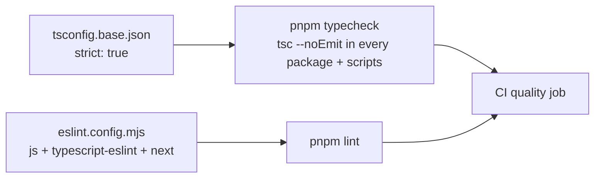

# Static checks: strict TypeScript + lint

History: see [CHANGELOG.md](../CHANGELOG.md) or run `pnpm docs:history`

Area: Testing · Status: ✅ built · Step doc: [01 setup](../../01-setup.md), [10 CI](../../10-ci.md)

## 1. In one line

**Static checks** find bugs without running the code: TypeScript in `strict` mode checks types in
every package, and ESLint checks code patterns; both gate CI.

## 2. Real-life comparison

A spell-checker and a grammar checker on an essay before anyone reads it: they don't judge the
argument, but they catch a whole class of mistakes for free.

## 3. Picture it



## 4. Where in our code

- Anchor: `eslint.config.mjs` · `tseslint.config(...)`: recommended JS and TS rules, Next.js rules for `apps/web` only.
- Anchor: `.github/workflows/ci.yml` · quality job: `pnpm typecheck`, `pnpm lint`.

Step by step:

1. `tsconfig.base.json` has `"strict": true` (null checks, no implicit any, …); every package
   extends it. (JSON can't hold an anchor comment for the check script, so the anchor is on CI.)
2. `pnpm typecheck` runs `tsc --noEmit` in every workspace package, then on `scripts/`
   (`erasableSyntaxOnly`, because Node runs those files by stripping types).
3. TypeScript is pinned to `~5.9.3` (the Next.js tooling uses its JS API; see `CLAUDE.md`).
4. `pnpm lint` runs ESLint's flat config across the repo, ignoring build output.
5. Types catch cross-package breaks too: the web is checked against the api's `AppRouter`
   ([end-to-end-types](end-to-end-types.md)).

## 5. See it yourself

```bash
pnpm typecheck && pnpm lint
```

**Break it on purpose:** in `services/account.ts`, return `user.createdAt` without
`.toISOString()`. `pnpm typecheck` fails: the procedure's output schema expects a string.

## 6. How it connects

- **Uses ←** [monorepo](monorepo.md) (shared base config).
- **Gives →** the cheapest layer of the [testing-pyramid](testing-pyramid.md); the first step of
  the [ci-pipeline](ci-pipeline.md).

## 7. Our settings and WHY

Strict everywhere, recommended lint sets, no custom rules yet. WHY: maximum safety for minimum
configuration.

## 8. Trade-offs

- **Pros:** instant feedback in the editor; catches contract breaks between apps.
- **Cons:** no type-aware lint rules (e.g. unhandled promises) are enabled; architectural rules
  (layers, feature folders) aren't enforced by lint.

## 9. Alternatives and when to choose them

- **`typescript-eslint` type-checked configs:** catch floating promises and unsafe `any`.
- **`no-restricted-imports` / boundaries plugins:** enforce our layering rules.
- **Biome:** one fast tool for lint and format.

## 10. What breaks, and how we'd notice

Disabling a rule or adding `any` quietly lowers safety; review catches it.

## 13. Interview answers at 3 levels

- **Simple:** Tools check the code for mistakes before it runs.
- **Senior:** `strict` TypeScript in every package via a shared base config, `tsc --noEmit` across the
  workspace and scripts, and ESLint with recommended JS/TS rules plus Next.js rules for the web. Both
  run first in CI; types also catch api/web contract breaks.
- **Lead:** Static checks are the cheapest quality gate; I'd add type-aware lint rules and import
  boundaries so architectural rules are enforced, not just written down.

## 14. Follow-up questions interviewers ask

- *What does `strict` turn on?* `strictNullChecks`, `noImplicitAny` and related checks.
- *Why `--noEmit`?* tsc only checks; tsx, esbuild and Next compile.

## 15. Say it in 30 seconds

"Strict TypeScript in every package through one base config, checked with tsc --noEmit across the
workspace, plus ESLint with recommended and Next.js rules. Both run first in CI, and types catch
breaking changes between the api and the web."

## 16. Status

✅ built. Possible next step: type-aware and import-boundary lint rules.
