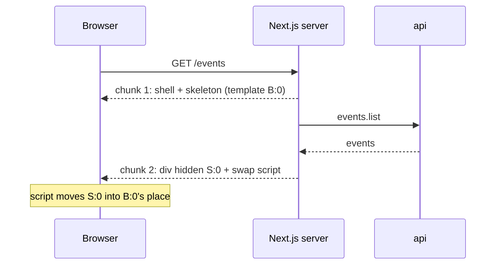

# Streaming with Suspense

History: see [CHANGELOG.md](../CHANGELOG.md) or run `pnpm docs:history`

Area: Frontend · Status: ✅ built · Step doc: [22 events SSR](../../22-events-ssr.md)

## 1. In one line

**Streaming** sends one HTTP response in pieces: `<Suspense>` marks the part of the page that waits
for data, so the server sends the rest (header, heading, a skeleton) at once and the finished part
later in the **same** response.

## 2. Real-life comparison

A restaurant that brings bread and water as soon as you sit down and the main course when the
kitchen is done. One visit to your table, not "wait at the door until everything is cooked".

## 3. Picture it

## 4. Where in our code

- Anchor: `apps/web/src/app/events/page.tsx` · `EventsPage`: `<Suspense fallback={<EventListSkeleton />}>` around `EventListWithServerData`.
- Anchor: `apps/web/src/features/events/components/event-list-skeleton.tsx` · `EventListSkeleton`: the fallback (also used by `EventList` when the browser fetches).
- Anchor: `apps/web/src/app/events/error.tsx` · `EventsError`: the error boundary for anything that throws, including inside the streamed part.
- Anchor: `apps/web/e2e/events.spec.ts` · "with JavaScript disabled": checks the streamed titles are in the page (attached, not visible).

Step by step:

1. `EventsPage` itself does not wait for anything. It renders the heading and a `<Suspense>`.
2. Inside it, `EventListWithServerData` is an **async** Server Component: it `await`s `prefetchEvents()`.
   While it waits, React uses the fallback.
3. React sends the first chunk: layout, heading, the skeleton, and a placeholder `<template id="B:0">`.
4. When the data is back, React sends `
` with the real list, plus a tiny inline
   script that moves it into the placeholder's spot and removes the skeleton.
5. If `EventListWithServerData` throws, the nearest error boundary (`app/events/error.tsx`) takes
   over. Once streaming has started the status code is already `200`; it cannot change to `500`.
6. `export const dynamic = "force-dynamic"` keeps the page rendered per request (no build-time HTML).

Measured on a production build (`docs/22`), with a stream-reading script:

| API speed | First chunk (shell + skeleton) | List chunk |
| --------- | ------------------------------ | ---------- |
| normal (about 2 ms) | +21.9 ms | +23.1 ms |
| 500 ms slower (delay proxy) | +22.2 ms | +531.0 ms |

`curl` with the slow API: TTFB about 6 ms (median of 5 runs), full response about 513 ms.

## 5. See it yourself

Save the stream-reading script from the Next.js streaming guide
(`apps/web/node_modules/next/dist/docs/01-app/02-guides/streaming.md`, "Observe raw chunks"), point
it at `http://localhost:3000/events`, and run it with `node`. You see the shell chunk, then the list
chunk with `hidden id="S:0"`.

`curl -s localhost:3000/events | grep -o '<template id="B:0"\|hidden id="S:0"'` shows both markers.

**Break it on purpose:** turn JavaScript off in DevTools and reload `/events`. The skeleton stays:
the titles are in the HTML (View Source), but the swap script never runs.

## 6. How it connects

- **Uses ←** [server-client-components](server-client-components.md) (async Server Components),
  [hydration](hydration.md) (the streamed chunk carries its part of the cache).
- **Gives →** [csr-vs-ssr](csr-vs-ssr.md): SSR whose first byte does not wait for the API;
  [ui-error-handling](ui-error-handling.md): `error.tsx` for errors in the streamed part.

## 7. Our settings and WHY

- **One boundary, around the list only.** The heading and layout need no data, so they are never held back.
- **The fallback is the old skeleton**, so CSR (Step 21) and SSR look the same while waiting.
- **No `loading.tsx`.** That file would make Next.js put the whole page behind one boundary,
  including the heading. An explicit `<Suspense>` keeps the heading in the first chunk.

## 8. Trade-offs

- **Pros:** fast first byte even with a slow API; one request; the slow part does not block the rest.
- **Cons:** the status code is fixed at `200` once the first chunk is out (a later error cannot
  become a `500`); content arrives in a hidden `
` that needs JavaScript to appear; a skeleton
  that is smaller than the real list still causes a layout shift (we saw CLS 0.084 in 1 of 3
  Lighthouse runs); proxies or compression that buffer can undo streaming.

## 9. Alternatives and when to choose them

- **No Suspense (wait, then send everything):** simplest, correct status codes, works without
  JavaScript; fine when the data is always fast.
- **`loading.tsx`:** the same mechanism for a whole route segment, with one file.
- **Static or cached HTML (later steps):** no waiting at all, if the data may be a little old.

## 10. What breaks, and how we'd notice

- **A buffering layer** (a proxy, a CDN, compression) holds chunks: TTFB jumps to the data time.
  We'd see it with the stream script; not checked through CloudFront yet (SSR does not run on AWS yet).
- **Errors after the first chunk** return `200` with the error boundary inside. Monitoring based on
  status codes would miss them; the web server log has the error and its `digest`.
- **No JavaScript:** the skeleton stays forever.

## 13. Interview answers at 3 levels

- **Simple:** The page frame shows at once; the list fills in when the data arrives, in the same response.
- **Senior:** `<Suspense>` around an async Server Component that awaits the API. React flushes the
  shell with a placeholder, then streams the list in a hidden div and a swap script. With the API
  slowed by 500 ms, TTFB stayed around 6 ms and the list arrived at about 530 ms.
- **Lead:** Place boundaries by data dependency and importance: keep above-the-fold, data-free parts
  in the shell; match skeleton size to avoid layout shift; remember that streaming fixes the status
  code early, so errors must be visible in logs, not just status metrics; check every proxy on the
  path for buffering.

## 14. Follow-up questions interviewers ask

- *Is streaming the same as WebSockets?* No: it is one normal HTTP response, sent in pieces.
- *Do bots get the stream?* Next.js treats "HTML-limited" bots (for example `Twitterbot`, and
  `Chrome-Lighthouse`) differently: it waits for the metadata before streaming. Our Lighthouse runs
  still received the shell first and the list after.
- *What if the boundary throws?* The nearest error boundary renders in its place.

## 15. Say it in 30 seconds

"The events page wraps only the list in Suspense. The shell and a skeleton go out immediately, the
list streams in the same response when the API answers. With a 500 ms slower API, the first byte
still came in about 6 ms. The catch: status is fixed at 200 once streaming starts, and the list needs
JavaScript to appear."

## 16. Status

✅ built (verified locally on a production build). Not yet checked through CloudFront and the ALB,
because SSR does not run on AWS yet ([server-to-server-calls](server-to-server-calls.md)).

## Where it appears in the story

- [App story: 10b. Reading events](../app-story.md#10b-reading-events)
