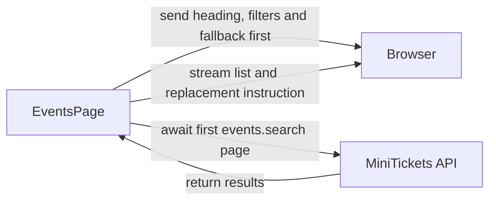

# Streaming with Suspense

History: see [CHANGELOG.md](../CHANGELOG.md) or run `pnpm docs:history`

Area: Frontend · Status: ✅ built · Step doc: [22 events SSR](../../22-events-ssr.md)
<!-- interview-card: v2 -->

## 1. What is it?

Streaming sends one page response in pieces. Suspense marks a part that can wait, allowing the rest of the page to arrive with a temporary placeholder.

## 2. Why do we need it?

If MiniTickets search is slow, visitors can still see the heading and filters promptly. They should not stare at a blank page while the event list loads.

## 3. How does it work?

1. Render the data-independent page frame and list skeleton.
2. Wait inside the list’s Suspense boundary.
3. Send the finished list later in the same response.

## 4. How do we use it in MiniTickets?

The events page wraps `EventListWithServerData` in Suspense. It prefetches current search data and passes it to the client list. The events error boundary handles unexpected render failures. Rendering remains per request.

## 5. Interview-ready answer

“MiniTickets streams its events page so the shell can arrive before search results. Suspense supplies a list skeleton, then React sends the finished content in the same response. It improves perceived speed rather than query speed. Once headers are sent, later errors need logs and an error boundary because the HTTP status cannot be changed.”

## 6. Important follow-up questions

- **Is this a WebSocket connection?** No. It is one ordinary HTTP response delivered progressively.
- **What if a proxy buffers the response?** The visitor loses the early-shell benefit; measure through the complete deployed path.
- **What if JavaScript is disabled?** Historical local checks found streamed titles in HTML but the client replacement did not reveal them.
- **Does a fast first byte prove a fast usable page?** No. Measure result arrival, layout stability and interaction too.

## 7. Advanced details

Technical reference

### Current boundary and rendering flow

EventsPage awaits URL searchParams, validates filters and sends data-independent heading/filter content outside a list Suspense boundary. EventListWithServerData awaits prefetchEvents, now an infinite events.search prefetch, then renders HydrationBoundary and EventList. The fallback EventListSkeleton also serves the browser loading state. Explicit Suspense keeps the heading outside the waiting region; there is no route loading.tsx. force-dynamic keeps rendering per request.

React can flush a placeholder/skeleton, then send hidden list content plus an instruction to replace it within the same HTTP response. Generated marker names such as B:0/S:0 are historical implementation observations, not a stable application API. Existing parent/child filter keys distinguish the form and list boundary so React does not confuse sibling identities when filters change.

If render fails after response headers are sent, the status cannot change to 500. app/events/error.tsx handles the render error; logs and its diagnostic digest remain necessary because a 200 alone does not prove a successful page. Buffers in proxies, compression or a CDN can prevent early chunks from reaching users. Measure the entire path rather than only localhost.

### Historical local measurements

Step22 measured an isolated production build, originally using events.list. These checks were not rerun for this rewrite:

| API speed | Shell + skeleton | List chunk |
| --- | --- | --- |
| Normal, roughly 2 ms | +21.9 ms | +23.1 ms |
| Added 500 ms delay proxy | +22.2 ms | +531.0 ms |

A curl run with the slow API recorded approximately 6 ms median TTFB over five runs and 513 ms full response. A smaller-than-result skeleton coincided with CLS 0.084 in one of three Lighthouse runs. These are historical observations, not production promises.

The raw stream reader from Next's installed streaming guide can inspect chunks; a historical curl check looked for template B:0 and hidden S:0. With JavaScript disabled, titles were attached in HTML but the swap script did not reveal them. Next's handling of HTML-limited bots and metadata can differ; the recorded Lighthouse runs still received shell then list. Current Service Connect is built; deployed ALB/CDN streaming acceptance remains pending.

### Alternatives

Waiting for all content simplifies status handling and can reveal complete HTML without the replacement step, but delays the first response. loading.tsx provides a route-segment boundary; explicit Suspense gives finer placement. Static/cached HTML can avoid repeated waiting when privacy and freshness permit it, but current nonce HTML is private,no-store. Streaming improves arrival, not database execution time.

### Source anchors

- Anchor: `apps/web/src/app/events/page.tsx` · `EventsPage`: `<Suspense fallback={<EventListSkeleton />}>` around `EventListWithServerData`.
- Anchor: `apps/web/src/features/events/components/event-list-skeleton.tsx` · `EventListSkeleton`: the fallback (also used by `EventList` when the browser fetches).
- Anchor: `apps/web/src/app/events/error.tsx` · `EventsError`: the error boundary for anything that throws, including inside the streamed part.
- Anchor: `apps/web/e2e/events.spec.ts` · "with JavaScript disabled": checks the streamed titles are in the page (attached, not visible).

### Related reading

- [22 events SSR](../../22-events-ssr.md)
- [server-to-server-calls](server-to-server-calls.md)
- [server-client-components](server-client-components.md)
- [hydration](hydration.md)
- [csr-vs-ssr](csr-vs-ssr.md)
- [ui-error-handling](ui-error-handling.md)
- [Open this piece in the city explorer](../guides/infra-explorer.html?concept=streaming-suspense#chapter=0&piece=laptop-web)
- [App story: 10b. Reading events](../app-story.md#10b-reading-events)

## Where it appears in the story

- [App story: 10b. Reading events](../app-story.md#10b-reading-events)

