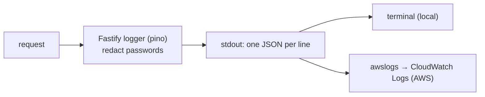

# Structured JSON logs (Fastify's logger, pino)

History: see [CHANGELOG.md](../CHANGELOG.md) or run `pnpm docs:history`

Area: Observability · Status: ✅ built · Step doc: [02 errors](../../02-errors.md)

## 1. In one line

The api writes one **JSON object per line** (level, time, request id, method, URL, status, response
time…) instead of free text, so logs can be searched and filtered by field.

## 2. Real-life comparison

A spreadsheet of deliveries with fixed columns (date, driver, parcel, status) instead of a diary of
sentences. "All failed deliveries yesterday" is one filter, not reading every page.

## 3. Picture it



## 4. Where in our code

- Anchor: `apps/api/src/app.ts` · `Fastify({ logger: { redact } })`, `onError`, `setErrorHandler`.

Step by step:

1. `logger: {…}` turns on Fastify's built-in pino logger (JSON to stdout).
2. Fastify logs every request twice: "incoming request" (method, URL, host, `remoteAddress`) and
   "request completed" (status code, `responseTime` in ms), both with the same `reqId`.
3. Our own lines: `onError` → `error` "procedure crashed" (with `err` and stack) or `warn`
   "procedure rejected" (with `code`); `/ready` logs which store failed; shutdown logs "shutting
   down" and "shutdown complete".
4. Levels are numbers: 30 info, 40 warn, 50 error.
5. Sensitive fields are redacted ([log-redaction](log-redaction.md)).
6. On AWS, the `awslogs` driver ships stdout to the log group `/ecs/minitickets-dev-api`, one stream
   per task ([cloudwatch-logs](cloudwatch-logs.md)).
7. A few `console.error` lines (config errors at startup, pool/Redis `"error"` events) are plain
   text, because they happen before or outside a request.

## 5. See it yourself

Recorded from a local api instance:

```json
{"level":30,"time":1791795811673,"pid":96497,"hostname":"…","reqId":"req-1","req":{"method":"GET","url":"/health","host":"localhost:4400","remoteAddress":"127.0.0.1","remotePort":61272},"msg":"incoming request"}
{"level":30,"time":1791795811678,"pid":96497,"hostname":"…","reqId":"req-1","res":{"statusCode":200},"responseTime":4.179416999999944,"msg":"request completed"}
{"level":40,"time":1791795828887,"pid":96497,"hostname":"…","reqId":"req-3","path":"auth.signup","code":"BAD_REQUEST","msg":"procedure rejected"}
```

Pretty-print locally: `pnpm --filter @minitickets/api dev | npx pino-pretty` (pino-pretty is not a
project dependency).

On AWS, CloudWatch Logs Insights can filter by field, e.g. `filter level >= 50`.

**Break it on purpose:** replace `request.log.error({ err })` with `console.log("failed", err)`.
The line loses its `reqId` and level, so you can no longer find it by request or severity.

## 6. How it connects

- **Uses ←** [fastify-app](fastify-app.md), [trust-proxy](trust-proxy.md) (real IP in
  `remoteAddress`).
- **Gives →** [cloudwatch-logs](cloudwatch-logs.md), [correlation-ids](correlation-ids.md),
  [error-handling](error-handling.md) diagnostics, future [metrics](metrics.md) from logs.

## 7. Our settings and WHY

pino defaults (info level, JSON) plus redaction. WHY: structured by default, fast, and CloudWatch
can query JSON fields.

## 8. Trade-offs

- **Pros:** searchable; fast; request-scoped context for free.
- **Cons:** hard to read raw; two log lines per request cost storage at scale; the web (Next.js)
  logs are not structured.

## 9. Alternatives and when to choose them

- **OpenTelemetry logs** with traces: when distributed tracing arrives.
- **Sampling** of info-level request logs at high traffic.
- **Embedded Metric Format:** emit metrics through log lines (explain-only).

## 10. What breaks, and how we'd notice

- Logging huge objects: big CloudWatch bills and slow requests.
- Wrong levels (user errors as `error`): noisy alerts later.

## 13. Interview answers at 3 levels

- **Simple:** The server writes logs as data, not sentences, so they're easy to search.
- **Senior:** Fastify's pino logger writes JSON lines to stdout: request start and end with `reqId`,
  status and response time, plus our warn/error lines from `onError` with the error cause.
  Passwords are redacted. On ECS, awslogs ships it to CloudWatch where Logs Insights filters by
  field.
- **Lead:** Logs are the cheapest observability we have; make them structured, levelled, correlated
  and redacted. Next: correlation ids across services, metrics derived from logs, and retention
  matched to need and cost.

## 14. Follow-up questions interviewers ask

- *Why log to stdout?* The platform (Docker, ECS) collects it; the app doesn't manage files.
- *What's in an error log?* Message, stack, request id, path; never the request body.

## 15. Say it in 30 seconds

"The api uses Fastify's pino logger: one JSON line per event with level, time and request id, a
start and end line per request with status and response time, and our own warn or error lines for
rejected or crashed procedures. Passwords are redacted. On AWS it all goes to CloudWatch, where we
can query by field."

## 16. Status

✅ built.
