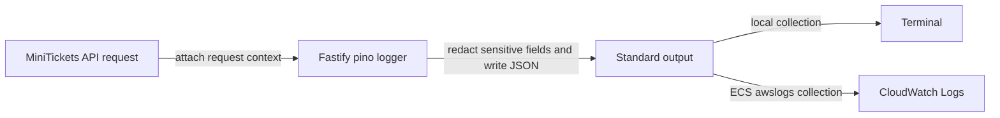

# Structured JSON logs (Fastify's logger, pino)

History: see [CHANGELOG.md](../CHANGELOG.md) or run `pnpm docs:history`

Area: Observability · Status: ✅ built · Step doc: [02 errors](../../02-errors.md)

<!-- interview-card: v2 -->

## 1. What is it?

Structured logging writes events as named fields rather than unstructured sentences. MiniTickets uses one JSON object per line so tools can filter useful details.

## 2. Why do we need it?

A buyer reports a server error. Searching by request ID, severity and route is more reliable than reading thousands of lines that all phrase failures differently.

## 3. How does it work?

1. Write consistent fields such as level, request ID and outcome.
2. Remove sensitive fields before records leave the application.
3. Let the runtime collect output and query records by field.

## 4. How do we use it in MiniTickets?

Fastify provides request-scoped API logs. The worker and web also have their own JSON log helpers. Correlation IDs connect asynchronous records; not every framework or startup line is necessarily JSON. Live AWS collection remains a separate check.

## 5. Interview-ready answer

“MiniTickets logs events as JSON with consistent fields, including severity and request context. That makes a failed request searchable instead of relying on free-text matching. We log rejected requests differently from unexpected crashes, and redact sensitive values. Writing to standard output lets the platform collect logs, but retention, volume and privacy still need deliberate controls.”

## 6. Important follow-up questions

- **Why write to standard output?** The platform collects logs; each app avoids managing local log files.
- **What belongs in an error record?** Useful identifiers, route, error cause and stack, without passwords or full request bodies.
- **What if every rejection is an error?** Expected user mistakes create noisy operational signals.
- **What is the cost trade-off?** Large objects and repetitive high-volume records increase storage, scan cost and request work.

## 7. Advanced details

Technical reference

### Log fields and sources

`apps/api/src/app.ts` configures Fastify/pino logging and redaction. Incoming/completed request lines share `reqId`; fields include method, URL, host, remote address, status and `responseTime` milliseconds. Levels: info **30**, warn **40**, error **50**. `onError` records procedure crashes with `err`/stack or rejections with `code`; readiness names failed stores; shutdown records start/completion. Some startup/config/pool/Redis errors still use plain text.

`apps/worker/src/log.ts` → `createLog` emits raw JSON in API-compatible shape so Lambda adds no text prefix. `apps/web/src/lib/server-log.ts` → `serverLog` emits web-owned JSON; this corrects the old statement that all web logging is unstructured, without claiming every Next.js framework line is JSON.

On AWS ECS `awslogs` sends output to **`/minitickets/dev/api`**, correcting the original historical `/ecs/minitickets-dev-api` path. Each task has a stream. CloudWatch Insights can use `filter level >= 50`. Pino defaults to info/JSON; sensitive fields are redacted, but arbitrary payload logging can still leak data.

### Operations and alternatives

Historical local examples showed matching request IDs on `/health` start/completion and a warn-level rejected signup; these are examples, not a fresh run. Local pretty-print reference: `pnpm --filter @minitickets/api dev | npx pino-pretty`; pino-pretty is not a project dependency and this command was not started here. Replacing contextual logging with plain `console.log` loses searchable identity/severity.

Future options include sampling info logs, OpenTelemetry logs/traces and Embedded Metric Format. Those are not implied by JSON logging. Keep retention and volume matched to incident needs and cost.

### Code anchors

- Anchor: `apps/api/src/app.ts` · `Fastify({ logger: { redact } })`, `onError`, `setErrorHandler`.
- Anchor: `apps/worker/src/log.ts` · `createLog`: the worker's JSON lines in the api's (pino's) shape, raw on stdout so Lambda adds no text prefix (P2).
- Anchor: `apps/web/src/lib/server-log.ts` · `serverLog`: the web server's own lines as JSON (P2).

### Related reading

[log-redaction](log-redaction.md) · [cloudwatch-logs](cloudwatch-logs.md) · [fastify-app](fastify-app.md) · [trust-proxy](trust-proxy.md) · [correlation-ids](correlation-ids.md) · [error-handling](error-handling.md) · [metrics](metrics.md)

[Open this concept in the city explorer](../guides/infra-explorer.html?concept=structured-logging#chapter=8&piece=logs).

## Where it appears in the story

- [App story: 4. Fastify: CORS, trustProxy, cookie](../app-story.md#4-fastify-cors-trustproxy-cookie)

