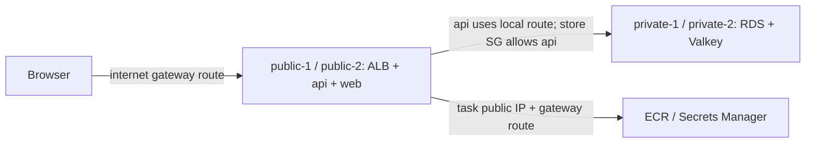

# Subnets: the city neighborhoods

History: see [CHANGELOG.md](../CHANGELOG.md) or run `pnpm docs:history`

Area: AWS Network · Status: ✅ built · Step doc: [12 network](../../12-infra-network.md)
<!-- interview-card: v2 -->

## 1. What is it?

A [subnet](../glossary.md#subnet) is a smaller address range inside a private network. Each subnet lives in one availability zone, an AWS location isolated from other zones.

## 2. Why do we need it?

MiniTickets needs a public entrance but private data. Subnets let us place the ALB where visitors can reach it and databases where they have no direct internet route.

## 3. How does it work?

1. Split the VPC into public and private subnet pairs.
2. Give the public pair an internet gateway route.
3. Place components in the pair matching their access needs.

## 4. How do we use it in MiniTickets?

Each of two zones has one public and one private subnet. Application tasks have public addresses for outgoing startup calls. Security groups restrict incoming calls; the databases stay private.

## 5. Interview-ready answer

“MiniTickets separates public applications from private data using subnets across two zones. A subnet is public because its route table leads directly to an internet gateway. Tasks also need public addressing for that path. Security groups still control who can connect, so placement and permission remain separate decisions.”

## 6. Important follow-up questions

- **Does naming a subnet ‘private’ protect it?** No. Its routes, resource addressing and security rules determine access.
- **Why put tasks in public subnets?** It avoids a standing NAT gateway cost in dev, at the cost of public task addresses.
- **Could tasks be private?** Yes, with suitable outbound paths through NAT or supported AWS endpoints.
- **What if image downloads time out?** Check task addressing and subnet routes before changing image permissions.

## 7. Advanced details

Technical reference

### Implementation and operations

`infra/src/network.ts` → `createNetwork` selects the first two available zones in `us-east-1`. Public ranges are `10.0.0.0/24` and `10.0.1.0/24`; private ranges are `10.0.10.0/24` and `10.0.11.0/24`. All belong to `10.0.0.0/16`. `publicSubnetIds` feeds the internet-facing ALB and `createApiService` / `createWebService` in `infra/src/compute/service.ts` and `infra/src/compute/web-service.ts`.

ALB reaches api 4000/web 3000 through source-group rules. Service Connect uses receiving proxy ports 14000/13000. API reaches RDS 5432 and Valkey 6379 through the stores' api-source rules. Subnet placement alone authorizes none of those connections.

VPC → Subnets → `minitickets-dev-public-1` → Details / Route table shows its range, zone and association. Compare its private neighbor and the second public subnet if only one zone fails. VPC → Your VPCs → `minitickets-dev-vpc` → Resource map shows all four. ECS → Clusters → `minitickets-dev` → Tasks → task → Networking shows actual task placement; live placement was not checked.

- Anchor: `infra/src/network.ts` · `publicSubnets`, `privateSubnets`: two of each, one per AZ.

Each `/24` provides 251 usable addresses after AWS reserves five. `mapPublicIpOnLaunch` is true on our public subnets and false on private ones; Fargate instead follows the service's `assignPublicIp: true`.

RDS and Valkey receive `privateSubnetIds` through their subnet groups. Moving RDS into a public subnet would not alone expose it: `publiclyAccessible: false` and `minitickets-dev-db-sg` are additional barriers. Conversely a private subnet name is no protection if someone adds an internet route and public addressing.

No NAT gateway is built. Private subnets have only the local route, and no endpoints are built. VPC endpoints provide private paths to supported AWS services; they are not a general internet exit. Private app tasks need ECR API/DKR, S3 image-layer access, secrets and logging access as appropriate. Interface endpoints carry per-zone standing charges; NAT carries standing and traffic charges. Old monthly/IPv4 figures were historical examples; check current regional prices before choosing.

Those older figures were roughly $33/month for NAT and $0.005 per public IPv4 address-hour. They explain the dev trade-off at that time; they are not a current quote.

An internet-facing ALB needs the public subnet pair. For public IPv4 internet access, a task needs a public IP as well as the gateway route. A private task without NAT/endpoints may stop with `CannotPullContainerError` or `ResourceInitializationError`.

An isolated third subnet tier can keep databases away even from a future NAT exit. Adding NAT does not make a private subnet public: its default route still points to NAT, not directly to an internet gateway. Read-only route inspection uses `aws ec2 describe-route-tables --filters Name=association.subnet-id,Values=<actual-subnet-id>`.

### Related reading

- [VPC](vpc.md)
- [Route tables](route-tables.md)
- [ALB](alb.md)
- [RDS](rds-postgres.md)

[Open this piece in the city explorer](../guides/infra-explorer.html?concept=subnets#chapter=24&piece=public-1).

## Where it appears in the story

- [Infra story: 10. The network: VPC, subnets, route tables, internet gateway](../infra-story.md#10-the-network-vpc-subnets-route-tables-internet-gateway)
- [Big picture: 4. Components](../00-big-picture.md#4-components)

