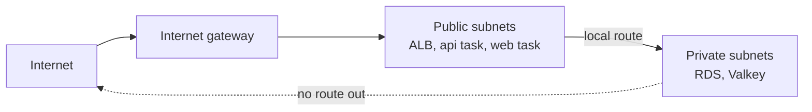

# Public vs private subnets

History: see [CHANGELOG.md](../CHANGELOG.md) or run `pnpm docs:history`

Area: AWS Network · Status: ✅ built · Step doc: [12 network](../../12-infra-network.md)

## 1. In one line

A **subnet** is a slice of the VPC's addresses in one AZ; it is **public** when its route table
sends `0.0.0.0/0` to the internet gateway, and **private** when it does not.

## 2. Real-life comparison

Floors of the office building. The ground floor has a door to the street (public); the upper
floors can only be reached by the internal stairs (private). The word "public" on a floor's sign
does nothing; the door does.

## 3. Picture it



## 4. Where in our code

- Anchor: `infra/src/network.ts` · `publicSubnets`, `privateSubnets`: two of each, one per AZ.

Step by step:

1. `publicCidrs = ["10.0.0.0/24", "10.0.1.0/24"]` → `publicSubnets`, with
   `mapPublicIpOnLaunch: true`.
2. `privateCidrs = ["10.0.10.0/24", "10.0.11.0/24"]` → `privateSubnets`, with
   `mapPublicIpOnLaunch: false`.
3. Each subnet sits in `azNames[i]` (see [regions-and-azs](regions-and-azs.md)).
4. What actually makes them public or private is the route table association (see
   [route-tables](route-tables.md)).
5. Who lives where (`infra/index.ts`): the ALB, the api tasks and the web tasks in the **public**
   subnets (`publicSubnetIds`); RDS and Valkey in the **private** ones (`privateSubnetIds`, via their
   subnet groups).

## 5. See it yourself

```bash
cd infra
pulumi stack output publicSubnetIds
pulumi stack output privateSubnetIds
# Which route table does each subnet use? Public ones should show a 0.0.0.0/0 -> igw-… route.
aws ec2 describe-route-tables --profile ticketlite \
  --filters Name=association.subnet-id,Values=$(pulumi stack output privateSubnetIds --json | jq -r '.[0]') \
  --query "RouteTables[0].Routes"
```

(`jq` must be installed.) A private subnet shows only the `local` route.

**Break it on purpose (thought experiment):** move RDS to the public subnets. It is still not
reachable, because `publiclyAccessible: false` gives it no public IP and the db security group
allows only the api. That is defense in depth: the subnet is one lock of three.

## 6. How it connects

- **Uses ←** the [VPC](vpc.md), the AZs, the [route tables](route-tables.md).
- **Gives →** homes for the [ALB](alb.md) and tasks ([ecs-service](ecs-service.md)) in public
  subnets, and for [RDS](rds-postgres.md) and [Valkey](elasticache-valkey.md) in private ones.

## 7. Our settings and WHY

| Choice | Why |
| ------ | --- |
| Databases in private subnets | They never need the internet, and the internet must never reach them. |
| Tasks in **public** subnets with a public IP | We have no NAT gateway (about $33 a month). A task needs a way out to ECR, Secrets Manager and CloudWatch, and the internet gateway is the only one. The api and web security groups still block all inbound traffic except from the ALB. (`infra/src/compute/service.ts` → `assignPublicIp: true`.) |
| `/24` per subnet | 251 usable addresses each, far more than we need. |

## 8. Trade-offs

- **Pros:** the data stores have no path to or from the internet; no NAT cost.
- **Cons:** the tasks have public IPs. They are **addressable**, not **open**, but a single wrong
  security group rule would expose them directly. Each public IPv4 address also costs $0.005 an hour.

## 9. Alternatives and when to choose them

- **Tasks in private subnets + NAT gateway:** the usual production setup; tasks get no public IP.
- **Tasks in private subnets + VPC endpoints** (ECR, Secrets Manager, CloudWatch Logs, S3): no
  internet path at all; each interface endpoint costs per hour per AZ.
- **A third tier of "isolated" subnets** for databases (no route even to a NAT): large production
  networks.

## 10. What breaks, and how we'd notice

- **A task in a private subnet (today, without NAT):** it cannot pull its image or read secrets;
  the stopped reason says `CannotPullContainerError` or `ResourceInitializationError`.
- **An ALB in private subnets:** internet-facing ALBs need public subnets; AWS refuses or nothing
  reaches it.

## 11. Reach / Allowed / Password

**Reach** only. A subnet decides which routes apply; [security groups](security-groups.md) decide
which connections are allowed.

## 12. Cost

Subnets are free. Public IPv4 addresses on tasks and the ALB cost $0.005 an hour each (see
[docs/17](../../17-infra-ecs-api.md), section 3.16).

## 13. Interview answers at 3 levels

- **Simple:** Public subnets can talk to the internet, private ones cannot. Our databases are
  private.
- **Senior:** The only difference is the route table: public subnets route `0.0.0.0/0` to the
  internet gateway. RDS and Valkey sit in private subnets; our Fargate tasks sit in public subnets
  with public IPs because we chose not to pay for a NAT gateway, and their security groups accept
  only the ALB.
- **Lead:** For production I would move the tasks into private subnets and pay for NAT or VPC
  endpoints, so a security group mistake cannot expose a container. In dev the saving is worth it
  because the security groups and the origin protection still hold.

## 14. Follow-up questions interviewers ask

- *Does `mapPublicIpOnLaunch` make a subnet public?* No. Only the route to the internet gateway
  does. It just gives new instances a public IP. (Fargate ignores it; the service's
  `assignPublicIp` decides for tasks.)
- *Can something in a private subnet reach the internet?* Only through a NAT gateway (outbound) or
  VPC endpoints (AWS services only).

## 15. Say it in 30 seconds

"Two public and two private `/24` subnets, one of each per AZ. Public means the route table points
`0.0.0.0/0` at the internet gateway. Databases are private; the tasks are public with a public IP
because we skip the NAT gateway, and their security groups let in only the ALB."

## 16. Status

✅ built. **To make it production-grade:** tasks in private subnets with NAT or VPC endpoints.

## Where it appears in the story

- [Infra story: 10. The network: VPC, subnets, route tables, internet gateway](../infra-story.md#10-the-network-vpc-subnets-route-tables-internet-gateway)
- [Big picture: 4. Components](../00-big-picture.md#4-components)
