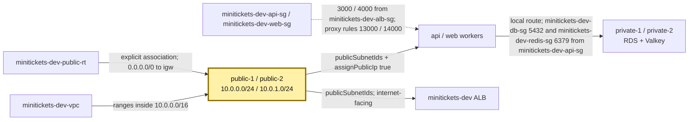
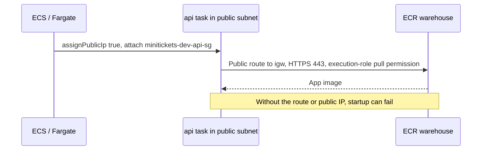

# Subnets: the city neighborhoods

History: see [CHANGELOG.md](../CHANGELOG.md) or run `pnpm docs:history`

Area: AWS Network · Status: ✅ built · Step doc: [12 network](../../12-infra-network.md)
<!-- interview-card: v1 -->

## 1. In one line

MiniTickets places its public workers and private databases in separate [subnets](../glossary.md#subnet): address slices, each in one availability zone.

## 2. Where it sits

[Open this piece in the city explorer](../guides/infra-explorer.html?concept=subnets#chapter=24&piece=public-1).

## 3. How it works

## 4. What happens in MiniTickets

1. `createNetwork` selects the first two available zones in `us-east-1`.
2. Each gets a public neighborhood: `10.0.0.0/24` or `10.0.1.0/24`.
3. Each also gets a private one: `10.0.10.0/24` or `10.0.11.0/24`.
4. The ALB, api and web use public subnets. RDS and Valkey use private ones.
5. Tasks have public IPs to fetch images and secrets. Their door guards still block unwanted callers.

## 5. Reach / Allowed / Password

**Reach:** the associated route table makes a subnet public or private.

**Allowed:** resource security groups still check ports and sources.

**Password:** not needed for a subnet; applications check credentials.

## 6. In our code

`infra/src/network.ts` → `createNetwork` (`publicSubnets`, `privateSubnets`).

`infra/src/compute/service.ts` → `createApiService`; `infra/src/compute/web-service.ts` → `createWebService`.

## 7. In the AWS console

VPC → Subnets → `minitickets-dev-public-1` → Details / Route table. Compare range and zone with its private neighbor. VPC → Your VPCs → `minitickets-dev-vpc` → Resource map shows the four neighborhoods. ECS → Clusters → `minitickets-dev` → Tasks → task → Networking shows actual placement. Live placement was not checked.

## 8. Good / Bad

**Good:** private data has no direct internet route; skipping a NAT gateway saves standing cost.

**Bad:** tasks have paid public IPv4 addresses; a mistaken door rule can expose them.

## 9. Other choices

- Pick private tasks plus a NAT gateway when workers must call arbitrary internet services without public addresses.
- Pick private tasks plus VPC endpoints when their outbound calls are supported AWS services.

## 10. Connected to

| Neighbor | Direction | What allows it | Console check |
| --- | --- | --- | --- |
| [VPC](vpc.md) | Contains subnet | Range inside `10.0.0.0/16` | VPC → Subnets → Details |
| [Route tables](route-tables.md) | Table → subnet | Explicit association | Subnet → Route table |
| [ALB](alb.md) | Placed in public pair | `publicSubnetIds` | Load Balancer → Network mapping |
| [RDS](rds-postgres.md) | Placed in private pair | DB subnet group | RDS → Connectivity & security |

## 11. When it breaks

- Image pull times out → task Networking and subnet route → restore public IP/path, or design NAT/endpoints.
- Twins behave differently → compare Route table tabs → fix the missing association.

## 12. Say it in 30 seconds

“Our four subnets are neighborhoods across two zones. Public means their road sign points to the internet gateway. The ALB and tasks live there; databases stay private. Tasks have public IPs because dev has no NAT, while security groups limit who may enter.”

## 13. Likely follow-ups

- **Does the name public open anything?** No. Routes, public addressing and guards all matter.
- **Does auto-assign public IPv4 control Fargate?** No. The ECS service uses `assignPublicIp`.

## 14. Remember it

A neighborhood is public because of its road, never because of its name.

## 15. More detail

Reference notes, source anchors and earlier useful detail

- Anchor: `infra/src/network.ts` · `publicSubnets`, `privateSubnets`: two of each, one per AZ.

Each `/24` provides 251 usable addresses after AWS reserves five. `mapPublicIpOnLaunch` is true on our public subnets and false on private ones; Fargate instead follows the service's `assignPublicIp: true`.

RDS and Valkey receive `privateSubnetIds` through their subnet groups. Moving RDS into a public subnet would not alone expose it: `publiclyAccessible: false` and `minitickets-dev-db-sg` are additional barriers. Conversely a private subnet name is no protection if someone adds an internet route and public addressing.

No NAT gateway is built. Private subnets have only the local route, and no endpoints are built. VPC endpoints provide private paths to supported AWS services; they are not a general internet exit. Private app tasks need ECR API/DKR, S3 image-layer access, secrets and logging access as appropriate. Interface endpoints carry per-zone standing charges; NAT carries standing and traffic charges. Old monthly/IPv4 figures were historical examples; check current regional prices before choosing.

Those older figures were roughly $33/month for NAT and $0.005 per public IPv4 address-hour. They explain the dev trade-off at that time; they are not a current quote.

An internet-facing ALB needs the public subnet pair. For public IPv4 internet access, a task needs a public IP as well as the gateway route. A private task without NAT/endpoints may stop with `CannotPullContainerError` or `ResourceInitializationError`.

An isolated third subnet tier can keep databases away even from a future NAT exit. Adding NAT does not make a private subnet public: its default route still points to NAT, not directly to an internet gateway. Read-only route inspection uses `aws ec2 describe-route-tables --filters Name=association.subnet-id,Values=<actual-subnet-id>`.

## Where it appears in the story

- [Infra story: 10. The network: VPC, subnets, route tables, internet gateway](../infra-story.md#10-the-network-vpc-subnets-route-tables-internet-gateway)
- [Big picture: 4. Components](../00-big-picture.md#4-components)
