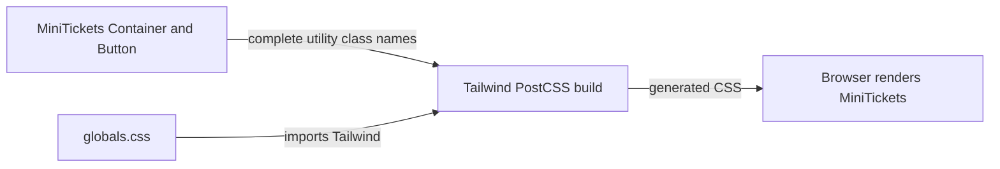

# Tailwind CSS (utility classes)

History: see [CHANGELOG.md](../CHANGELOG.md) or run `pnpm docs:history`

Area: Frontend · Status: ✅ built · Step doc: [03 landing](../../03-landing.md)
<!-- interview-card: v2 -->

## 1. What is it?

Tailwind styles elements with small CSS utility classes written beside the markup. Its build tool generates the styles for the class names it finds.

## 2. Why do we need it?

MiniTickets needs consistent spacing, colours and focus states across forms and cards. Small shared building blocks make those choices easy to see where the UI is written.

## 3. How does it work?



1. Write recognised utility names in components.
2. Run Tailwind through the web build.
3. Load generated CSS to apply the selected styles.

## 4. How do we use it in MiniTickets?

Tailwind v4 runs through PostCSS. The root layout imports global CSS; shared Button, Input and Container components reuse visual rules. Responsive prefixes adjust layouts, while visible focus helps keyboard users.

## 5. Interview-ready answer

“MiniTickets uses utility CSS so layout and appearance stay near the elements they affect. Tailwind generates the detected styles at build time, while shared React components provide reuse. This keeps styling local, but long class lists and undetected dynamic names need discipline. Browser review still matters because a style typo can fail silently.”

## 6. Important follow-up questions

- **What if a class name is misspelled?** It may produce no style and no build error; inspect the rendered UI.
- **Why avoid building names from string fragments?** The scanner needs complete detectable class names; choose explicit class alternatives.
- **How do you avoid repeating long styles?** Put a reusable look in a focused UI component with clear variants.
- **Does Tailwind guarantee accessibility?** No. Semantics, contrast, focus, interaction and human testing still matter.

## 7. Advanced details

<details>
<summary>Technical reference</summary>

### Current reading notes

Current setup uses Tailwind 4 through `apps/web/postcss.config.mjs`; no extra Tailwind config file is required for this small app. Optional CloudFront can cache hashed static CSS, but current public entry is direct ALB. Build/visual examples below are reference instructions, not checks rerun for this documentation edit.

### Implementation reference

- Anchor: `apps/web/postcss.config.mjs` · `plugins: { "@tailwindcss/postcss": {} }`: Tailwind v4 runs as a PostCSS plugin that Next.js picks up.
- Anchor: `apps/web/src/components/ui/container.tsx` · `Container`: a typical use, `mx-auto w-full max-w-5xl px-4 sm:px-6`.

Step by step:

1. `apps/web/src/app/globals.css` has one line, `@import "tailwindcss";` (reset + utilities).
   (CSS files cannot hold a `@concept` anchor for the check script, so the anchor is on the
   PostCSS config.)
2. `layout.tsx` imports `globals.css` once for the whole app.
3. Components write classes inline. Shared looks live in components, not in CSS files: `Button`
   (`variants.primary`, `variants.secondary`), `Input`, `Container`.
4. `sm:` prefixes apply from the small breakpoint up (`sm:grid-cols-3` in `FeaturesList`).
5. `focus-visible:outline-*` gives keyboard users a visible focus ring, but not mouse users.

### Inspection and historical evidence

```bash
pnpm --filter @minitickets/web build
ls apps/web/.next/static/css/       # the generated CSS file(s)
```

**Break it on purpose:** write a class that does not exist, e.g. `bg-indigo-650`. There is no
error; it silently has no effect. Tailwind generates only classes it recognises.

### Settings and reasoning

Tailwind v4 with zero config (no `tailwind.config.js`). WHY: v4 finds class names in the source by
itself, so there is nothing to configure for a small app.

### Trade-offs

- **Pros:** no naming of CSS classes; styles next to markup; small final CSS; consistent spacing
  and colour scale.
- **Cons:** long class strings; dynamic class names built from variables (`"bg-" + color`) are not
  detected; a typo fails silently.

### Alternatives and scaling

- **CSS Modules:** scoped plain CSS; good when designers write CSS.
- **A component library** (shadcn/ui on Tailwind, MUI): faster for big UIs.
- **CSS-in-JS** (styled-components): runtime cost; less common with Server Components.

### Failure diagnosis

Silent: missing styles from typos or dynamic class names. Visible only in the browser (the e2e tests
don't check styles).

### Further questions

- *How does Tailwind keep CSS small?* It scans source files and generates only the classes it finds.
- *How do you reuse styles?* Components (`Button`), not `@apply`.

### Related reading

- [cdn-caching](cdn-caching.md)

[Open this piece in the city explorer](../guides/infra-explorer.html?concept=tailwind#chapter=0&piece=laptop-web).

## Where it appears in the story

- [App story: 1. Browser → Next.js: layout, server vs client components, proxy guard](../app-story.md#1-browser--nextjs-layout-server-vs-client-components-proxy-guard)

</details>
