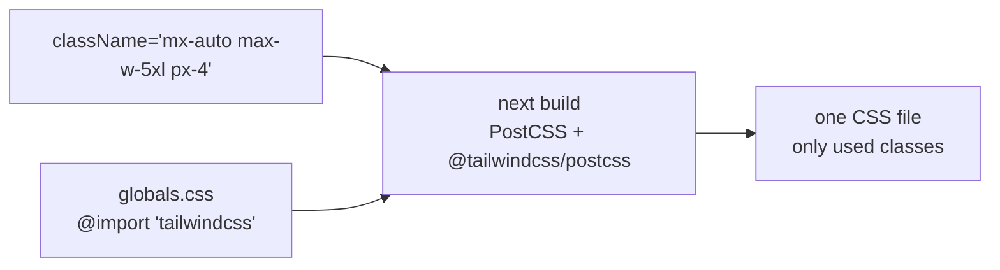

# Tailwind CSS (utility classes)

History: see [CHANGELOG.md](../CHANGELOG.md) or run `pnpm docs:history`

Area: Frontend · Status: ✅ built · Step doc: [03 landing](../../03-landing.md)

## 1. In one line

**Tailwind CSS** styles elements with small single-purpose class names (`px-4`, `text-red-700`)
written directly in the markup; at build time it generates only the CSS for the classes we use.

## 2. Real-life comparison

Building with Lego bricks instead of carving each piece: a fixed set of small, standard pieces that
you combine on the spot, and only the pieces you used are packed in the box.

## 3. Picture it



## 4. Where in our code

- Anchor: `apps/web/postcss.config.mjs` · `plugins: { "@tailwindcss/postcss": {} }`: Tailwind v4 runs as a PostCSS plugin that Next.js picks up.
- Anchor: `apps/web/src/components/ui/container.tsx` · `Container`: a typical use, `mx-auto w-full max-w-5xl px-4 sm:px-6`.

Step by step:

1. `apps/web/src/app/globals.css` has one line, `@import "tailwindcss";` (reset + utilities).
   (CSS files cannot hold a `@concept` anchor for the check script, so the anchor is on the
   PostCSS config.)
2. `layout.tsx` imports `globals.css` once for the whole app.
3. Components write classes inline. Shared looks live in components, not in CSS files: `Button`
   (`variants.primary`, `variants.secondary`), `Input`, `Container`.
4. `sm:` prefixes apply from the small breakpoint up (`sm:grid-cols-3` in `FeaturesList`).
5. `focus-visible:outline-*` gives keyboard users a visible focus ring, but not mouse users.

## 5. See it yourself

```bash
pnpm --filter @minitickets/web build
ls apps/web/.next/static/css/       # the generated CSS file(s)
```

**Break it on purpose:** write a class that does not exist, e.g. `bg-indigo-650`. There is no
error; it silently has no effect. Tailwind generates only classes it recognises.

## 6. How it connects

- **Uses ←** Next.js's built-in PostCSS support.
- **Gives →** the look of every component; the static CSS file is served from `/_next/static/*`,
  which CloudFront caches ([cdn-caching](cdn-caching.md)).

## 7. Our settings and WHY

Tailwind v4 with zero config (no `tailwind.config.js`). WHY: v4 finds class names in the source by
itself, so there is nothing to configure for a small app.

## 8. Trade-offs

- **Pros:** no naming of CSS classes; styles next to markup; small final CSS; consistent spacing
  and colour scale.
- **Cons:** long class strings; dynamic class names built from variables (`"bg-" + color`) are not
  detected; a typo fails silently.

## 9. Alternatives and when to choose them

- **CSS Modules:** scoped plain CSS; good when designers write CSS.
- **A component library** (shadcn/ui on Tailwind, MUI): faster for big UIs.
- **CSS-in-JS** (styled-components): runtime cost; less common with Server Components.

## 10. What breaks, and how we'd notice

Silent: missing styles from typos or dynamic class names. Visible only in the browser (the e2e tests
don't check styles).

## 13. Interview answers at 3 levels

- **Simple:** We style with small ready-made classes instead of writing CSS files.
- **Senior:** Tailwind v4 as a PostCSS plugin; `globals.css` imports it once; components compose
  utilities and shared looks are React components (`Button` variants), not CSS classes. The build
  emits only used utilities.
- **Lead:** Utility CSS makes styles local and deletable, which keeps CSS from growing forever. The
  reuse unit becomes the component, so a small design system of components matters more than CSS
  conventions.

## 14. Follow-up questions interviewers ask

- *How does Tailwind keep CSS small?* It scans source files and generates only the classes it finds.
- *How do you reuse styles?* Components (`Button`), not `@apply`.

## 15. Say it in 30 seconds

"Tailwind v4 via PostCSS with no config. One import in globals.css; components use utility classes,
and reusable looks are React components like Button and Input. The build outputs only the classes we
actually use."

## 16. Status

✅ built.
