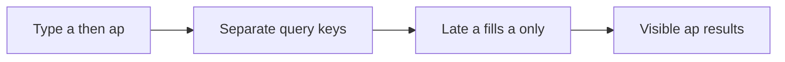

# TanStack Query: the server-state cache

History: see [CHANGELOG.md](../CHANGELOG.md) or run `pnpm docs:history`

Area: Frontend · Status: ✅ built in repository; live acceptance is separate

## 1. In one line

TanStack Query identifies server state by a complete input key. Current catalogue uses infinite events.search with q/filters/cursor, 30 s staleTime and previous-data feedback. Auth mutations invalidate relevant identity data; booking retries explicitly retain intent identity.

## 2. Real-life comparison

A catalogue with a bookmark: each question and position has its own identity, and only the visible page lies open.

## 3. Picture it

## 4. Where in our code

- Anchor: `apps/web/src/providers/query-provider.tsx` · `QueryProvider`: creates one `QueryClient` per browser tab with our retry rules.
- Anchor: `apps/web/src/features/auth/hooks/use-me.ts` · `useMe`: `useQuery(trpc.auth.me.queryOptions())`.
- Anchor: `apps/web/src/features/events/hooks/use-events.ts` · `useEvents`: `useQuery(trpc.events.list.queryOptions(undefined, { staleTime: 30_000 }))`, a second example of the same pattern (key `events.list`), filled from the server since Step 22.

`apps/web/src/features/events/hooks/use-event-search.ts` → `useEventSearch` debounces 250 ms, uses tRPC infinite-query options keyed by all input, consumes cancellation and keeps previous data. The component labels typing/loading. Run `pnpm demo:search`; the related browser spec deliberately delays an older response.

## 5. See it yourself

`apps/web/src/features/events/hooks/use-event-search.ts` → `useEventSearch` debounces 250 ms, uses tRPC infinite-query options keyed by all input, consumes cancellation and keeps previous data. The component labels typing/loading. Run `pnpm demo:search`; the related browser spec deliberately delays an older response.

Failure thought experiment: Could filters race too? Yes: venue/date/cursor must be in the input key. Should previous rows be bookable? Recheck authoritative availability on booking.

## 6. How it connects

Uses the [current system](../00-big-picture.md); gives a concrete decision to the [scenario](../guides/interview-scenarios.md#search-races) and [explorer tour](../guides/infra-explorer.html?tour=search).

## 7. Our settings and WHY

TanStack Query identifies server state by a complete input key. Current catalogue uses infinite events.search with q/filters/cursor, 30 s staleTime and previous-data feedback. Auth mutations invalidate relevant identity data; booking retries explicitly retain intent identity. A shared results variable with no request identity allows stale completion to win.

## 8. Trade-offs

A monotonically increasing request id also works for manual fetch. Abort alone does not prove the server stopped; debounce does not order responses.

## 9. Alternatives and when to choose them

10x: measure input-to-result latency and cap retained pages. 100x: add relevance/search infrastructure only after query plans and traffic justify it.

## 10. What breaks and how we notice

Could filters race too? Yes: venue/date/cursor must be in the input key. Should previous rows be bookable? Recheck authoritative availability on booking.

## 13. Interview answers at 3 levels

- **Simple:** TanStack Query identifies server state by a complete input key. Current catalogue uses infinite events.search with q/filters/cursor, 30 s staleTime and previous-data feedback. Auth mutations invalidate relevant identity data; booking retries explicitly retain intent identity.
- **Senior:** An old request may finish last. Give each search input its own query key so it can only fill its own cache entry. Cancellation saves work, but identity provides correctness even when a server ignores cancellation. Keep previous results visibly marked while the next input is loading.
- **Lead:** 10x: measure input-to-result latency and cap retained pages. 100x: add relevance/search infrastructure only after query plans and traffic justify it.

## 14. Follow-up questions with answers

Could filters race too? Yes: venue/date/cursor must be in the input key. Should previous rows be bookable? Recheck authoritative availability on booking.

## 15. Say it in 30 seconds

An old request may finish last. Give each search input its own query key so it can only fill its own cache entry. Cancellation saves work, but identity provides correctness even when a server ignores cancellation. Keep previous results visibly marked while the next input is loading.

## 16. Status and production work

Repository implementation and local evidence are described above. Live AWS/CI execution remains owner acceptance. 10x: measure input-to-result latency and cap retained pages. 100x: add relevance/search infrastructure only after query plans and traffic justify it.

## Where it appears in the story

- [App story: 2. TanStack Query: cache, retries, invalidation](../app-story.md#2-tanstack-query-cache-retries-invalidation)
- [App story: 10b. Reading events](../app-story.md#10b-reading-events) (the events hook as a second example)
