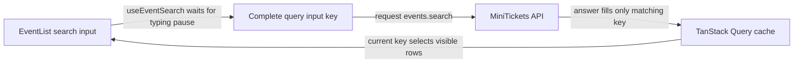

# TanStack Query: the server-state cache

History: see [CHANGELOG.md](../CHANGELOG.md) or run `pnpm docs:history`

Area: Frontend · Status: ✅ built in repository; live acceptance is separate
<!-- interview-card: v2 -->

## 1. What is it?

TanStack Query manages browser copies of server data. It remembers answers by a query key and tracks loading, errors, freshness and refetching.

## 2. Why do we need it?

On MiniTickets, someone may search for “jazz” and then “rock” before the first request finishes. A late jazz answer must not replace the results for rock.

## 3. How does it work?

1. Build a key from the full search input.
2. Request and store its answer under that identity.
3. Observe the active key so an older completion cannot become the new search result.

## 4. How do we use it in MiniTickets?

`useEventSearch` debounces text, uses infinite-query pages and labels previous results while new input loads. Auth hooks invalidate identity data after changes. Booking retries separately keep the same durable intent identity.

## 5. Interview-ready answer

“TanStack Query is MiniTickets’ server-state manager. Each complete input identifies its own cache entry, which keeps late search responses attached to the right request. It also handles freshness and request state. Debounce and cancellation reduce work; correct identity prevents stale completion from winning even when cancellation cannot stop the server.”

## 6. Important follow-up questions

- **Does debounce prevent response races?** No. Earlier requests can still finish late; query identity provides correctness.
- **What if a filter is absent from the key?** Different questions can share one answer incorrectly; include every result-changing input.
- **Does a cached seat count authorize purchase?** No. Postgres rechecks availability in the booking transaction.
- **Why retain previous data?** It avoids a blank list, but clearly show that a replacement search is loading.

## 7. Advanced details

Technical reference

### Current implementation

Current search uses 250 ms debounce, limit 50, 30-second staleTime, keepPreviousData and abortOnUnmount. The infinite-query cache owns its cursor pages within that complete input identity. QueryProvider retries non-4xx failures at most twice; mutations do not retry globally. Legacy useEvents remains a separate events.list example; catalogue SSR uses events.search.

### Technical limits and diagnosis

QueryProvider creates QueryClient and tRPC client once for the mounted browser provider. Queries avoid retrying 4xx; other failures get at most two retries. Mutations use retry 0 globally; booking separately opts into durable-intent retry. useMe observes auth.me; legacy useEvents observes events.list.

Current search uses infinite-query pages with getNextPageParam from nextCursor. All result-changing filters/text belong to the input identity; cursor pages belong to the same traversal. Debounce reduces calls but does not order completions. Cancellation can save resources but cannot prove server work stopped. Previous rows remain explicitly marked while the next input loads; their availability cannot authorize purchase.

The isolated search demo and browser spec deliberately delayed an older response in historical local evidence. A manual increasing request ID is an alternative to query-key identity. Measure input-to-result latency and cap retained pages before introducing specialised relevance infrastructure. No demo or production benchmark was run for this rewrite.

### Source anchors

- Anchor: `apps/web/src/providers/query-provider.tsx` · `QueryProvider`: creates one `QueryClient` per browser tab with our retry rules.
- Anchor: `apps/web/src/features/auth/hooks/use-me.ts` · `useMe`: `useQuery(trpc.auth.me.queryOptions())`.
- Anchor: `apps/web/src/features/events/hooks/use-events.ts` · `useEvents`: `useQuery(trpc.events.list.queryOptions(undefined, { staleTime: 30_000 }))`, a second example of the same pattern (key `events.list`), filled from the server since Step 22.

### Related reading

- [current system](../00-big-picture.md)
- [scenario](../guides/interview-scenarios.md#search-races)
- [explorer tour](../guides/infra-explorer.html?tour=search)
- [App story: 2. TanStack Query: cache, retries, invalidation](../app-story.md#2-tanstack-query-cache-retries-invalidation)
- [App story: 10b. Reading events](../app-story.md#10b-reading-events)

[Open this piece in the city explorer](../guides/infra-explorer.html?concept=tanstack-query#chapter=24&piece=code-hook).

## Where it appears in the story

- [App story: 2. TanStack Query: cache, retries, invalidation](../app-story.md#2-tanstack-query-cache-retries-invalidation)
- [App story: 10b. Reading events](../app-story.md#10b-reading-events) (the events hook as a second example)

