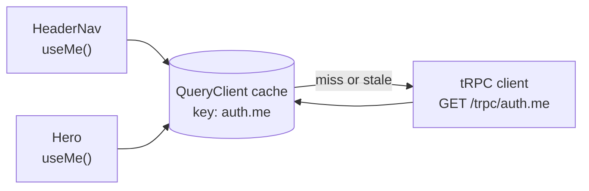

# TanStack Query: the server-state cache

History: see [CHANGELOG.md](../CHANGELOG.md) or run `pnpm docs:history`

Area: Frontend · Status: ✅ built · Step doc: [04 signup form](../../04-signup-form.md), [07 login](../../07-login-session.md)

## 1. In one line

**TanStack Query** keeps a cache of answers from the api in the browser, keyed by what was asked,
and gives components `data`, `isPending` and `error` without writing any fetch or loading code.

## 2. Real-life comparison

A notice board in a shared office. Instead of everyone phoning head office to ask "who is logged
in?", the first person phones, pins the answer on the board, and everyone else reads the board.
When the answer might be old, someone phones again and replaces the note.

## 3. Picture it

Two components ask for the same key; there is one request and one cached answer.

## 4. Where in our code

- Anchor: `apps/web/src/providers/query-provider.tsx` · `QueryProvider`: creates one `QueryClient` per browser tab with our retry rules.
- Anchor: `apps/web/src/features/auth/hooks/use-me.ts` · `useMe`: `useQuery(trpc.auth.me.queryOptions())`.

Step by step:

1. `QueryProvider` makes a `QueryClient` once (`useState(() => new QueryClient(...))`), so a
   re-render never throws the cache away.
2. `TRPCProvider` (inside it) connects tRPC to that client, so `trpc.auth.me.queryOptions()`
   returns a **query key** (the procedure path plus input) and a function that calls the api.
3. `useMe` is used by both `HeaderNav` and `Hero`. The first one triggers the request; the second
   reads the same cache entry.
4. Result states: `isPending` (no data yet), `data` (`{ id, email }` or `null`), `error`.
   `HeaderNav` renders an empty `<nav>` while pending so it never flashes the wrong links.
5. **Defaults we keep** (verified in the installed `@tanstack/query-core` 5.104.1 source):
   `staleTime` 0 (an answer is "stale" right away), so the query is fetched again when a component
   mounts or the window gets focus again; unused entries are removed after `gcTime` 5 minutes
   (`3e5` ms in `removable.js`).
6. **Defaults we change:** `retry` ([retry-policy](retry-policy.md)). Mutations never retry.

## 5. See it yourself

DevTools → Network, filter `trpc`. Load `/`: one `auth.me` request even though two components use
it. Switch to another tab and back: `auth.me` is asked again (refetch on window focus, because the
answer is stale).

**Break it on purpose:** move `new QueryClient(...)` out of `useState` into the component body.
Every render now creates an empty cache: you will see repeated `auth.me` requests and loading
flicker.

## 6. How it connects

- **Uses ←** [trpc-client](trpc-client.md) to actually send requests.
- **Gives →** cached data for [feature-folders](feature-folders.md) hooks; the base for
  [query-invalidation](query-invalidation.md) and [retry-policy](retry-policy.md).

## 7. Our settings and WHY

| Setting | Value | Why |
| ------- | ----- | --- |
| `QueryClient` lifetime | one per tab, in `useState` | A cache must outlive re-renders. |
| `queries.retry` | `shouldRetry` | Retry network and 5xx errors, never 4xx. |
| `mutations.retry` | `0` | A retried signup could hit its own new row (409). |
| `staleTime`, `gcTime` | library defaults (0, 5 min) | Always-fresh auth state is worth a tiny extra request. |

## 8. Trade-offs

- **Pros:** no hand-written loading/error state; de-duplication; background refresh; one place for
  retry rules.
- **Cons:** another mental model (stale vs fresh, keys); with `staleTime` 0 we ask `auth.me`
  more often than strictly needed.

## 9. Alternatives and when to choose them

- **SWR:** similar, smaller API.
- **Redux Toolkit Query:** when the app already uses Redux.
- **Plain `fetch` in `useEffect`:** only for one-off calls; you rebuild caching and races by hand.
- **Server Components fetching data:** data arrives with the HTML (see
  [server-client-components](server-client-components.md)).

## 10. What breaks, and how we'd notice

- Cache not cleared on logout: the next user sees the previous user's data. We clear it
  ([query-invalidation](query-invalidation.md)).
- A wrong key: two components fetch twice or show different answers. Visible in the Network tab.

## 13. Interview answers at 3 levels

- **Simple:** It remembers answers from the server so the page doesn't ask twice.
- **Senior:** One `QueryClient` per tab holds server state keyed by tRPC path and input. `useMe`
  is shared by the header and the hero, so there is one request. We keep `staleTime` 0 so auth state
  refreshes on focus, retry only network and 5xx failures, and never retry mutations.
- **Lead:** Treat server state as a cache with explicit freshness and invalidation rules, not as
  global app state. The rules that matter are per data type: auth must be fresh, reference data can
  be stale for minutes. I'd tune `staleTime` per query once we have more data types.

## 14. Follow-up questions interviewers ask

- *Stale vs inactive vs garbage-collected?* Stale: may be refetched. Inactive: no component uses it.
  Collected: removed after `gcTime`.
- *Why not put server data in Redux?* Then you write the caching, refetching and invalidation
  yourself.

## 15. Say it in 30 seconds

"TanStack Query is our server-state cache. One QueryClient per tab, keyed by the tRPC procedure.
The header and the hero both call useMe, but there's one request. We keep it fresh on focus, retry
only network and 5xx errors, never retry mutations, and invalidate or clear it after login and
logout."

## 16. Status

✅ built.
