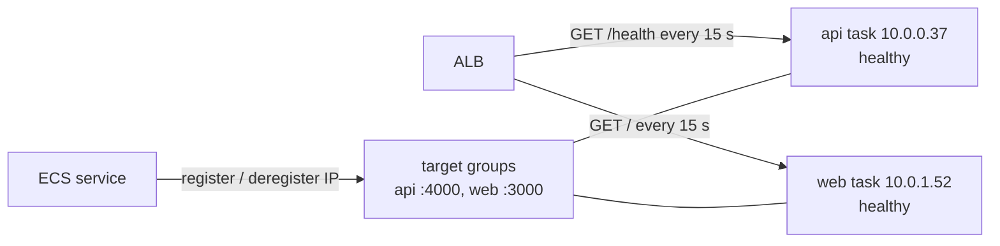

# Target groups and ALB health checks

History: see [CHANGELOG.md](../CHANGELOG.md) or run `pnpm docs:history`

Area: AWS Network · Status: ✅ built · Step doc: [18 ALB + web](../../18-infra-alb-web.md) (sections 3.4-3.7)

## 1. In one line

A **target group** is the ALB's list of task IP addresses for one kind of request, plus a health
check that decides which of them get traffic.

## 2. Real-life comparison

The list of staffed desks for one service counter. Every 15 seconds someone walks past and asks
"open?". Only desks that answer get customers.

## 3. Picture it



## 4. Where in our code

- Anchor: `infra/src/entry/target-groups.ts` · `createTargetGroups`: the api and web target groups and their health checks.

Step by step:

1. `shared`: `targetType: "ip"` (Fargate tasks have their own IPs; there is no EC2 instance to
   point at), `protocol: "HTTP"`, `deregistrationDelay: 30`.
2. No `name`: Pulumi adds a random suffix, so a replacement (e.g. a new port) can create the new
   group before deleting the old one.
3. `healthCheckTiming`: every 15 s, 5 s timeout, `matcher: "200"`, 2 passes = healthy,
   3 failures = unhealthy.
4. `apiTargetGroup`: port 4000, path `/health`. Not `/ready`: a short database blip must not pull
   every api task out of the ALB.
5. `webTargetGroup`: port 3000, path `/` (the landing page needs no database or api).
6. The ECS services fill the lists: `service.ts` / `web-service.ts` → `loadBalancers` with
   `containerName` and `containerPort`.

## 5. See it yourself

```bash
for TG in $(aws elbv2 describe-target-groups --profile ticketlite \
  --query "TargetGroups[?starts_with(TargetGroupName,'minitickets-dev-')].TargetGroupArn" --output text); do
  aws elbv2 describe-target-health --profile ticketlite --target-group-arn "$TG" \
    --query 'TargetHealthDescriptions[].{ip:Target.Id,port:Target.Port,state:TargetHealth.State}' --output text
done
```

Expect one `healthy` target on 4000 and one on 3000.

**Break it on purpose (scratch branch):** change the api health check path to `/nope`. The api answers
404, the target reports `Target.ResponseCodeMismatch`, and after the 60 s grace period ECS stops the
task (`Task failed ELB health checks`) and starts a new one, which fails the same way. Changing a
target group is not an ECS deployment, so the circuit breaker does not step in; the loop goes on
until you fix the path.

## 6. How it connects

- **Uses ←** the [VPC](vpc.md); the api's `/health` route (`apps/api/src/app.ts`, Phase 3
  `health-checks` card).
- **Gives →** the [ALB](alb.md) rules' destinations; [ecs-service](ecs-service.md) registration;
  draining for [zero-downtime deploys](zero-downtime-deploys.md); the
  [load balancing algorithm](load-balancing-algorithms.md).

## 7. Our settings and WHY

| Setting | Value | Why |
| ------- | ----- | --- |
| `targetType` | `ip` | Fargate `awsvpc` tasks have their own IPs. |
| `deregistrationDelay` | 30 s | Default 300 s would make every deploy wait 5 minutes; our requests take milliseconds. |
| Interval / timeout | 15 s / 5 s | Notice a dead task within about 45 s. |
| Healthy / unhealthy | 2 / 3 | Two passes before traffic; three misses before removal, so one slow answer is forgiven. |
| api path | `/health` | Liveness, not readiness: database blips must not empty the group. |
| web path | `/` | Needs only Next.js itself. |

## 8. Trade-offs

- **Pros:** the ALB never sends users to a dead task; failed tasks are replaced automatically.
- **Cons:** `/health` does not prove the api can reach Postgres; a task with a broken database
  connection still gets traffic (and answers 500s).

## 9. Alternatives and when to choose them

- **`/ready` as the ALB check:** when one task can be broken while others are fine (for example a
  per-task connection problem), and you have enough tasks that removing one is safe.
- **`instance` target type:** containers on your own EC2 machines.
- **Slow start mode:** ramp traffic to a new target gradually; useful for apps that warm caches.

## 10. What breaks, and how we'd notice

| Health reason | Usually means |
| ------------- | ------------- |
| `Target.Timeout` | Security group blocks ALB → task, or (web) `HOSTNAME` is not `0.0.0.0` |
| `Target.ResponseCodeMismatch` | The path answers, but not 200 |
| `Elb.RegistrationInProgress` | The task just started |
| No targets at all | The service is not running or not attached (`loadBalancers`) |

## 11. Reach / Allowed / Password

**Reach:** health checks need the same security group path as real traffic (alb group → api/web
group on 4000/3000). **Allowed:** ECS registers targets with its service-linked role. **Password:**
none; health checks do not carry the secret header and do not need it.

## 12. Cost

Free (part of the ALB).

## 13. Interview answers at 3 levels

- **Simple:** A target group is the list of servers behind a load balancer, with health checks.
- **Senior:** We use `ip` target groups because Fargate tasks have their own ENIs. The api group
  checks `/health` on 4000, web checks `/` on 3000, every 15 s, 2 to become healthy, 3 to fail. The
  ECS services register task IPs, and deregistration waits 30 s so in-flight requests finish.
- **Lead:** The liveness-vs-readiness choice for the ALB check is a blast-radius decision: checking
  a shared dependency turns one database blip into "zero healthy targets". I'd keep liveness for the
  ALB and alert on readiness separately.

## 14. Follow-up questions interviewers ask

- *Why `ip` and not `instance`?* `awsvpc` tasks have their own IP; there is no instance of ours.
- *What happens if all targets are unhealthy?* An ALB "fails open" and sends traffic to all of
  them anyway (AWS documents this behaviour); users then see whatever the tasks answer.
- *Why no fixed name?* So Pulumi can create-before-delete on replacement.

## 15. Say it in 30 seconds

"Two `ip` target groups: api on 4000 checking `/health`, web on 3000 checking `/`, every 15 seconds,
2 passes to join, 3 failures to leave. ECS registers each task's IP, and deregistration waits 30
seconds so in-flight requests finish during deploys."

## 16. Status

✅ built.
