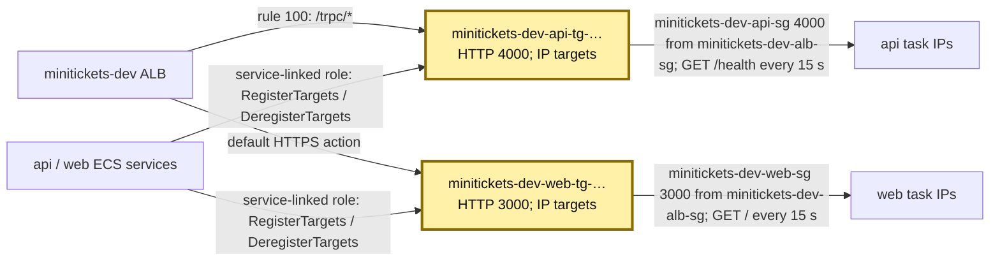
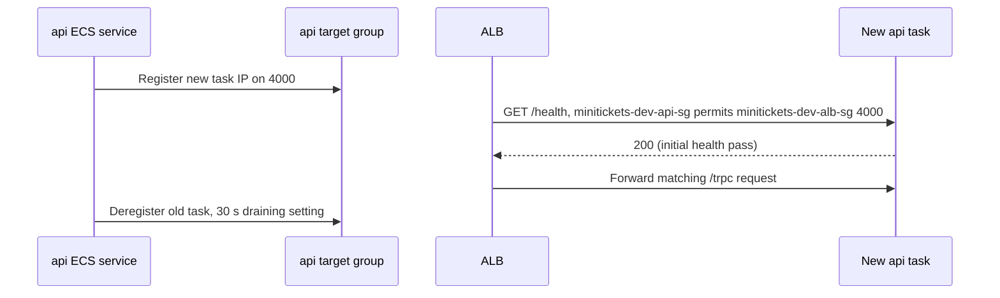

# Target groups: the on-duty staff lists

History: see [CHANGELOG.md](../CHANGELOG.md) or run `pnpm docs:history`

Area: AWS Network · Status: ✅ built · Step doc: [18 ALB + web](../../18-infra-alb-web.md) (sections 3.4-3.7)
<!-- interview-card: v1 -->

## 1. In one line

The MiniTickets ALB chooses an api or web worker from a [target group](../glossary.md#target-group): a changing list of task IPs and their health.

## 2. Where it sits

[Open this piece in the city explorer](../guides/infra-explorer.html?concept=target-groups#chapter=24&piece=api-tg).

## 3. How it works

## 4. What happens in MiniTickets

1. `createTargetGroups` creates api `4000` and web `3000` lists inside our VPC.
2. ECS registers each task's private IP. The ALB never needs its public IP.
3. ALB checks api `/health` and web `/`, every `15 s`, with a `5 s` timeout.
4. Three failed checks mark unhealthy; two passes recover it. A new registered target needs one initial pass.
5. Removal stops new work and allows existing requests to drain, with `30 s` configured.

## 5. Reach / Allowed / Password

**Reach:** ALB-to-worker source-group rules on `4000/3000`.

**Allowed:** ECS's service-linked role manages target registration; not the app task role.

**Password:** not needed by target checks; they bypass listener header rules.

## 6. In our code

`infra/src/entry/target-groups.ts` → `createTargetGroups`.

`infra/src/compute/service.ts` → `createApiService` (`loadBalancers`).

`infra/src/compute/web-service.ts` → `createWebService`.

## 7. In the AWS console

EC2 → Target Groups → `minitickets-dev-api-tg-…` → Targets / Health checks / Attributes. See actual IPs, reason codes and draining delay. EC2 → Load Balancers → `minitickets-dev` → Resource map joins both lists to rules and workers. [AWS health guide](https://docs.aws.amazon.com/elasticloadbalancing/latest/application/target-group-health-checks.html). Live targets were not checked.

## 8. Good / Bad

**Good:** worker addresses update automatically; bad workers can be removed without changing public DNS.

**Bad:** `/health` cannot prove database access; when all registered targets are unhealthy, ALB can send to them anyway.

## 9. Other choices

- Pick readiness checks when one worker can be broken while others work, and removing it is safe.
- Pick instance targets when routing to owned EC2 instances.
- Pick slow start when new workers need gradual traffic to warm up.

## 10. Connected to

| Neighbor | Direction | What allows it | Console check |
| --- | --- | --- | --- |
| [ALB](alb.md) | Listener → list | Forward action | ALB → Resource map |
| [ECS service](ecs-service.md) | Service → list | Service-linked role + `loadBalancers` | ECS → Service → Configuration |
| [Health checks](health-checks.md) | ALB → task | SG 4000/3000 + HTTP 200 | Target group → Health checks |
| [Deploys](zero-downtime-deploys.md) | Old target leaves | Deregistration delay 30 s | Target group → Attributes |

## 11. When it breaks

- `Target.Timeout` → worker bind address and guard rules → fix listening/network path.
- `Target.ResponseCodeMismatch` → check path and returned code → restore `/health` or `/`.
- Empty list → ECS service events and attachment → restore running attached tasks.

## 12. Say it in 30 seconds

“Our two staff lists hold Fargate task IPs: api on 4000 and web on 3000. ECS maintains membership; ALB probes health. Thirty-second draining protects requests during removal. Liveness avoids shared-database restart cascades, but all-unhealthy fail-open remains an explicit limit.”

## 13. Likely follow-ups

- **Why IP targets?** Fargate gives each task its own network interface.
- **Why generated names?** Replacement can create a new group before removing the old one.

## 14. Remember it

The list changes when workers move; the public reception desk stays the same.

## 15. More detail

Reference notes, source anchors and earlier useful detail

- Anchor: `infra/src/entry/target-groups.ts` · `createTargetGroups`: the api and web target groups and their health checks.

### Full settings and limits

Shared settings: `targetType: "ip"`, `protocol: "HTTP"`, the VPC ID and `deregistrationDelay: 30`. Health timing is interval 15, timeout 5, matcher `200`, healthy threshold 2, unhealthy threshold 3. Initial registration needs one successful check; the earlier simplified “two before first traffic” statement was inaccurate. Recovery uses the configured healthy threshold. Failure detection is approximate, not a 45-second deadline.

The API path deliberately uses `/health`, not `/ready`. A database or cache outage should not eject every worker for one shared failure. The web check is `/`, the landing page that needs neither API nor database. This means a live API with broken store access can still receive user requests and return failures. Readiness and user-visible error metrics must be investigated separately.

[AWS documents fail-open](https://docs.aws.amazon.com/elasticloadbalancing/latest/application/target-group-health-checks.html): if a target group contains only unhealthy registered targets, ALB routes to those targets anyway. This differs from an empty target group; do not promise health checks always prevent traffic to broken workers.

No fixed AWS name is supplied. Pulumi adds a suffix so replacements can create-before-delete without a name collision. Do not memorize example private IPs such as `10.0.0.37`; actual addresses change. ECS `loadBalancers` attaches container `api:4000` or `web:3000`, and each service has a 60-second health-check grace period.

For a normal rolling deployment/scale-in, ECS deregisters/drains a target before stopping its container. Draining allows in-flight requests rather than new requests; the 30-second setting is not a promise that every removal always waits exactly 30 seconds. Default delay would be 300 seconds. Spot termination has different timing; do not assume draining finishes before SIGTERM. App graceful shutdown still matters.

Changing a health-check path to `/nope` would produce `Target.ResponseCodeMismatch` and can make ECS repeatedly replace tasks after grace. Editing a target group alone is not an ECS deployment, so deployment circuit-breaker rollback does not necessarily fix it. `Elb.RegistrationInProgress` is a normal transient startup reason. `Target.Timeout` can mean the app binds only localhost (`HOSTNAME` matters for web) or a source/port rule is missing.

Read-only inspection uses `aws elbv2 describe-target-health --target-group-arn <actual-arn>` and `describe-target-group-attributes`. Do not manually register ECS-managed tasks as a repair. Target groups are billed within load balancing rather than as a separate hourly group charge. Slow start, alternative algorithms and instance targets are choices, not current settings.

## Where it appears in the story

- [Infra story: 3. Target groups](../infra-story.md#3-target-groups)
- [Big picture: 4. Components](../00-big-picture.md#4-components)
