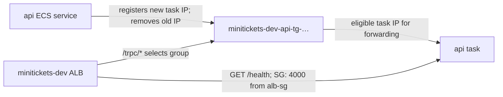

# Target groups: the on-duty staff lists

History: see [CHANGELOG.md](../CHANGELOG.md) or run `pnpm docs:history`

Area: AWS Network · Status: ✅ built · Step doc: [18 ALB + web](../../18-infra-alb-web.md) (sections 3.4-3.7)
<!-- interview-card: v2 -->

## 1. What is it?

A [target group](../glossary.md#target-group) is a list of application destinations that a load balancer can call. It tracks task addresses and whether they answer health checks.

## 2. Why do we need it?

A replaced MiniTickets task gets a new address. We need requests to follow the replacement without changing the website's public address or manually updating a server list.

## 3. How does it work?

1. ECS adds a new task's private address.
2. ALB checks whether it answers the configured health request.
3. During replacement, the old address drains existing requests and leaves the group.

## 4. How do we use it in MiniTickets?

Separate groups serve api and web. API checks `/health`; web checks `/`. These deliberately avoid shared data stores. ECS manages membership through its service-linked role, rather than the application role.

## 5. Interview-ready answer

“MiniTickets target groups separate routing from changing task addresses. ECS registers each task, and the ALB probes it before normal routing. Deregistration allows requests to drain during replacement. Our checks prove the process responds, not that bookings work, so we also need dependency and user-error monitoring.”

## 6. Important follow-up questions

- **Why IP targets?** Fargate gives each task its own network interface.
- **What if every registered target is unhealthy?** ALB can fail open and send traffic to them anyway.
- **What if the group is empty?** Check ECS service events, running tasks and its load-balancer attachment.
- **What if health checks time out?** Check listening address and security rules; a localhost-only server can pass its own probe but reject ALB traffic.

## 7. Advanced details

Technical reference

### Implementation and operational checks

`infra/src/entry/target-groups.ts` → `createTargetGroups` creates `minitickets-dev-api-tg-…` on HTTP 4000 and `minitickets-dev-web-tg-…` on HTTP 3000, both in our VPC. `infra/src/compute/service.ts` → `createApiService` and `infra/src/compute/web-service.ts` → `createWebService` attach them through `loadBalancers`. ECS's service-linked role registers/deregisters task private IPs; ALB does not need task public IPs. Direct HTTPS routes priority 100 `/trpc/*` to api and default to web.

EC2 → Target Groups → actual group → Targets / Health checks / Attributes shows IPs, reason codes and draining settings. ALB → Resource map joins rules and targets. Live targets were not checked. Source-group rules admit ALB 4000/3000; target probes bypass listener origin-header rules and require no application password. `Target.ResponseCodeMismatch` points to the configured path/response. An empty list requires inspecting ECS events and attachment.

- Anchor: `infra/src/entry/target-groups.ts` · `createTargetGroups`: the api and web target groups and their health checks.

### Full settings and limits

Shared settings: `targetType: "ip"`, `protocol: "HTTP"`, the VPC ID and `deregistrationDelay: 30`. Health timing is interval 15, timeout 5, matcher `200`, healthy threshold 2, unhealthy threshold 3. Initial registration needs one successful check; the earlier simplified “two before first traffic” statement was inaccurate. Recovery uses the configured healthy threshold. Failure detection is approximate, not a 45-second deadline.

The API path deliberately uses `/health`, not `/ready`. A database or cache outage should not eject every worker for one shared failure. The web check is `/`, the landing page that needs neither API nor database. This means a live API with broken store access can still receive user requests and return failures. Readiness and user-visible error metrics must be investigated separately.

[AWS documents fail-open](https://docs.aws.amazon.com/elasticloadbalancing/latest/application/target-group-health-checks.html): if a target group contains only unhealthy registered targets, ALB routes to those targets anyway. This differs from an empty target group; do not promise health checks always prevent traffic to broken workers.

No fixed AWS name is supplied. Pulumi adds a suffix so replacements can create-before-delete without a name collision. Do not memorize example private IPs such as `10.0.0.37`; actual addresses change. ECS `loadBalancers` attaches container `api:4000` or `web:3000`, and each service has a 60-second health-check grace period.

For a normal rolling deployment/scale-in, ECS deregisters/drains a target before stopping its container. Draining allows in-flight requests rather than new requests; the 30-second setting is not a promise that every removal always waits exactly 30 seconds. Default delay would be 300 seconds. Spot termination has different timing; do not assume draining finishes before SIGTERM. App graceful shutdown still matters.

Changing a health-check path to `/nope` would produce `Target.ResponseCodeMismatch` and can make ECS repeatedly replace tasks after grace. Editing a target group alone is not an ECS deployment, so deployment circuit-breaker rollback does not necessarily fix it. `Elb.RegistrationInProgress` is a normal transient startup reason. `Target.Timeout` can mean the app binds only localhost (`HOSTNAME` matters for web) or a source/port rule is missing.

Read-only inspection uses `aws elbv2 describe-target-health --target-group-arn <actual-arn>` and `describe-target-group-attributes`. Do not manually register ECS-managed tasks as a repair. Target groups are billed within load balancing rather than as a separate hourly group charge. Slow start, alternative algorithms and instance targets are choices, not current settings.

### Related reading

- [ALB](alb.md)
- [ECS service](ecs-service.md)
- [Health checks](health-checks.md)
- [Deploys](zero-downtime-deploys.md)

[Open this piece in the city explorer](../guides/infra-explorer.html?concept=target-groups#chapter=24&piece=api-tg).

## Where it appears in the story

- [Infra story: 3. Target groups](../infra-story.md#3-target-groups)
- [Big picture: 4. Components](../00-big-picture.md#4-components)

