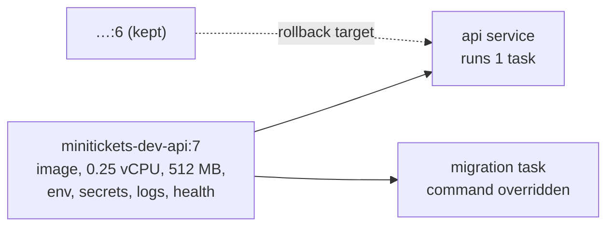

# Task definition: recipe, revisions, `awsvpc`

History: see [CHANGELOG.md](../CHANGELOG.md) or run `pnpm docs:history`

Area: AWS Compute · Status: ✅ built · Step docs: [17 ECS api](../../17-infra-ecs-api.md), [18 ALB + web](../../18-infra-alb-web.md)

## 1. In one line

A **task definition** is the recipe for running containers: image, CPU and memory, ports, env vars,
secrets, logs, health check and roles. Every change creates a new numbered **revision**.

## 2. Real-life comparison

A recipe card. It cooks nothing by itself. Each time you change it, you write a new card
("version 7") and keep the old ones, so you can go back to yesterday's recipe.

## 3. Picture it



## 4. Where in our code

- Anchor: `infra/src/compute/task.ts` · `createApiTask`: the api recipe.
- Anchor: `infra/src/compute/web-task.ts` · `createWebTask`: the web recipe.

The api task definition, step by step:

1. `family: minitickets-dev-api`. Revisions are `:1`, `:2`, …
2. `requiresCompatibilities: ["FARGATE"]`, `networkMode: "awsvpc"`: each task gets its own network
   interface and IP in our VPC, so it can wear a security group.
3. `cpu: "256"` (¼ vCPU), `memory: "512"`; `runtimePlatform` ARM64 ([arm64-graviton](arm64-graviton.md)).
4. `executionRoleArn` and `taskRoleArn` ([execution-vs-task-role](execution-vs-task-role.md)).
5. One container `api`: `portMappings` 4000, `environment` (`NODE_ENV`, `HOST`, `PORT`, `DB_HOST`,
   `DB_PORT`, `DB_NAME`, `WEB_ORIGIN`, `TRUST_PROXY_HOPS`), `secrets` (`DB_USER`, `DB_PASSWORD`,
   `REDIS_URL`), `logConfiguration` (awslogs), `healthCheck` (node fetches `/health`),
   `linuxParameters.initProcessEnabled`.

The web task definition is shorter: `PORT=3000`, `HOSTNAME=0.0.0.0`, no secrets, no task role, no
container health check (the ALB check on `/` decides).

## 5. See it yourself

```bash
cd infra
aws ecs describe-task-definition --profile ticketlite --task-definition $(pulumi stack output apiTaskDefinitionArn) \
  --query "taskDefinition.{rev:revision,cpu:cpu,mem:memory,arch:runtimePlatform.cpuArchitecture,env:containerDefinitions[0].environment[].name,secrets:containerDefinitions[0].secrets[].name}"
aws ecs list-task-definitions --profile ticketlite --family-prefix minitickets-dev-api
```

The secrets show only names and ARNs, never values.

**Break it on purpose (scratch branch):** set `HOST` to `127.0.0.1`. The container health check
(which runs inside the container) still passes, but the ALB cannot connect from outside: target
`Target.Timeout`, then `Task failed ELB health checks`.

## 6. How it connects

- **Uses ←** [ECR](ecr.md) image, IAM roles, the [log group](cloudwatch-logs.md), the
  [RDS](rds-postgres.md) address and secret ARNs, `appUrl` from [CloudFront](cloudfront.md).
- **Gives →** the recipe for the [ECS service](ecs-service.md) and `scripts/run-migrations.sh`.

## 7. Our settings and WHY

| Setting | Value | Why |
| ------- | ----- | --- |
| Size | 256 CPU / 512 MB | Smallest Fargate size; enough for one Node process in dev. |
| `HOST` / `HOSTNAME` | `0.0.0.0` | Listen on the task's network card, not only inside the container. |
| Health check | `/health`, 15 s, 3 retries, 15 s start period | Liveness only; the slim image has no curl, so `node -e fetch(...)`. |
| `initProcessEnabled` | true | A tiny init as PID 1 forwards signals and reaps ECS Exec shells. |
| One task definition for api and migration | — | The migration uses exactly the deployed code and SQL files. |

## 8. Trade-offs

- **Pros:** immutable revisions give easy rollback; config lives in code.
- **Cons:** every env change is a new revision and a redeploy; secrets are read only at start.

## 9. Alternatives and when to choose them

- **Sidecar containers** in the same task (log router, proxy, OpenTelemetry collector): when you
  need them.
- **Bigger sizes, or x86_64:** libraries without ARM builds, or heavy workloads.

## 10. What breaks, and how we'd notice

| Mistake | Sign |
| ------- | ---- |
| Wrong architecture | `exec format error` in the logs |
| Missing env var | App exits at start: `Invalid environment variables` |
| Secret ARN or key wrong | `ResourceInitializationError: unable to pull secrets` |
| Memory too small | Task stops with an out-of-memory reason |

## 11. Reach / Allowed / Password

The task definition decides **Allowed** (which roles) and carries **Password** references
(`secrets`); **Reach** comes from the service's network configuration.

## 12. Cost

Free. You pay per running task for the CPU and memory it asks for.

## 13. Interview answers at 3 levels

- **Simple:** The recipe for our container: image, size, settings, secrets, logs.
- **Senior:** Fargate, `awsvpc`, ARM64, ¼ vCPU and 512 MB. Plain settings in `environment`, three
  values in `secrets` that ECS injects from Secrets Manager using the execution role, awslogs to
  `/minitickets/dev/api`, and a node-based `/health` check. The same definition runs the one-off
  migration with an overridden command.
- **Lead:** Revisions make rollback cheap, and the deployment circuit breaker uses them. I'd keep
  task definitions generated from code, pin images by SHA or digest, and move secrets to runtime
  reads where rotation matters.

## 14. Follow-up questions interviewers ask

- *Why `awsvpc`?* Each task gets its own ENI and security group; Fargate requires it.
- *Where do secret values live?* Only in Secrets Manager and, at runtime, the container's
  environment; the definition holds ARNs.

## 15. Say it in 30 seconds

"The api task definition is a Fargate, ARM64, quarter-vCPU recipe with plain env vars, three
secrets injected by ECS, awslogs, and a node-based health check on `/health`. Each change is a new
revision, which the circuit breaker can roll back to, and the migration task reuses it."

## 16. Status

✅ built.
