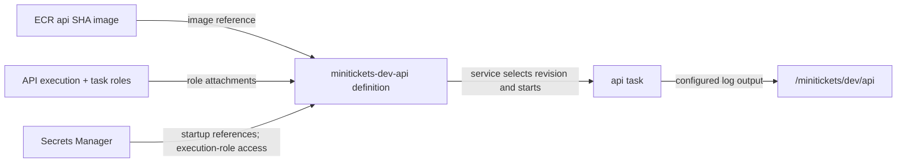

# Task definition: the worker’s recipe

History: see [CHANGELOG.md](../CHANGELOG.md) or run `pnpm docs:history`
Area: AWS Compute · Status: ✅ built in repository; live acceptance is separate
<!-- interview-card: v2 -->

## 1. What is it?

A [task definition](../glossary.md#task-definition) is a saved, numbered recipe for running a container. It describes the image, resources, settings and permissions to use.

## 2. Why do we need it?

MiniTickets must start replacement tasks consistently. A saved recipe prevents one API copy from getting a different image or missing configuration, and lets us identify what a release intended to run.

## 3. How does it work?

1. Save the container recipe as a revision.
2. A service selects that revision.
3. ECS obtains the image and allowed secrets, then starts a running copy.

## 4. How do we use it in MiniTickets?

API and web have separate recipes. The migration task has another, so the new image can update the database before application rollout. The service decides how many copies run and where.

## 5. Interview-ready answer

“A task definition is MiniTickets' versioned container recipe: image, CPU, memory, ports, logs and roles. ECS resolves its secret references at startup. A service then chooses the revision and runs copies. Migrations use a separate recipe so delivery can apply schema changes before switching the applications.”

## 6. Important follow-up questions

- **Definition versus task?** The recipe versus one running copy; saving a recipe starts nothing.
- **Does changing a secret update a task?** No. Existing processes retain their startup values.
- **Why does image architecture matter?** The task's CPU type must match the built image.
- **What if it stops before startup?** Inspect the stopped reason, image compatibility, execution-role access and secret references.

## 7. Advanced details

Technical reference

### Source, attachment and console view

`infra/src/compute/task.ts` → `createApiTask`, `infra/src/compute/web-task.ts` → `createWebTask` and `infra/src/compute/migration-task.ts` → `createMigrationTask` create the recipes. Families include `minitickets-dev-api` and `minitickets-dev-migrate`; changes produce revisions. The service's `taskDefinition` field selects a revision ARN.

The execution role supplies image pulls, startup-secret reads and logs; `taskRoleArn` supplies app runtime permissions. `awsvpc` gives each task a network interface; the service selects subnets and security groups. Secret values become process environment values before Node starts; recipe JSON stores references.

In `us-east-1`: ECS → Task definitions → `minitickets-dev-api` → revision → Containers / JSON shows image URI, role ARNs, secret references and port 4000. Clusters → `minitickets-dev` → Tasks shows the actual running revision; it was not checked live. Increase resources only when measured CPU/memory pressure warrants it. Old revisions support explaining and reversing compatible releases.

- Anchor: `infra/src/compute/task.ts` · `createApiTask`: the api recipe.
- Anchor: `infra/src/compute/web-task.ts` · `createWebTask`: the web recipe.

The API uses Fargate with `awsvpc` and Linux ARM64. Without Service Connect it requests 256 CPU units/512 MiB; with current entry enabled it requests 512/1024 so the added proxy shares enough capacity. Web always requests 512/1024. Migration uses 256/512, no port, no health check, no task role and command `node dist/migrate.js`. It reuses the API execution role, which is broader than migration strictly needs.

API listens on `0.0.0.0:4000`; web on `0.0.0.0:3000`. Named mappings `api` and `web` let Service Connect find their ports. API environment includes DB endpoint/name, `WEB_ORIGIN`, `TRUST_PROXY_HOPS` (currently 1), `WEB_INTERNAL_URL`, SNS topic, tickets table and assets bucket. Web uses `API_INTERNAL_URL=http://api:4000` and the shared revalidation secret. Browser public URL configuration is baked into the web image separately.

API secrets select `username` and `password` from the RDS JSON secret; Redis URL is a whole string. The recipe contains secret addresses, not their contents. API writes `api/api/<task id>` streams; migration writes `migrate/migrate/<task id>` in the API group.

API container health uses Node fetch, `/health`, interval 15 s, timeout 5 s, retries 3, start period 15 s. It deliberately avoids `/ready`: a brief store failure must not kill every working process. `initProcessEnabled` supports clean child-process handling for ECS Exec. Current live revision and readiness remain owner acceptance.

### Related reading

- [ECR](ecr.md)
- [Roles](execution-vs-task-role.md)
- [Service](ecs-service.md)

[Open this piece in the city explorer](../guides/infra-explorer.html?concept=task-definition#chapter=8&piece=api-task).

## Where it appears in the story

- [Infra story: 4. ECS: cluster, service, task definition, task, Spot](../infra-story.md#4-ecs-cluster-service-task-definition-task-spot)
- [Big picture: 4. Components](../00-big-picture.md#4-components)

