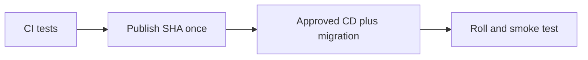

# Task definition: recipe, revisions, `awsvpc`

History: see [CHANGELOG.md](../CHANGELOG.md) or run `pnpm docs:history`

Area: AWS Compute · Status: ✅ built in repository; live acceptance is separate

## 1. In one line

A task definition pins image, environment, secrets, roles and resource/network settings. API/web definitions differ, and a dedicated migration definition uses the new API image before service rollout; it is not borrowed from the API service.

## 2. Real-life comparison

A sealed package is built once, then checked at a gate before the manager installs that exact version.

## 3. Picture it

## 4. Where in our code

- Anchor: `infra/src/compute/task.ts` · `createApiTask`: the api recipe.
- Anchor: `infra/src/compute/web-task.ts` · `createWebTask`: the web recipe.

The publish job in `.github/workflows/cd.yml` builds/pushes; its deploy job resolves release and runs two-phase deploy/migrate/smoke checks. `infra/src/image-tag.ts` reads the tag; `release.ts` tracks last deployed commit. See runbook §3.11–3.18. No publish, AWS write or live rollback was performed by this documentation work.

## 5. See it yourself

The publish job in `.github/workflows/cd.yml` builds/pushes; its deploy job resolves release and runs two-phase deploy/migrate/smoke checks. `infra/src/image-tag.ts` reads the tag; `release.ts` tracks last deployed commit. See runbook §3.11–3.18. No publish, AWS write or live rollback was performed by this documentation work.

Failure thought experiment: Should rollback run old Pulumi code? No; image rollback and infrastructure rollback are different risks.

## 6. How it connects

Uses the [current system](../00-big-picture.md); gives a concrete decision to the [scenario](../guides/interview-scenarios.md#delivery-rollback) and [explorer tour](../guides/infra-explorer.html?tour=deploy).

## 7. Our settings and WHY

A task definition pins image, environment, secrets, roles and resource/network settings. API/web definitions differ, and a dedicated migration definition uses the new API image before service rollout; it is not borrowed from the API service. Rebuilding on deploy can ship bytes that were never reviewed or tested.

## 8. Trade-offs

Rolling deployment overlaps versions. Blue/green gives a switchable target but costs overlap and still needs compatible migrations. Secrets/config are part of release compatibility.

## 9. Alternatives and when to choose them

10x: expired approvals and automated rollback criteria. 100x: canary analysis, immutable manifests and cross-service compatibility.

## 10. What breaks and how we notice

Should rollback run old Pulumi code? No; image rollback and infrastructure rollback are different risks.

## 13. Interview answers at 3 levels

- **Simple:** A task definition pins image, environment, secrets, roles and resource/network settings. API/web definitions differ, and a dedicated migration definition uses the new API image before service rollout; it is not borrowed from the API service.
- **Senior:** Publish API/web/worker images once with the git SHA after CI, then deploy that immutable release. The environment switches live in committed Pulumi YAML; deployed image tag lives in SSM and is written by CD. Migration runs before rollout. Roll back app images to a known tag while respecting current schema and current infrastructure.
- **Lead:** 10x: expired approvals and automated rollback criteria. 100x: canary analysis, immutable manifests and cross-service compatibility.

## 14. Follow-up questions with answers

Should rollback run old Pulumi code? No; image rollback and infrastructure rollback are different risks.

## 15. Say it in 30 seconds

Publish API/web/worker images once with the git SHA after CI, then deploy that immutable release. The environment switches live in committed Pulumi YAML; deployed image tag lives in SSM and is written by CD. Migration runs before rollout. Roll back app images to a known tag while respecting current schema and current infrastructure.

## 16. Status and production work

Repository implementation and local evidence are described above. Live AWS/CI execution remains owner acceptance. 10x: expired approvals and automated rollback criteria. 100x: canary analysis, immutable manifests and cross-service compatibility.

## Where it appears in the story

- [Infra story: 4. ECS: cluster, service, task definition, task, Spot](../infra-story.md#4-ecs-cluster-service-task-definition-task-spot)
- [Big picture: 4. Components](../00-big-picture.md#4-components)
