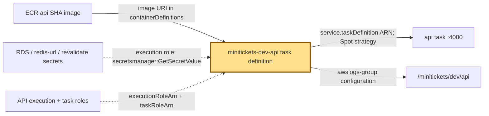
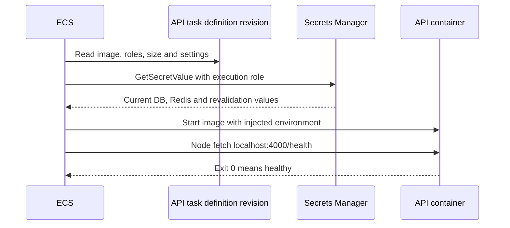

# Task definition: the worker’s recipe

History: see [CHANGELOG.md](../CHANGELOG.md) or run `pnpm docs:history`
Area: AWS Compute · Status: ✅ built in repository; live acceptance is separate
<!-- interview-card: v1 -->

## 1. In one line

Before MiniTickets starts a [task](../glossary.md#task-definition), ECS reads a numbered recipe saying which image, settings and badges to use.

## 2. Where it sits

[Open this piece in the city explorer](../guides/infra-explorer.html?concept=task-definition#chapter=8&piece=api-task).

## 3. How it works

## 4. What happens in MiniTickets

1. `createApiTask` saves family `minitickets-dev-api`; changes create a new revision.
2. Current entry-on API and web recipes each request ARM64, 512 CPU units and 1024 MiB memory.
3. ECS pulls the chosen SHA image and injects allowed secret values before Node starts.
4. The service runs that revision. `minitickets-dev-migrate` has its own recipe so migration can use a new image first.

## 5. Reach / Allowed / Password

**Reach:** `awsvpc` gives each task its own network interface; the service chooses subnets and guards.

**Allowed:** separate execution and task role fields.

**Password:** secret references become environment values at startup.

## 6. In our code

`infra/src/compute/task.ts` → `createApiTask`; `infra/src/compute/web-task.ts` → `createWebTask`.

`infra/src/compute/migration-task.ts` → `createMigrationTask`.

## 7. In the AWS console

`us-east-1` → ECS → Task definitions → `minitickets-dev-api` → revision → Containers / JSON. Expect image URI, role ARNs, secret references and port 4000. Actual running revision: Clusters → `minitickets-dev` → Tasks. Not checked live.

## 8. Good / Bad

**Good:** Complete saved recipe. Old revisions help explain and reverse releases.

**Bad:** A recipe runs nothing itself. Secret rotation does not refresh an existing task’s environment.

## 9. Other choices

- Separate migration recipe: pick it when schema must change before app rollout.
- More task resources: pick them when measured CPU or memory pressure warrants it.

## 10. Connected to

| Neighbor | Direction | What allows it | Console check |
| --- | --- | --- | --- |
| [ECR](ecr.md) | In ← | Image URI + execution-role pull permissions | ECR → repository → Images |
| [Roles](execution-vs-task-role.md) | Guard | executionRoleArn / taskRoleArn | IAM → Roles |
| [Service](ecs-service.md) | Out → | Task-definition revision ARN | ECS → service → Deployments |

## 11. When it breaks

Stopped before startup → ECS stopped reason → inspect image architecture, execution-role access and secret references.

## 12. Say it in 30 seconds

“A task definition is our saved worker recipe. It pins image, CPU, memory, ports, logs and two roles. ECS resolves secret references at startup. The service chooses how many copies run and where. Migrations have a separate recipe so their new image can run before the app changes.”

## 13. Likely follow-ups

- Definition versus task? Recipe versus running copy.
- Why ARM64? The recipe must match the built image’s CPU type.

## 14. Remember it

Changing the recipe creates a revision; the manager decides when to cook it.

## 15. More detail

Settings, limits and deeper interview notes

- Anchor: `infra/src/compute/task.ts` · `createApiTask`: the api recipe.
- Anchor: `infra/src/compute/web-task.ts` · `createWebTask`: the web recipe.

The API uses Fargate with `awsvpc` and Linux ARM64. Without Service Connect it requests 256 CPU units/512 MiB; with current entry enabled it requests 512/1024 so the added proxy shares enough capacity. Web always requests 512/1024. Migration uses 256/512, no port, no health check, no task role and command `node dist/migrate.js`. It reuses the API execution role, which is broader than migration strictly needs.

API listens on `0.0.0.0:4000`; web on `0.0.0.0:3000`. Named mappings `api` and `web` let Service Connect find their ports. API environment includes DB endpoint/name, `WEB_ORIGIN`, `TRUST_PROXY_HOPS` (currently 1), `WEB_INTERNAL_URL`, SNS topic, tickets table and assets bucket. Web uses `API_INTERNAL_URL=http://api:4000` and the shared revalidation secret. Browser public URL configuration is baked into the web image separately.

API secrets select `username` and `password` from the RDS JSON secret; Redis URL is a whole string. The recipe contains secret addresses, not their contents. API writes `api/api/<task id>` streams; migration writes `migrate/migrate/<task id>` in the API group.

API container health uses Node fetch, `/health`, interval 15 s, timeout 5 s, retries 3, start period 15 s. It deliberately avoids `/ready`: a brief store failure must not kill every working process. `initProcessEnabled` supports clean child-process handling for ECS Exec. Current live revision and readiness remain owner acceptance.

## Where it appears in the story

- [Infra story: 4. ECS: cluster, service, task definition, task, Spot](../infra-story.md#4-ecs-cluster-service-task-definition-task-spot)
- [Big picture: 4. Components](../00-big-picture.md#4-components)
