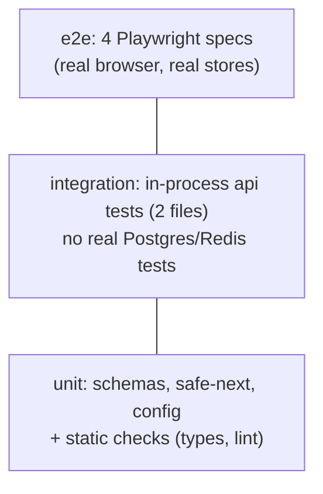

# Testing pyramid

History: see [CHANGELOG.md](../CHANGELOG.md) or run `pnpm docs:history`

Area: Testing · Status: 🟡 partial (unit + in-process + e2e; no integration tests against a real database) · Step doc: [10 CI](../../10-ci.md)

## 1. In one line

The **testing pyramid** says: many fast, small tests at the bottom, fewer slower integration tests
in the middle, a few end-to-end tests at the top; ours has a base and a top, and a thin middle.

## 2. Real-life comparison

Checking a building: test every brick (cheap, many), then each wall with its bricks (fewer), then
walk through the finished house (a few times). Skipping the walls means problems show up only on the
walk-through, when they're harder to find.

## 3. Picture it



## 4. Where in our code

- Anchor: `vitest.config.mts` · `include`: the unit and in-process layer.
- Anchor: `apps/web/playwright.config.ts` · the e2e layer.

What we have:

| Layer | Tools | Files |
| ----- | ----- | ----- |
| Static | tsc strict, ESLint | whole repo ([static-checks](static-checks.md)) |
| Unit | Vitest | 3 files ([unit-tests](unit-tests.md)) |
| In-process | Vitest + `createCallerFactory` / `inject` | 2 files ([in-process-api-tests](in-process-api-tests.md)) |
| Integration with real stores | — | **none** |
| E2E | Playwright | 4 specs ([e2e-tests](e2e-tests.md)) |

The gap: `queries/` and `services/` are only tested through e2e. A broken query is found by a
browser test, slowly, and the failure points at the UI, not the query.

## 5. See it yourself

```bash
pnpm test         # unit + in-process, under a second
pnpm test:e2e     # with pnpm dev running; minutes
```

## 6. How it connects

- **Uses ←** every testing card.
- **Gives →** the [ci-pipeline](ci-pipeline.md) order: static + unit first, e2e after.

## 7. Our settings and WHY

Unit tests for risky pure logic, e2e for user journeys, in-process tests where middleware matters.
WHY: the biggest confidence per minute of effort while the app is small.

## 8. Trade-offs

- **Pros:** fast feedback for logic; full-stack confidence for journeys.
- **Cons:** the missing middle makes data-layer bugs slow to diagnose; e2e is the slowest and
  flakiest layer and carries the most weight today.

## 9. Alternatives and when to choose them

- **Integration tests with Testcontainers** or the CI service containers: test `queries/` and
  `services/` against real Postgres and Redis.
- **The "testing trophy":** weight on integration tests, especially for web apps.
- **Contract tests:** when services are owned by different teams (explain-only card).

## 10. What breaks, and how we'd notice

A query bug shows up only as an e2e failure with a UI symptom; debugging takes longer.

## 13. Interview answers at 3 levels

- **Simple:** Lots of small quick tests, fewer big slow ones.
- **Senior:** Static checks and Vitest unit tests at the bottom; two in-process api tests for
  middleware and proxy handling; four Playwright journeys at the top running against real Postgres and
  Redis in CI. The missing piece is integration tests for queries and services against real stores.
- **Lead:** The shape should follow risk: our riskiest code is data access and auth, so the next
  investment is real-database integration tests in CI, which also lets e2e shrink to smoke tests.

## 14. Follow-up questions interviewers ask

- *Why not test everything with e2e?* Slow, flaky, and failures are hard to locate.
- *What would you add first?* Integration tests for `queries/users.ts` and `queries/sessions.ts`.

## 15. Say it in 30 seconds

"We have the base and the top: strict types, lint and Vitest unit tests, two in-process api tests,
and four Playwright journeys against real Postgres and Redis. The thin part is the middle: no
integration tests for queries and services against real stores, which is what I'd add next."

## 16. Status

🟡 partial. **To make it production-grade:** integration tests for `queries/` and `services/` using
the CI service containers.
