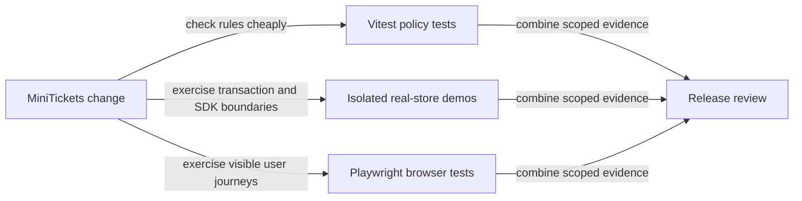

# Testing pyramid

History: see [CHANGELOG.md](../CHANGELOG.md) or run `pnpm docs:history`

Area: Testing · Status: ✅ built in repository; live acceptance is separate

<!-- interview-card: v2 -->

## 1. What is it?

A testing pyramid uses many fast, focused checks and fewer broad user-journey checks. Each layer answers a different question about correctness.

## 2. Why do we need it?

A booking rule may be correct in isolation but fail when two buyers compete in Postgres. A browser test may find a broken button without explaining the underlying rule.

## 3. How does it work?

1. Test policy and edge cases with small tests.
2. Use real stores for transaction and concurrency guarantees.
3. Use browser tests for critical journeys, then separate live AWS acceptance.

## 4. How do we use it in MiniTickets?

Vitest covers policy and in-process API behavior. Isolated demos exercise real Postgres, queues and failure recovery. Playwright covers user flows in the browser. A passing local emulator cannot establish AWS permissions or real email delivery.

## 5. Interview-ready answer

“I choose tests by failure mode. MiniTickets tests small rules quickly, checks transaction and concurrency invariants against real stores, and exercises critical journeys through the browser. This gives useful failure locations without making every check expensive. Test counts are supporting evidence; a scoped green run is not a claim that every flow or deployed AWS policy works.”

## 6. Important follow-up questions

- **Why not mock all SQL?** Mocks cannot demonstrate actual row locks, uniqueness races or database rollback.
- **Why not use only browser tests?** They are slower and often identify failures less precisely.
- **What makes a useful demo?** Measured outcomes, isolated data and deliberate failure cases, rather than success text alone.
- **Does local green prove IAM?** No. AWS must evaluate the deployed policy and real service path.

## 7. Advanced details

Technical reference

### Evidence and test locations

`vitest.config.mts` includes unit/in-process tests; `apps/web/playwright.config.ts` defines browser execution. Historical handbook evidence records **404 Vitest tests**, **24 production-mode local e2e** in `pnpm demo:security`, and **144 offline D1 tour navigations without screenshots**. These are recorded results, not counts rerun by this rewrite or a full-suite/deployment claim.

`pnpm demo:search`, `pnpm demo:sale` and `pnpm demo:outbox` isolate scale/failure scenarios. Security used an isolated inverted-origin mutation to show relevant tests fail. Real row-lock/idempotency evidence comes from demos rather than mocked SQL. SDK emulators do not establish IAM, ALB proxy behavior, SES delivery or CloudFront policy.

### Trade-offs and next work

Overmocking can conceal store behavior; broad slow suites can obscure a precise failure. Stable fixtures and flake ownership matter as the suite grows. Later options include contract tests, production canaries and risk-based gates. Accessibility also needs semantic conventions and representative assistive-technology review, beyond automated scans. No need to rerun every behavior test for comment-only edits unless behavior or unresolved risk warrants it.

### Code anchors

- Anchor: `vitest.config.mts` · `include`: the unit and in-process layer.
- Anchor: `apps/web/playwright.config.ts` · the e2e layer.

### Related reading

[current system](../00-big-picture.md) · [scenario](../guides/interview-scenarios.md#accessibility) · [explorer tour](../guides/infra-explorer.html?tour=security-layers)

[Open this concept in the city explorer](../guides/infra-explorer.html?concept=testing-pyramid#chapter=13&piece=github).

## Where it appears in the story

- [App story: 14. The testing pyramid](../app-story.md#14-the-testing-pyramid)

