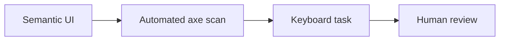

# Testing pyramid

History: see [CHANGELOG.md](../CHANGELOG.md) or run `pnpm docs:history`

Area: Testing · Status: ✅ built in repository; live acceptance is separate

## 1. In one line

Use policy units, in-process API tests, isolated real Postgres/SDK demos and production browser flows for different failures. The current suite has 404 units and targeted phase e2e; real row-lock/idempotency evidence comes from demos, not mocked SQL. AWS acceptance stays separate.

## 2. Real-life comparison

A stopwatch on a real visitor’s journey answers different questions from a rehearsed practice lap.

## 3. Picture it

## 4. Where in our code

- Anchor: `vitest.config.mts` · `include`: the unit and in-process layer.
- Anchor: `apps/web/playwright.config.ts` · the e2e layer.

Vitest currently has 404 tests. `pnpm demo:security` passed 24 production e2e; `demo:search`, `demo:sale`, `demo:outbox` isolate scale/failure. Security used one isolated inverted-origin mutation to prove important tests fail. D1 tested 144 offline tour navigations without screenshots. No full-suite or AWS deployment claim is implied.

## 5. See it yourself

Vitest currently has 404 tests. `pnpm demo:security` passed 24 production e2e; `demo:search`, `demo:sale`, `demo:outbox` isolate scale/failure. Security used one isolated inverted-origin mutation to prove important tests fail. D1 tested 144 offline tour navigations without screenshots. No full-suite or AWS deployment claim is implied.

Failure thought experiment: Does local green mean IAM correct? No; only AWS evaluates the deployed policies.

## 6. How it connects

Uses the [current system](../00-big-picture.md); gives a concrete decision to the [scenario](../guides/interview-scenarios.md#accessibility) and [explorer tour](../guides/infra-explorer.html?tour=security-layers).

## 7. Our settings and WHY

Use policy units, in-process API tests, isolated real Postgres/SDK demos and production browser flows for different failures. The current suite has 404 units and targeted phase e2e; real row-lock/idempotency evidence comes from demos, not mocked SQL. AWS acceptance stays separate. Different failure modes need different evidence; test count alone is not confidence.

## 8. Trade-offs

Overmocked SQL cannot prove row locks; broad slow suites can hide targeted failures. Avoid repeating every test after comment-only docs edits unless source behavior changes.

## 9. Alternatives and when to choose them

10x: stable fixtures and flake ownership. 100x: contract tests, production canaries and measured risk-based gates.

## 10. What breaks and how we notice

Does local green mean IAM correct? No; only AWS evaluates the deployed policies.

## 13. Interview answers at 3 levels

- **Simple:** Use policy units, in-process API tests, isolated real Postgres/SDK demos and production browser flows for different failures. The current suite has 404 units and targeted phase e2e; real row-lock/idempotency evidence comes from demos, not mocked SQL. AWS acceptance stays separate.
- **Senior:** Unit-test pure policy and failure decisions, integration-test real transaction/concurrency invariants and browser-test user-visible flows. A demo should print measurable counts rather than only success text. Emulators exercise SDK contracts but cannot prove IAM, ALB proxy behavior, SES delivery or CloudFront policy. Keep those as explicit live acceptance.
- **Lead:** 10x: stable fixtures and flake ownership. 100x: contract tests, production canaries and measured risk-based gates.

## 14. Follow-up questions with answers

Does local green mean IAM correct? No; only AWS evaluates the deployed policies.

## 15. Say it in 30 seconds

Unit-test pure policy and failure decisions, integration-test real transaction/concurrency invariants and browser-test user-visible flows. A demo should print measurable counts rather than only success text. Emulators exercise SDK contracts but cannot prove IAM, ALB proxy behavior, SES delivery or CloudFront policy. Keep those as explicit live acceptance.

## 16. Status and production work

Repository implementation and local evidence are described above. Live AWS/CI execution remains owner acceptance. 10x: component-level semantic conventions. 100x: representative assistive-technology testing across critical journeys.

## Where it appears in the story

- [App story: 14. The testing pyramid](../app-story.md#14-the-testing-pyramid)
