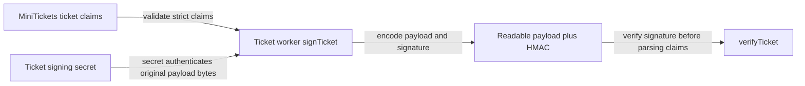

# Ticket signing

History: see [CHANGELOG.md](../CHANGELOG.md) or run `pnpm docs:history`

Area: Auth & Security · Status: 🟡 partial
<!-- interview-card: v2 -->

## 1. What is it?

Ticket signing adds a secret-generated authenticity check to QR data. A verifier can detect changed data without treating the readable claims as private or single-use.

## 2. Why do we need it?

An attacker should not change a MiniTickets QR from one seat to another and still have it accepted as issued by us. Signing ties the stored claims to a server-held secret.

## 3. How does it work?

1. Validate the claims and sign their encoded bytes.
2. Keep the signing secret on the authorized server.
3. Verify the original bytes and claim identity before trusting a token.

## 4. How do we use it in MiniTickets?

Our worker builds signed QR tickets and has isolated secret access. Verification checks encoding, bounds and identity. Door admission and a rotation key ring remain explain-only; a valid token alone does not prevent reuse.

## 5. Interview-ready answer

“MiniTickets signs ticket claims with a server-held HMAC secret. Verification authenticates the original bytes, then validates the claims and ticket identity. This detects tampering, but it neither encrypts the payload nor makes a ticket one-time use. Door check-in needs separate authoritative state, and key rotation needs a deliberate transition.”

## 6. Important follow-up questions

- **Can customers read the claims?** Yes. Encoding is not encryption.
- **Does a valid signature prevent replay?** No. One-time admission needs a conditional used-state transition.
- **Why constant-time comparison?** It avoids a value-dependent signature-comparison shortcut.
- **What if we replace the only signing key?** Old tickets stop verifying under it; a staged key-ring design is not built yet.

## 7. Advanced details

Technical reference

### Source references

- Anchor: `apps/worker/src/handlers/tickets.ts` — `handleTickets`; follow the numbered comments at this boundary.
- Anchor: `apps/worker/src/tickets/token.ts` — `TicketSigningSecret`; follow the numbered comments at this boundary.

`apps/worker/src/tickets/token.ts` signs/verifies bounded strict claims; `infra/src/tickets/iam.ts` grants only ticket worker secret access; `services/tickets.ts` owner-scopes reads. Run `pnpm demo:tickets` and `pnpm demo:p4-assets` separately. Proposed rotation adds key id plus verification key ring, staged rollout and old-key retirement; this key-ring is not built.

### Configuration and design

HMAC-SHA256 authenticates QR bytes using a 32-byte secret. Strict bounds/encoding and constant-time comparison reject forgery. Claims are readable; one-time door admission and key-ring rotation remain explain-only. A client must never receive the signing secret or invent a valid ticket.

### Checks and troubleshooting

Run `pnpm demo:tickets` and inspect the asserted outcome described above.

Are signed QR claims private? No; base64url is readable. Do not change a live stack to demonstrate it.

Does a valid HMAC stop ticket reuse? **No.**

### Trade-offs and alternatives

Rotating a single key immediately invalidates old QR tokens unless a key ring is supported. OWASP review also needs abuse, dependency, authorization, logging and incident practices beyond code checks.

10x: expiry/rotation drills and audit access. 100x: per-environment/key versioning, compromise playbooks and threat modeling.

### Further technical context

Store signing/database credentials in Secrets Manager, expose them only to the runtime that needs them and never log them. HMAC authenticates the original ticket bytes and constant-time comparison rejects tampering; it does not encrypt the payload or prevent reuse. Authorization still checks owner/role and uploads remain untrusted.

### Related reading

Uses the [current system](../00-big-picture.md); gives a concrete decision to the [scenario](../guides/interview-scenarios.md#secrets-forgery) and [explorer tour](../guides/infra-explorer.html?tour=check-in).

[Open this piece in the city explorer](../guides/infra-explorer.html?concept=ticket-signing#chapter=18&piece=signing-secret).

## Where it appears in the story

- [app-story: 9c. Side path: outbox, fan-out and recoverable work](../app-story.md#9c-side-path-outbox-fan-out-and-recoverable-work)

