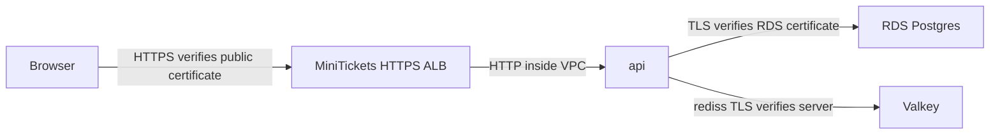

# Encryption in transit (TLS)

History: see [CHANGELOG.md](../CHANGELOG.md) or run `pnpm docs:history`

Area: Auth & Security · Status: ✅ built (one unencrypted hop in dev) · Step docs: [17 ECS api](../../17-infra-ecs-api.md) (sections 3.8, 3.9), [19 CloudFront](../../19-infra-cloudfront.md) (section 3.5)
<!-- interview-card: v2 -->

## 1. What is it?

Transport Layer Security, or TLS, protects data while it travels and lets a client verify the server identity. HTTPS is HTTP carried over TLS.

## 2. Why do we need it?

MiniTickets sends passwords, session cookies and database records over networks. Encryption prevents someone on the path reading them; certificate checks help stop an impostor receiving them.

## 3. How does it work?



1. The client checks the server certificate and expected name.
2. TLS establishes an encrypted connection.
3. Each later network hop needs its own transport decision.

## 4. How do we use it in MiniTickets?

Current public HTTPS ends at the ALB; its task hop remains HTTP. API connections to RDS and Valkey use verified TLS. Optional CloudFront is disabled and retains a separate HTTP origin design.

## 5. Interview-ready answer

“MiniTickets encrypts browser traffic to its current ALB and API connections to both stores. For RDS the image includes the trusted AWS certificate bundle and verification stays enabled. TLS is checked per hop: the ALB-to-task link is still HTTP, and an optional CDN origin path needs its own decision.”

## 6. Important follow-up questions

- **Is encryption without certificate verification enough?** No. An impostor could establish an encrypted connection with the client.
- **Why add the RDS certificate bundle?** Node needs the appropriate trust chain to verify that server.
- **Does browser HTTPS secure every later hop?** No. TLS termination ends that connection.
- **What if verification fails?** Fix trust, hostname or certificate configuration; do not disable verification.

## 7. Advanced details

<details>
<summary>Technical reference</summary>

### Source references

- Anchor: `apps/api/src/config/database.ts` · `DatabaseEnvSchema` step 2d: `ssl: { rejectUnauthorized: true }` for the AWS settings.
- Anchor: `apps/api/Dockerfile` · step 11b: downloads the RDS CA bundle and sets `NODE_EXTRA_CA_CERTS`.
- Anchor: `infra/src/data/cache.ts` · `transitEncryptionEnabled: true`: Valkey accepts TLS only.

Step by step:

1. **Postgres:** RDS for Postgres 15+ sets `rds.force_ssl = 1`, refusing plain connections. The api's
   `ssl: { rejectUnauthorized: true }` checks that the certificate is signed by a trusted CA **and**
   names `DB_HOST`.
2. Node does not trust the RDS CA by default, so the Dockerfile `ADD`s
   `https://truststore.pki.rds.amazonaws.com/global/global-bundle.pem` and sets
   `NODE_EXTRA_CA_CERTS` (adds to Node's list, never replaces it).
3. **Valkey:** `transitEncryptionEnabled: true` on the server; the `rediss://` scheme in the secret
   makes ioredis use TLS.
4. **Browser:** currently HTTPS to the ACM-backed ALB; optional CloudFront uses its default `*.cloudfront.net` certificate
   ([tls-termination](tls-termination.md)).
5. **Locally:** `DATABASE_URL` gets no SSL, because the Docker Postgres does not offer it.

### Configuration and design

| Hop | TLS | Why |
| --- | --- | --- |
| Browser → current ALB | yes | ACM-backed HTTPS; supports the production `Secure` cookie. |
| Browser → optional CloudFront | yes | Default distribution certificate. |
| Optional CloudFront → ALB | no | Existing optional origin design; CDN is currently disabled. |
| ALB → task | no | Inside the VPC. |
| api → RDS | yes, verified | RDS requires it; verification stops impostors. |
| api → Valkey | yes | Session ids must not travel in plain text. |

TLS is part of **Password**: it proves the server's identity and protects the credentials sent over
the connection.

### Checks and troubleshooting

Inside the api task (ECS Exec):

```bash
echo $NODE_EXTRA_CA_CERTS                     # /usr/local/share/rds-global-bundle.pem
node -e "fetch('http://localhost:4000/ready').then(async r => console.log(r.status, await r.text()))"
```

200 means both TLS connections (Postgres, Valkey) succeeded with verification.

**Break it on purpose (thought experiment, never ship):** remove `NODE_EXTRA_CA_CERTS`. Connections
fail with `self-signed certificate in certificate chain`. The fix is to trust the CA, **never**
`rejectUnauthorized: false`.

| Error | Cause |
| ----- | ----- |
| `self-signed certificate in certificate chain` | RDS CA not trusted |
| `no pg_hba.conf entry …` (the message says the connection had no encryption) | Plain connection to RDS |
| Valkey hang / reset | `redis://` instead of `rediss://` |

- *Why not `rejectUnauthorized: false`?* It encrypts but trusts anyone, so an attacker in the middle
  can read the password.
- *Why `NODE_EXTRA_CA_CERTS` and not replacing the CA list?* Public sites must still verify normally.

### Trade-offs and alternatives

- **Pros:** store connections are encrypted and RDS identity is verified; internal HTTP application hops still carry request data.
- **Cons:** ALB-to-task HTTP carries request data; optional edge-to-ALB HTTP also carries cookies and the origin secret; the RDS CA bundle is
  fetched at build time and must stay current.

- **HTTPS to the origin** with an ACM certificate: production.
- **TLS all the way to the container:** compliance-driven environments.
- **Service mesh / mTLS:** many services that must prove their identity to each other.

### Further technical context

The api connects to RDS with `rejectUnauthorized: true`, trusting the RDS CA bundle
  baked into the image via `NODE_EXTRA_CA_CERTS`, and to Valkey with `rediss://` against a
  TLS-only replication group. Browsers currently use HTTPS directly to ALB. Optional CloudFront → ALB and ALB → task use HTTP.

Historical cost notes (not a current quote):

Free: TLS is built into RDS, ElastiCache and CloudFront.

### Related reading

- **Uses ←** [RDS](rds-postgres.md), [Valkey](elasticache-valkey.md), [CloudFront](cloudfront.md).
- **Gives →** confidentiality for passwords, session ids and user data on the network; the TLS part
  of the **Password** answers.

[Open this piece in the city explorer](../guides/infra-explorer.html?concept=tls-in-transit#chapter=5&piece=rds).

## Where it appears in the story

- [App story: 10. Postgres and Redis](../app-story.md#10-postgres-and-redis)
- [Infra story: 7. RDS Postgres](../infra-story.md#7-rds-postgres)

</details>
