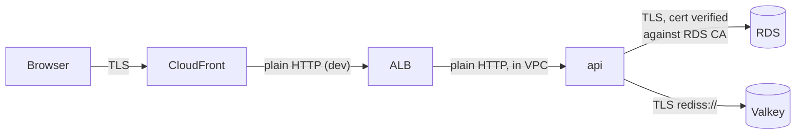

# Encryption in transit (TLS)

History: see [CHANGELOG.md](../CHANGELOG.md) or run `pnpm docs:history`

Area: Auth & Security · Status: ✅ built (one unencrypted hop in dev) · Step docs: [17 ECS api](../../17-infra-ecs-api.md) (sections 3.8, 3.9), [19 CloudFront](../../19-infra-cloudfront.md) (section 3.5)

## 1. In one line

**TLS** encrypts data while it travels and proves who the server is; we use it from the browser to
CloudFront and from the api to Postgres and Valkey.

## 2. Real-life comparison

A sealed, tamper-evident envelope with the sender's official stamp. Nobody on the way can read it,
and the stamp proves it came from the real bank, not a look-alike.

## 3. Picture it



## 4. Where in our code

- Anchor: `apps/api/src/config/database.ts` · `DatabaseEnvSchema` step 2d: `ssl: { rejectUnauthorized: true }` for the AWS settings.
- Anchor: `apps/api/Dockerfile` · step 11b: downloads the RDS CA bundle and sets `NODE_EXTRA_CA_CERTS`.
- Anchor: `infra/src/data/cache.ts` · `transitEncryptionEnabled: true`: Valkey accepts TLS only.

Step by step:

1. **Postgres:** RDS for Postgres 15+ sets `rds.force_ssl = 1`, refusing plain connections. The api's
   `ssl: { rejectUnauthorized: true }` checks that the certificate is signed by a trusted CA **and**
   names `DB_HOST`.
2. Node does not trust the RDS CA by default, so the Dockerfile `ADD`s
   `https://truststore.pki.rds.amazonaws.com/global/global-bundle.pem` and sets
   `NODE_EXTRA_CA_CERTS` (adds to Node's list, never replaces it).
3. **Valkey:** `transitEncryptionEnabled: true` on the server; the `rediss://` scheme in the secret
   makes ioredis use TLS.
4. **Browser:** HTTPS to CloudFront with the default `*.cloudfront.net` certificate
   ([tls-termination](tls-termination.md)).
5. **Locally:** `DATABASE_URL` gets no SSL, because the Docker Postgres does not offer it.

## 5. See it yourself

Inside the api task (ECS Exec):

```bash
echo $NODE_EXTRA_CA_CERTS                     # /usr/local/share/rds-global-bundle.pem
node -e "fetch('http://localhost:4000/ready').then(async r => console.log(r.status, await r.text()))"
```

200 means both TLS connections (Postgres, Valkey) succeeded with verification.

**Break it on purpose (thought experiment, never ship):** remove `NODE_EXTRA_CA_CERTS`. Connections
fail with `self-signed certificate in certificate chain`. The fix is to trust the CA, **never**
`rejectUnauthorized: false`.

## 6. How it connects

- **Uses ←** [RDS](rds-postgres.md), [Valkey](elasticache-valkey.md), [CloudFront](cloudfront.md).
- **Gives →** confidentiality for passwords, session ids and user data on the network; the TLS part
  of the **Password** answers.

## 7. Our settings and WHY

| Hop | TLS | Why |
| --- | --- | --- |
| Browser → CloudFront | yes | Required for the `Secure` cookie. |
| CloudFront → ALB | no | Dev compromise: no domain to certify the ALB. |
| ALB → task | no | Inside the VPC. |
| api → RDS | yes, verified | RDS requires it; verification stops impostors. |
| api → Valkey | yes | Session ids must not travel in plain text. |

## 8. Trade-offs

- **Pros:** passwords and sessions never cross the network in clear; identity checked for RDS.
- **Cons:** one plain hop (edge → ALB) carries cookies and the origin secret; the RDS CA bundle is
  fetched at build time and must stay current.

## 9. Alternatives and when to choose them

- **HTTPS to the origin** with an ACM certificate: production.
- **TLS all the way to the container:** compliance-driven environments.
- **Service mesh / mTLS:** many services that must prove their identity to each other.

## 10. What breaks, and how we'd notice

| Error | Cause |
| ----- | ----- |
| `self-signed certificate in certificate chain` | RDS CA not trusted |
| `no pg_hba.conf entry …` (the message says the connection had no encryption) | Plain connection to RDS |
| Valkey hang / reset | `redis://` instead of `rediss://` |

## 11. Reach / Allowed / Password

TLS is part of **Password**: it proves the server's identity and protects the credentials sent over
the connection.

## 12. Cost

Free: TLS is built into RDS, ElastiCache and CloudFront.

## 13. Interview answers at 3 levels

- **Simple:** We encrypt traffic so nobody can read it on the way.
- **Senior:** The api connects to RDS with `rejectUnauthorized: true`, trusting the RDS CA bundle
  baked into the image via `NODE_EXTRA_CA_CERTS`, and to Valkey with `rediss://` against a
  TLS-only replication group. Browsers use HTTPS to CloudFront; the CloudFront → ALB hop is HTTP in dev.
- **Lead:** Verifying certificates is the part people skip; encryption without verification does not
  stop a man-in-the-middle. For production I'd close the last plain hop with an ACM certificate on the
  ALB and consider end-to-end TLS where required.

## 14. Follow-up questions interviewers ask

- *Why not `rejectUnauthorized: false`?* It encrypts but trusts anyone, so an attacker in the middle
  can read the password.
- *Why `NODE_EXTRA_CA_CERTS` and not replacing the CA list?* Public sites must still verify normally.

## 15. Say it in 30 seconds

"TLS from the browser to CloudFront, and from the api to both data stores. For RDS we verify the
certificate against AWS's CA bundle baked into the image; Valkey is TLS-only via `rediss://`. The one
plain hop is CloudFront to the ALB, a dev compromise."

## 16. Status

✅ built. **To make it production-grade:** HTTPS on the CloudFront → ALB hop.

## Where it appears in the story

- [App story: 10. Postgres and Redis](../app-story.md#10-postgres-and-redis)
- [Infra story: 7. RDS Postgres](../infra-story.md#7-rds-postgres)
