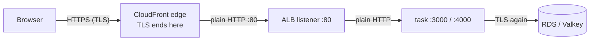

# TLS termination: where HTTPS ends

History: see [CHANGELOG.md](../CHANGELOG.md) or run `pnpm docs:history`

Area: AWS Network · Status: ✅ built (dev compromise) · Step doc: [19 CloudFront](../../19-infra-cloudfront.md) (section 3.5)

## 1. In one line

**TLS termination** is the place where an encrypted connection ends and the request is read in plain
form; for our browsers that is the CloudFront edge.

## 2. Real-life comparison

A sealed envelope carried to a post office counter. The clerk opens it there and sends the letter
on inside the building in an internal (unsealed) folder. The seal protected it on the street, not
in the building.

## 3. Picture it



## 4. Where in our code

- Anchor: `infra/src/entry/cdn.ts` · `originProtocolPolicy: "http-only"`: CloudFront → ALB is plain HTTP.
- Anchor: `infra/src/entry/listener.ts` · `listener`: the ALB listens on HTTP :80 only.

Step by step:

1. `cdn.ts` → `viewerCertificate: { cloudfrontDefaultCertificate: true }`: browsers get TLS with
   the `*.cloudfront.net` certificate.
2. `cdn.ts` → `viewerProtocolPolicy: "redirect-to-https"`: plain `http://` is redirected.
3. `cdn.ts` → origin `customOriginConfig.originProtocolPolicy: "http-only"`, `httpPort: 80`.
   (`originSslProtocols: ["TLSv1.2"]` is required by the API but unused with http-only.)
4. `listener.ts` → `port: 80, protocol: "HTTP"`. There is no 443 listener.
5. Because the ALB's own listener is HTTP, it sets `X-Forwarded-Proto: http`. That causes the
   harmless extra redirect on `/dashboard` described in [docs/19](../../19-infra-cloudfront.md),
   section 3.10.

## 5. See it yourself

```bash
cd infra && APP=$(pulumi stack output appUrl)
curl -sv "$APP/" -o /dev/null 2>&1 | grep -E 'SSL connection|subject:|issuer:'
```

Shows the TLS version and the `*.cloudfront.net` certificate. In the CloudFront console, the
origin shows "HTTP only".

**Break it on purpose (scratch branch):** set `originProtocolPolicy: "https-only"`. Nothing listens
on 443 at the ALB, so every request gets CloudFront's 502.

## 6. How it connects

- **Uses ←** [CloudFront](cloudfront.md), the [ALB](alb.md).
- **Gives →** the `Secure` cookie works (the browser only judges its own HTTPS connection);
  [tls-in-transit](tls-in-transit.md) covers the other hops.

## 7. Our settings and WHY

| Hop | Encrypted? | Why |
| --- | ---------- | --- |
| Browser → edge | yes | Free default certificate. |
| Edge → ALB | **no** | HTTPS here needs a certificate for a domain we own; the ALB's name belongs to AWS. Runs on AWS's network, but is not encrypted. |
| ALB → task | no | Inside our VPC. |
| api → RDS, api → Valkey | yes | Required by RDS (`force_ssl`) and by the cache (`transitEncryptionEnabled`). |

## 8. Trade-offs

- **Pros:** HTTPS for users with no domain and no certificate work; the ALB does no TLS work.
- **Cons:** the edge-to-ALB hop carries cookies and the origin secret unencrypted;
  `X-Forwarded-Proto` says `http`, which confuses redirects.

## 9. Alternatives and when to choose them

- **HTTPS to the origin** (custom domain + ACM certificate on the ALB, `https-only`): production.
- **End-to-end TLS to the task** (the ALB re-encrypts to the container): strict compliance
  (for example some PCI setups).
- **TLS at the ALB only, no CDN:** a single-region app with a custom domain.

## 10. What breaks, and how we'd notice

- `https-only` with no 443 listener: 502 everywhere.
- Visiting the ALB directly over HTTP: times out (security group), and even if it did not, the
  `Secure` cookie would be dropped.

## 11. Reach / Allowed / Password

**Password** for the browser hop: the certificate proves CloudFront's identity to the browser. The
edge → ALB hop has no TLS, so the ALB only gets the shared-secret header as proof.

## 12. Cost

The default CloudFront certificate is free; ACM public certificates are free too.

## 13. Interview answers at 3 levels

- **Simple:** HTTPS ends at CloudFront; behind it traffic is plain HTTP.
- **Senior:** Browsers do TLS with CloudFront's `*.cloudfront.net` certificate. CloudFront reaches
  the ALB with `http-only` on port 80 because we have no domain to certify the ALB with. Inside, the
  api uses TLS again to RDS and Valkey. The side effect is `X-Forwarded-Proto: http`.
- **Lead:** Where TLS terminates is a risk decision. In dev I accept an unencrypted hop on AWS's
  network; for production I'd terminate at the edge and re-encrypt to the ALB with an ACM
  certificate, and evaluate end-to-end TLS if compliance requires it.

## 14. Follow-up questions interviewers ask

- *Why does the Secure cookie work if the hop to the ALB is HTTP?* The browser only sees its own
  connection to CloudFront, which is HTTPS.
- *What would you need for HTTPS to the ALB?* A domain, an ACM certificate in the ALB's region, a
  443 listener and `https-only` on the origin.

## 15. Say it in 30 seconds

"TLS ends at the CloudFront edge with the free `*.cloudfront.net` certificate. From the edge to the
ALB it's plain HTTP on port 80, a dev compromise because we own no domain. The api then uses TLS
again to RDS and Valkey."

## 16. Status

✅ built as a dev compromise. **To make it production-grade:** custom domain, ACM certificate on the
ALB, HTTPS listener, `https-only` origin.

## Where it appears in the story

- [Infra story: 1. CloudFront](../infra-story.md#1-cloudfront)
- [Big picture: 4. Components](../00-big-picture.md#4-components)
