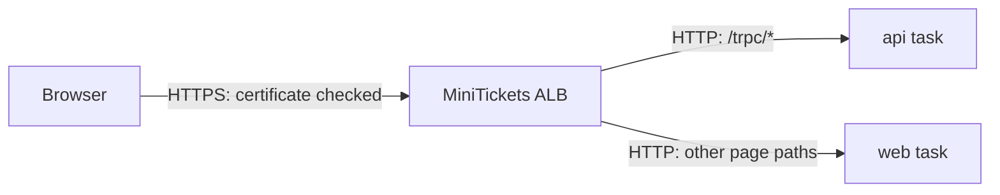

# TLS termination: where HTTPS ends

History: see [CHANGELOG.md](../CHANGELOG.md) or run `pnpm docs:history`

Area: AWS Network · Status: ✅ built in repository; live AWS acceptance is separate
<!-- interview-card: v2 -->

## 1. What is it?

TLS termination is the point where an encrypted HTTPS connection ends. The component there reads the HTTP request and may forward it using another connection.

## 2. Why do we need it?

MiniTickets needs one public certificate and request routing before traffic reaches API or web tasks. The load balancer can handle that work while tasks serve internal HTTP.

## 3. How does it work?

1. The browser establishes HTTPS with the public entry point.
2. The entry point decrypts and routes the request.
3. The forwarded connection follows its own encryption policy.

## 4. How do we use it in MiniTickets?

Our current public connection ends at the certificate-backed ALB. Optional CloudFront would terminate browser TLS at its edge; its existing origin hop uses HTTP. End-to-end encryption to task containers is a separate design choice.

## 5. Interview-ready answer

“TLS termination is where MiniTickets decrypts the public request. Today that is the ALB, which then routes HTTP to web or API. Centralizing certificates simplifies entry configuration, but it does not mean every hop is encrypted. I document the boundary and add origin or task TLS when the threat model requires it.”

## 6. Important follow-up questions

- **Can the load balancer inspect the request path?** Yes. Terminating TLS makes the HTTP request available for routing.
- **What if we require encrypted internal hops?** Configure backend TLS and its trust rules; browser HTTPS alone is insufficient.
- **Does a private network provide encryption?** No. Network isolation and transport encryption solve different problems.
- **What causes a browser certificate warning?** Check certificate issuance, hostname match and the attached listener certificate.

## 7. Advanced details

Technical reference

### Source anchors

- Anchor: `infra/src/entry/cdn.ts` — `module configuration`; follow the numbered comments at this boundary.
- Anchor: `infra/src/entry/listener.ts` — `listener`; follow the numbered comments at this boundary.

### Current endpoints and implementation

`infra/src/entry/https-listener.ts` → `createHttpsListener` attaches the ACM certificate to ALB HTTPS 443 and redirects HTTP 80 with 301. The public name is `minitickets.theversehub.in`; committed `cdnEnabled=false`. TLS policy is `ELBSecurityPolicy-TLS13-1-2-2021-06`, allowing TLS 1.2/1.3. ACM and ALB are in the same region; certificate issuance and owner DNS remain separate prerequisites.

ALB forwards API HTTP 4000 and web HTTP 3000 through source-security-group rules. Store connections use separate verified TLS. Service Connect server calls bypass the ALB and use private task names; those names are not browser destinations. Public task IPs avoid NAT in dev, but do not encrypt traffic or bypass inbound groups.

Optional `cdn.ts` terminates viewer TLS with the default CloudFront certificate. Its `listener.ts` origin path is HTTP, guarded by the CloudFront prefix list and `X-Origin-Verify`; that optional path is inactive. HTTPS for CloudFront-to-ALB needs its own owned origin name/certificate and origin policy. Task TLS or mutual TLS is a separate possible design, not built here.

### Console and diagnosis

EC2 → Load Balancers → minitickets-dev → Listeners and rules shows certificate attachment and routing. ACM → Certificates shows issuance and domain names. Check DNS, certificate domain match, listener policy and then each backend hop separately. Do not infer encryption from a private address or a successful password check. No live certificate/handshake acceptance was run for this rewrite.

### Related boundaries

Routes provide reach, security groups permit network connections, and IAM applies to AWS service APIs. Security groups are stateful; subnet NACLs are stateless. An ENI is a task network interface. Private names, egress mapping, segmentation, IPv6/endpoints and flow logs remain separate network concerns. Existing resource prices in older guides are historical, not current estimates.

### Preserved references

- [current system](../00-big-picture.md)
- [scenario](../guides/interview-scenarios.md#network-boundaries)
- [explorer tour](../guides/infra-explorer.html?tour=database-reach)
- [Every IAM badge](../guides/infra-build-along.md#every-iam-badge-who--what--attached)

[Open this piece in the city explorer](../guides/infra-explorer.html?concept=tls-termination#chapter=10&piece=cert).

## Where it appears in the story

- [infra-story: 4b. Private service discovery and asynchronous workers](../infra-story.md#4b-private-service-discovery-and-asynchronous-workers)

