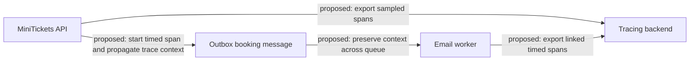

# Tracing

History: see [CHANGELOG.md](../CHANGELOG.md) or run `pnpm docs:history`

Area: Observability · Status: 📖 explain-only

<!-- interview-card: v2 -->

## 1. What is it?

Distributed tracing would follow one operation through timed steps called spans. It would show which step was slow and how work crossed service boundaries.

## 2. Why do we need it?

A MiniTickets email is delayed, but matching log IDs do not show where the time went. A trace could distinguish API work, queue waiting and worker processing.

## 3. How does it work?

1. A proposed implementation would start a trace at the request boundary.
2. It would carry trace context through stored messages.
3. Sampled spans would be exported and inspected together.

## 4. How do we use it in MiniTickets?

Tracing is explain-only. MiniTickets currently connects logs using correlation IDs. No collector, tracing permissions or tracing resources are built. The existing correlation/message boundaries are the natural places to discuss adding trace propagation.

## 5. Interview-ready answer

“MiniTickets currently has correlation logs, not distributed tracing. A tracing design would add timed spans and carry trace context from the API through the outbox and consumers. That could locate latency across asynchronous work. I would define sampling, privacy and cost limits before adding a collector, and would still use business metrics to judge whether bookings and confirmations actually succeed.”

## 6. Important follow-up questions

- **How is this different from correlation?** A label connects records; spans add timing and causal relationships.
- **Does sampling keep every failure?** Not necessarily. Sampling policy trades coverage for cost and overhead.
- **Can traces replace success metrics?** No. Sampled operations do not define a complete business-outcome denominator.
- **What happens if export fails?** A proposed design should bound exporter work so diagnostics do not stall bookings.

## 7. Advanced details

Technical reference

### Proposed placement, not built resources

Existing integration point: `apps/api/src/http/correlation-id.ts`. A proposal would load a new `apps/api/src/tracing.ts` before server modules, use an ADOT sidecar in the API task, configure Lambda tracing and narrowly scoped X-Ray writes, and propagate W3C `traceparent` through the message envelope. None of that file, collector, sidecar, tracing IAM or tracing configuration is established as built here; no runnable feature demo exists.

### Observability design and trade-offs

Spans form a timed tree or linked asynchronous work. Sampling may omit an individual trace; sidecars consume CPU/memory and collectors require operations. Bound exported customer data and tracing cost. Current UUID-correlated logs remain actual evidence.

A related SLI would measure booking success/latency or email delay; an SLO would choose its target/window, and an error budget would define tolerated failures. For example, 99.5% permits 0.5% of valid events to miss the objective; it is not a claimed MiniTickets target. Define exclusions/denominators, test alerts, and prefer sustained budget-burn signals over harmless blips. No SLO resources or meaningful production SLO demonstration exists in this development app. At greater scale, evaluate sampled spans and release policy tied to measured budgets.

### Related reading

[current system](../00-big-picture.md) · [scenario](../guides/interview-scenarios.md#tracing-slos) · [explorer tour](../guides/infra-explorer.html?tour=failing-email)

[Open this concept in the city explorer](../guides/infra-explorer.html?concept=tracing#chapter=8&piece=logs).

## Where it appears in the story

- [infra-story: 9b. Follow a booking through symptoms](../infra-story.md#9b-follow-a-booking-through-symptoms)

