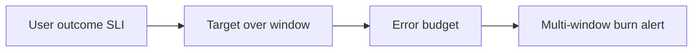

# Tracing

History: see [CHANGELOG.md](../CHANGELOG.md) or run `pnpm docs:history`

Area: Observability · Status: 📖 explain-only

## 1. In one line

Explain-only: timed spans and propagated W3C trace context would add causal timing beyond current UUID correlation logs; no collector, X-Ray permissions or tracing resources exist.

## 2. Real-life comparison

A receipt number follows one purchase through every desk; an alarm points at the desk where work is stuck.

## 3. Picture it

## 4. Where in our code

Not in our app as an anchored feature. The proposed or observational location is explained below; it must not be mistaken for a deployed resource.

WHERE IN MINITICKETS: proposed apps/api/src/tracing.ts loaded before server modules, ADOT sidecar in API task, Lambda tracing config and narrowly scoped X-Ray write IAM. Propagate W3C traceparent through the message envelope. Proposed CloudWatch SLI for booking success/latency and email delay; logs remain current evidence. No OTel collector, tracing grants or SLO resource is built.

Existing integration point: `apps/api/src/http/correlation-id.ts`.

## 5. See it yourself

Use the linked scenario and tour to trace the existing integration point. This proposed extension has no runnable feature demo.

Failure thought experiment: Does 99.5% mean zero failures? No; it allows 0.5% of valid events to miss the objective. Do not change a live stack to demonstrate it.

## 6. How it connects

Uses the [current system](../00-big-picture.md); gives a concrete decision to the [scenario](../guides/interview-scenarios.md#tracing-slos) and [explorer tour](../guides/infra-explorer.html?tour=failing-email).

## 7. Our settings and WHY

Explain-only: timed spans and propagated W3C trace context would add causal timing beyond current UUID correlation logs; no collector, X-Ray permissions or tracing resources exist. Average latency and raw error counts can hide a failing user journey.

## 8. Trade-offs

Sampling loses individual traces; sidecars cost CPU/memory and collector operations. ALB errors alone do not fully describe business success. Use a business metric where needed.

## 9. Alternatives and when to choose them

10x: define denominator/exclusions and test alerts. 100x: sampled distributed spans, cost/PII limits and release policies tied to budget.

## 10. What breaks and how we notice

Does 99.5% mean zero failures? No; it allows 0.5% of valid events to miss the objective.

## 13. Interview answers at 3 levels

- **Simple:** Explain-only: timed spans and propagated W3C trace context would add causal timing beyond current UUID correlation logs; no collector, X-Ray permissions or tracing resources exist..
- **Senior:** Traces form a tree of timed spans linked by trace context. An SLI measures a user outcome; an SLO sets a target/window; an error budget is the permitted failure fraction. Alert on sustained fast budget burn, not a brief harmless blip. A dev app without real traffic cannot demonstrate a meaningful production SLO.
- **Lead:** 10x: define denominator/exclusions and test alerts. 100x: sampled distributed spans, cost/PII limits and release policies tied to budget.

## 14. Follow-up questions with answers

Does 99.5% mean zero failures? No; it allows 0.5% of valid events to miss the objective.

What is an SLI? **A measured user outcome ratio.**

## 15. Say it in 30 seconds

Traces form a tree of timed spans linked by trace context. An SLI measures a user outcome; an SLO sets a target/window; an error budget is the permitted failure fraction. Alert on sustained fast budget burn, not a brief harmless blip. A dev app without real traffic cannot demonstrate a meaningful production SLO.

## 16. Status and production work

Explain-only: no feature deployment exists. 10x: define denominator/exclusions and test alerts. 100x: sampled distributed spans, cost/PII limits and release policies tied to budget.

## Where it appears in the story

- [infra-story: 9b. Follow a booking through symptoms](../infra-story.md#9b-follow-a-booking-through-symptoms)
