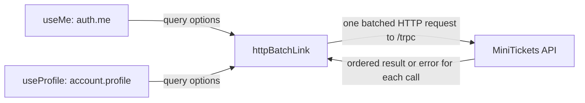

# tRPC client and request batching

History: see [CHANGELOG.md](../CHANGELOG.md) or run `pnpm docs:history`

Area: Frontend · Status: ✅ built · Step doc: [01 setup](../../01-setup.md), [18 ALB + web](../../18-infra-alb-web.md)
<!-- interview-card: v2 -->

## 1. What is it?

The tRPC client turns a typed API call into an HTTP request. Request batching combines compatible calls started together into one trip to the server.

## 2. Why do we need it?

MiniTickets dashboard may need both login identity and a profile. Sending them together reduces request overhead while keeping a separate result for each procedure.

## 3. How does it work?



1. Feature hooks construct typed procedure calls.
2. The batch link groups compatible calls made together.
3. The server returns individual results, which populate their matching query entries.

## 4. How do we use it in MiniTickets?

The browser client uses relative `/trpc` in production and a configured API origin locally. It includes cookies. A separate server client uses the internal URL and an unbatched link for server rendering.

## 5. Interview-ready answer

“MiniTickets’ tRPC client uses the API router type to build checked calls over HTTP. The browser batch link combines compatible queries or mutations, includes cookies and uses the same public origin in production. Batching reduces overhead but couples response latency, so one slow call can delay its neighbours.”

## 6. Important follow-up questions

- **Are queries and mutations one mixed batch?** They use different request types: reads use GET and mutations use POST.
- **What if local cookies disappear?** Check credentials inclusion and the API’s exact-origin credential policy.
- **What if a batched GET grows too long?** URL limits can reject it; limit size, split requests or choose an appropriate transport.
- **When avoid batching?** For independent latency, uploads or calls whose response should stream separately.

## 7. Advanced details

<details>
<summary>Technical reference</summary>

### Current reading notes

Current browser source uses httpBatchLink with credentials: include; no maxURLLength is configured. The server-side client uses httpLink and does not forward visitor cookies for public search. The old CloudFront path is optional today; current production public entry is direct HTTPS ALB. Installed-source and curl observations below are historical, not rerun checks.

### Implementation reference

- Anchor: `apps/web/src/lib/trpc/client.ts` · `makeTrpcClient`: `createTRPCClient<AppRouter>` with one `httpBatchLink`.

Step by step:

1. `API_URL` comes from `NEXT_PUBLIC_API_URL`: `http://localhost:4000` locally, **empty** on AWS
   (same origin, see [same-origin-routing](same-origin-routing.md)). A value that is set but not
   `http(s)://…` throws at startup.
2. ``httpBatchLink({ url: `${API_URL}/trpc` })``: every call goes through this link.
3. Calls in the same tick are batched. **Queries** are sent as `GET` (inputs in the URL), and
   **mutations** as `POST` (inputs in the JSON body). Verified in the installed `@trpc/client`
   11.19.0 source: `METHOD = { query: "GET", mutation: "POST", … }`.
4. `fetch: … credentials: "include"`: the browser sends the session cookie to the api even when it
   is another origin (locally :3000 → :4000), and saves the `Set-Cookie` from login
   ([cors](cors.md)).
5. `createTRPCContext<AppRouter>()` gives `TRPCProvider` and `useTRPC` for the React side
   ([tanstack-query](tanstack-query.md)).

### Inspection and historical evidence

Open `/dashboard` while logged in, Network tab: one request like
`/trpc/auth.me,account.profile?batch=1&input=…`. Its response is an array with two results.

Or with curl against a local api (`$SID` = your `sid` cookie value):

```bash
curl -s -b "sid=$SID" "http://localhost:4000/trpc/auth.me,account.profile?batch=1&input=%7B%7D"
# [{"result":{"data":{"id":"…","email":"…"}}},{"result":{"data":{…,"createdAt":"…"}}}]
```

(Shape recorded against a local api instance.)

**Break it on purpose:** set `NEXT_PUBLIC_API_URL=localhost:4000` (no `http://`) in
`apps/web/.env.local` and restart `pnpm dev`: the app fails at once with the clear error from
`client.ts`, instead of sending requests to a broken URL.

### Settings and reasoning

| Setting | Why |
| ------- | --- |
| `httpBatchLink` | Fewer round-trips when a page needs several answers. |
| Empty `API_URL` on AWS | One image works everywhere; the ALB routes `/trpc/*`. |
| `credentials: "include"` | Cookies must cross origins locally. Harmless on the same origin. |
| No `maxURLLength` | Default is unlimited (verified in source); our batched GETs are short. |

### Trade-offs

- **Pros:** typed calls, no hand-written URLs; fewer requests.
- **Cons:** one slow procedure delays the whole batch response; batched URLs are harder to read in
  logs; long batched GET URLs could hit URL limits if inputs grow (CloudFront rejects URLs over
  8,192 bytes, per AWS's custom-origin docs).

### Alternatives and scaling

- **`httpLink`:** one request per call; simplest to debug.
- **`httpBatchStreamLink`:** batch, but stream each answer as soon as it is ready (fixes the "slowest
  wins" problem).
- **`splitLink`:** different links for different calls (e.g. never batch uploads).

### Failure diagnosis

- Wrong `NEXT_PUBLIC_API_URL` baked into the image: every call fails (network errors in DevTools).
  Same-origin with an empty value avoids it.
- Forgetting `credentials: "include"` locally: login "works" but the next call is logged out.

### Further questions

- *Why GET for queries?* Reads can be cached by browsers and CDNs; we choose not to cache `/trpc/*`.
- *What does a batch response look like?* A JSON array, one result or error per call, same order.

### Related reading

- [end-to-end-types](end-to-end-types.md)
- [fastify-app](fastify-app.md)

[Open this piece in the city explorer](../guides/infra-explorer.html?concept=trpc-client#chapter=24&piece=code-trpc).

## Where it appears in the story

- [App story: 3. The tRPC client](../app-story.md#3-the-trpc-client)

</details>
