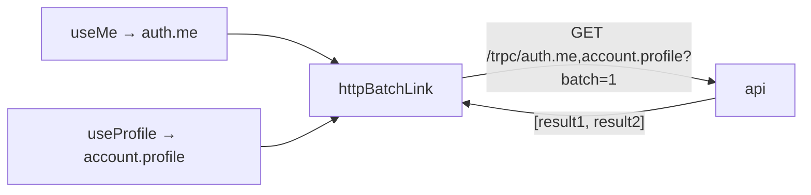

# tRPC client and request batching

History: see [CHANGELOG.md](../CHANGELOG.md) or run `pnpm docs:history`

Area: Frontend · Status: ✅ built · Step doc: [01 setup](../../01-setup.md), [18 ALB + web](../../18-infra-alb-web.md)

## 1. In one line

The **tRPC client** turns a typed function call like `auth.me` into an HTTP request to `/trpc/…`;
`httpBatchLink` combines calls made at the same moment into one request.

## 2. Real-life comparison

A postal clerk who waits a moment before sending: three letters handed over in the same minute go
in one envelope, and the replies come back in one envelope in the same order.

## 3. Picture it



## 4. Where in our code

- Anchor: `apps/web/src/lib/trpc/client.ts` · `makeTrpcClient`: `createTRPCClient<AppRouter>` with one `httpBatchLink`.

Step by step:

1. `API_URL` comes from `NEXT_PUBLIC_API_URL`: `http://localhost:4000` locally, **empty** on AWS
   (same origin, see [same-origin-routing](same-origin-routing.md)). A value that is set but not
   `http(s)://…` throws at startup.
2. ``httpBatchLink({ url: `${API_URL}/trpc` })``: every call goes through this link.
3. Calls in the same tick are batched. **Queries** are sent as `GET` (inputs in the URL), and
   **mutations** as `POST` (inputs in the JSON body). Verified in the installed `@trpc/client`
   11.19.0 source: `METHOD = { query: "GET", mutation: "POST", … }`.
4. `fetch: … credentials: "include"`: the browser sends the session cookie to the api even when it
   is another origin (locally :3000 → :4000), and saves the `Set-Cookie` from login
   ([cors](cors.md)).
5. `createTRPCContext<AppRouter>()` gives `TRPCProvider` and `useTRPC` for the React side
   ([tanstack-query](tanstack-query.md)).

## 5. See it yourself

Open `/dashboard` while logged in, Network tab: one request like
`/trpc/auth.me,account.profile?batch=1&input=…`. Its response is an array with two results.

Or with curl against a local api (`$SID` = your `sid` cookie value):

```bash
curl -s -b "sid=$SID" "http://localhost:4000/trpc/auth.me,account.profile?batch=1&input=%7B%7D"
# [{"result":{"data":{"id":"…","email":"…"}}},{"result":{"data":{…,"createdAt":"…"}}}]
```

(Shape recorded against a local api instance.)

**Break it on purpose:** set `NEXT_PUBLIC_API_URL=localhost:4000` (no `http://`) in
`apps/web/.env.local` and restart `pnpm dev`: the app fails at once with the clear error from
`client.ts`, instead of sending requests to a broken URL.

## 6. How it connects

- **Uses ←** `type AppRouter` from the api ([end-to-end-types](end-to-end-types.md)).
- **Gives →** the transport for [tanstack-query](tanstack-query.md); talks to
  [fastify-app](fastify-app.md) through CloudFront and the ALB on AWS.

## 7. Our settings and WHY

| Setting | Why |
| ------- | --- |
| `httpBatchLink` | Fewer round-trips when a page needs several answers. |
| Empty `API_URL` on AWS | One image works everywhere; the ALB routes `/trpc/*`. |
| `credentials: "include"` | Cookies must cross origins locally. Harmless on the same origin. |
| No `maxURLLength` | Default is unlimited (verified in source); our batched GETs are short. |

## 8. Trade-offs

- **Pros:** typed calls, no hand-written URLs; fewer requests.
- **Cons:** one slow procedure delays the whole batch response; batched URLs are harder to read in
  logs; long batched GET URLs could hit URL limits if inputs grow (CloudFront rejects URLs over
  8,192 bytes, per AWS's custom-origin docs).

## 9. Alternatives and when to choose them

- **`httpLink`:** one request per call; simplest to debug.
- **`httpBatchStreamLink`:** batch, but stream each answer as soon as it is ready (fixes the "slowest
  wins" problem).
- **`splitLink`:** different links for different calls (e.g. never batch uploads).

## 10. What breaks, and how we'd notice

- Wrong `NEXT_PUBLIC_API_URL` baked into the image: every call fails (network errors in DevTools).
  Same-origin with an empty value avoids it.
- Forgetting `credentials: "include"` locally: login "works" but the next call is logged out.

## 13. Interview answers at 3 levels

- **Simple:** It's how the web app calls the api, like calling a function.
- **Senior:** `makeTrpcClient` creates a typed client from `AppRouter` with `httpBatchLink`, so
  queries made together go as one GET and mutations as POST. On AWS the URL is just `/trpc`
  (same origin through the ALB); locally it's `localhost:4000` with credentials included.
- **Lead:** Batching trades latency of the slowest call for fewer round-trips; on HTTP/2 between
  browser and edge the gain is smaller, but it still saves server work. I'd switch to the streaming
  batch link once some procedures get slow.

## 14. Follow-up questions interviewers ask

- *Why GET for queries?* Reads can be cached by browsers and CDNs; we choose not to cache `/trpc/*`.
- *What does a batch response look like?* A JSON array, one result or error per call, same order.

## 15. Say it in 30 seconds

"The tRPC client is typed straight from the api's router type. httpBatchLink bundles calls made
together into one request: queries as GET, mutations as POST. On AWS it calls /trpc on the same
origin; locally it calls localhost:4000 and includes credentials so the cookie crosses origins."

## 16. Status

✅ built.

## Where it appears in the story

- [App story: 3. The tRPC client](../app-story.md#3-the-trpc-client)
