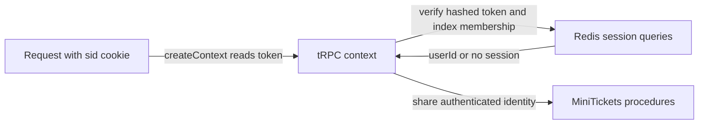

# tRPC context, built once per request

History: see [CHANGELOG.md](../CHANGELOG.md) or run `pnpm docs:history`

Area: API · Status: ✅ built in repository; live acceptance is separate
<!-- interview-card: v2 -->

## 1. What is it?

Context is the per-request information shared with tRPC procedures. MiniTickets uses it to expose the verified session identity and request/response objects.

## 2. Why do we need it?

A batch may call several procedures. Each needs the same trustworthy caller identity; repeatedly interpreting the raw cookie would duplicate work and invite inconsistent checks.

## 3. How does it work?

1. Read the session cookie if present.
2. Verify its server-side session once for the request.
3. Pass the resulting identity to middleware and procedures.

## 4. How do we use it in MiniTickets?

Context includes userId, not a cached admin role. Admin middleware separately reads the current Postgres role. Owner checks use the verified identity. A browser presence cookie helps navigation only; it cannot authorize API access.

## 5. Interview-ready answer

“MiniTickets context establishes who is calling once per request by verifying an opaque Redis session. Procedures share that identity, while admin authorization reads the current database role only when needed. Missing session membership fails closed. This avoids stale roles in cookies, but store failures and already authorized in-flight work remain real limits.”

## 6. Important follow-up questions

- **Does a cookie’s presence prove login?** No. The API verifies the saved session and index membership.
- **Why avoid a role lookup in every context?** Only admin operations need it; unrelated requests should not add that database dependency.
- **Can revocation stop already running work?** No. An earlier authorized request may finish; revocation governs later checks.
- **What if Redis cannot verify the session?** Do not accept an unverified identity; treat auth-store failure explicitly.

## 7. Advanced details

Technical reference

### Current implementation

Current createContext calls session queries once and exposes `{userId}` or null. Session indices cap 20 devices; login rotates tokens. User-role changes revoke sessions before and after the Postgres update, but Redis/Postgres are not one transaction. Deleted-user cases differ by operation: auth.me can return null, profile can return not found, and admin role checks reject missing users.

### Technical limits and diagnosis

The request context includes req/res for HTTP boundary work and sessionId for logout. Missing, fake or expired IDs produce no valid session. Sessions are hashed random tokens with required membership in a bounded per-user index; eviction fails closed. Context contains userId, not the admin role.

Deleted-user outcomes depend on the operation: auth.me can return null, profile can return not found, and admin checks reject a missing user. Admin role lookup happens only on admin requests. A role cached for seven days in a session would become stale after privilege changes.

Cookies are HttpOnly/SameSite and Secure in production. Presence cookies only avoid a predictable redirect flash; they never authorize API access. Historical demo:security exercises rotation, old cookies, all-device logout and role revocation. Monitor auth-store errors and session churn. JWTs trade lookup dependence for explicit revocation/role-update design; versioning, richer device management and coordinated rotation are growth choices. No live AWS check was run here.

### Source anchors

- Anchor: `apps/api/src/trpc/context.ts` · `createContext`, `Context`: the per-request object and its type.

### Related reading

- [current system](../00-big-picture.md)
- [scenario](../guides/interview-scenarios.md#sessions-roles)
- [explorer tour](../guides/infra-explorer.html?tour=security-layers)
- [App story: 5. The tRPC context](../app-story.md#5-the-trpc-context)

[Open this piece in the city explorer](../guides/infra-explorer.html?concept=trpc-context#chapter=0&piece=laptop-api).

## Where it appears in the story

- [App story: 5. The tRPC context](../app-story.md#5-the-trpc-context)

