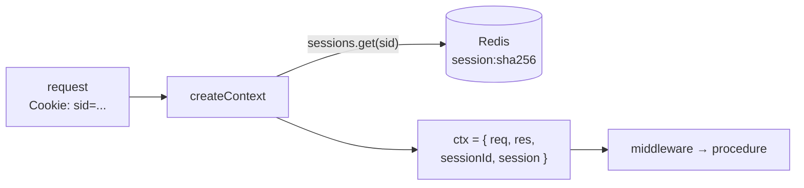

# tRPC context, built once per request

History: see [CHANGELOG.md](../CHANGELOG.md) or run `pnpm docs:history`

Area: API · Status: ✅ built · Step doc: [07 login](../../07-login-session.md)

## 1. In one line

`createContext` runs once for every tRPC request and builds `ctx`: the raw request and reply, the
session id from the cookie, and the **session** looked up in Redis (or `null`).

## 2. Real-life comparison

The check-in desk at a hotel: before you reach any service, they look at your key card once and
write "Room 204, guest Ana" on your wristband. Every service after that reads the wristband instead
of checking again.

## 3. Picture it



## 4. Where in our code

- Anchor: `apps/api/src/trpc/context.ts` · `createContext`, `Context`: the per-request object and its type.

Step by step:

1. Read `req.cookies["sid"]` (`SESSION_COOKIE`). It may be missing.
2. If there is one, `sessions.get(sessionId)` hashes it and asks Redis
   ([sessions-vs-jwt](sessions-vs-jwt.md)). Missing, fake and expired ids all give `null`.
3. Keep only `{ userId }` as `session`: the one thing procedures need.
4. Return `{ req, res, sessionId, session }`. `req`/`res` let procedures set cookies;
   `sessionId` is kept for logout.
5. `type Context = Awaited<ReturnType<typeof createContext>>` gives tRPC the type;
   `initTRPC.context<Context>()` in `init.ts` uses it.

## 5. See it yourself

```bash
curl -s localhost:4000/trpc/auth.me                       # {"result":{"data":null}}
curl -s -b 'sid=not-real' localhost:4000/trpc/auth.me     # null too: Redis has no such key
```

With a real `sid` from your browser (DevTools → Application → Cookies → `localhost`), the same
call returns your `{ id, email }`.

**Break it on purpose:** return `session: { userId: "x" }` always. Every caller now passes
`protectedProcedure`, and `account.profile` throws "User not found" (404). This is why the session
lookup must be on the server.

## 6. How it connects

- **Uses ←** [fastify-app](fastify-app.md) (cookie plugin), [sessions-vs-jwt](sessions-vs-jwt.md)
  (`queries/sessions.ts`).
- **Gives →** `ctx.session` for [protected-procedure](protected-procedure.md) and
  [trpc-middleware](trpc-middleware.md); `ctx.res` for [session-cookie](session-cookie.md).

## 7. Our settings and WHY

Look the session up **once per request, in the context**. WHY: no procedure can forget it, and a
batched request does it once for all its calls.

## 8. Trade-offs

- **Pros:** one place for "who is calling"; procedures stay simple.
- **Cons:** every tRPC request with a cookie costs one Redis round-trip, even for procedures that
  don't need the user. A Redis outage therefore fails those requests too.

## 9. Alternatives and when to choose them

- **Lazy lookup** (resolve the session only when a procedure asks): saves Redis calls on public
  procedures.
- **Stateless tokens (JWT) verified in the context:** no network call, but harder revocation.

## 10. What breaks, and how we'd notice

- Redis down: `sessions.get` throws, the request fails fast with a generic 500
  ([fail-fast](fail-fast.md)); `/ready` turns 503.
- Context throws on a malformed cookie: not today; a missing or odd cookie just becomes `null`.

## 13. Interview answers at 3 levels

- **Simple:** For each request, the server works out who you are once, then every function uses that.
- **Senior:** `createContext` reads the `sid` cookie, looks up `session:<sha256>` in Redis, and puts
  `{ userId }` or `null` on `ctx` with `req`/`res`. Middleware and procedures read `ctx.session`;
  procedures use `ctx.res` to set cookies.
- **Lead:** The context is the request's identity boundary. I'd keep it small and cheap, make
  lookups lazy if we add many public procedures, and add per-request things like a correlation id
  here.

## 14. Follow-up questions interviewers ask

- *Why not look up the session in each procedure?* Duplication and the risk of forgetting it.
- *Is context created per batch or per call?* Once per HTTP request, so once per batch.

## 15. Say it in 30 seconds

"createContext runs once per tRPC request: it reads the sid cookie, looks up the hashed session in
Redis, and puts userId or null on ctx, plus the request and reply for cookies. Every middleware and
procedure reads ctx.session, so nobody can forget the lookup."

## 16. Status

✅ built.

## Where it appears in the story

- [App story: 5. The tRPC context](../app-story.md#5-the-trpc-context)
