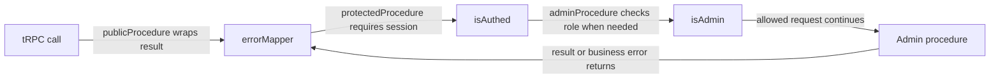

# tRPC middleware chain

History: see [CHANGELOG.md](../CHANGELOG.md) or run `pnpm docs:history`

Area: API · Status: ✅ built · Step doc: [02 errors](../../02-errors.md), [09 dashboard](../../09-dashboard.md)
<!-- interview-card: v2 -->

## 1. What is it?

Middleware is a shared step that runs around an API procedure. It can check a policy before proceeding or translate a failure on the way back.

## 2. Why do we need it?

MiniTickets should not copy login checks and error translation into every endpoint. Shared procedure building blocks make those rules consistent and easier to review.

## 3. How does it work?

1. Use the procedure building block matching the endpoint’s policy.
2. Run authentication, then any required authorization.
3. Let the outer mapper translate business errors consistently.

## 4. How do we use it in MiniTickets?

Public procedures include error mapping. Protected procedures add a verified-session requirement. Admin procedures add a fresh role lookup. Input validation and error formatting remain separate parts of the request boundary.

## 5. Interview-ready answer

“MiniTickets builds procedures from a short middleware chain: shared error mapping, optional authentication, and an admin-role check where required. The order matters because identity must exist before authorization, and outer mapping must see business failures. Keeping each step small makes the actual policy visible instead of hiding it in a long chain.”

## 6. Important follow-up questions

- **Does publicProcedure skip validation?** No. It only omits the login requirement; input schemas and shared error handling still apply.
- **What if a route uses raw t.procedure?** It can bypass our shared mapping and policy conventions.
- **Why read the admin role at request time?** A role copied into a long-lived session could stay wrong after a privilege change.
- **Does next always throw on failure?** tRPC middleware receives a result object; our mapper inspects its error cause.

## 7. Advanced details

Technical reference

### Current building blocks and order

`apps/api/src/trpc/init.ts` initializes tRPC with Context and errorFormatter. publicProcedure is t.procedure.use(errorMapper); protectedProcedure adds isAuthed; adminProcedure adds isAdmin. Earlier “two middlewares only” descriptions predate the built admin chain.

errorMapper awaits next() and inspects its returned result. A successful result or non-AppError cause passes through. A service AppError becomes a TRPCError using codeByKind, preserving the cause. Zod input errors remain formatter input and become 400/fieldErrors; unexpected errors receive the safe generic response. Because the mapper is outermost, it can see business failures from later steps.

isAuthed rejects null sessions with UNAUTHORIZED, then next({ctx:{session}}) narrows the downstream session type. isAdmin requires authenticated identity and reads the current Postgres role through the user service. Missing user means unauthorized; non-admin means forbidden; a failed lookup never grants access. Context deliberately avoids that role dependency for ordinary requests.

### Retry metadata and enforcement

RateLimitedError is mapped to TOO_MANY_REQUESTS. A batch shares response headers, so the mapper retains the largest Retry-After among limited operations; errorFormatter exposes retryAfterSeconds. Rate-limit service calls are currently explicit at procedure boundaries rather than another universal middleware. Fastify admission hooks cover pre-tRPC request concerns separately.

Procedures must use the exported building block matching their policy. Raw t.procedure would bypass the shared mapper; hiding links in UI cannot enforce authorization. Middleware order and long chains can obscure behaviour, so keep each step focused and testable. init.test.ts uses direct callers to check NotFound/Conflict mappings and unexpected-error handling; those checks were not rerun by this documentation change. More timing/metrics middleware or Fastify hooks are alternatives when their placement fits the concern.

### Source anchors

- Anchor: `apps/api/src/trpc/init.ts` · `errorMapper`, `publicProcedure`, `protectedProcedure`: the chain.

### Related reading

- [02 errors](../../02-errors.md)
- [09 dashboard](../../09-dashboard.md)
- [error-handling](error-handling.md)
- [protected-procedure](protected-procedure.md)
- [trpc-context](trpc-context.md)
- [Open this piece in the city explorer](../guides/infra-explorer.html?concept=trpc-middleware#chapter=0&piece=laptop-api)
- [App story: 6. Middleware: errorMapper and protectedProcedure](../app-story.md#6-middleware-errormapper-and-protectedprocedure)

## Where it appears in the story

- [App story: 6. Middleware: errorMapper and protectedProcedure](../app-story.md#6-middleware-errormapper-and-protectedprocedure)

