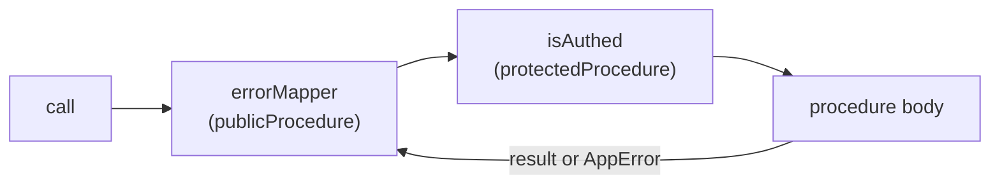

# tRPC middleware chain

History: see [CHANGELOG.md](../CHANGELOG.md) or run `pnpm docs:history`

Area: API · Status: ✅ built · Step doc: [02 errors](../../02-errors.md), [09 dashboard](../../09-dashboard.md)

## 1. In one line

A **middleware** wraps a procedure and runs code before and after it; ours form a chain:
`errorMapper` on every procedure, and `isAuthed` on top for protected ones.

## 2. Real-life comparison

Airport layers: everyone passes the baggage desk (errorMapper translates any problem into a
standard form), and only the gate for international flights adds a passport check (isAuthed).

## 3. Picture it



## 4. Where in our code

- Anchor: `apps/api/src/trpc/init.ts` · `errorMapper`, `publicProcedure`, `protectedProcedure`: the chain.

Step by step:

1. `const t = initTRPC.context<Context>().create({ errorFormatter })`.
2. `errorMapper = t.middleware(async ({ next }) => { const result = await next(); … })`: runs the
   rest of the chain, then looks at the result. An `AppError` from a service becomes a `TRPCError`
   with the mapped code ([error-handling](error-handling.md)); anything else passes through.
3. `isAuthed = t.middleware(({ ctx, next }) => …)`: throws `UNAUTHORIZED` when `ctx.session` is
   null, otherwise calls `next({ ctx: { session: ctx.session } })` to narrow the type
   ([protected-procedure](protected-procedure.md)).
4. `publicProcedure = t.procedure.use(errorMapper)`;
   `protectedProcedure = publicProcedure.use(isAuthed)`. Order: `errorMapper` is outermost.
5. Input validation (`.input(schema)`) happens inside this chain; a `ZodError` is passed through
   by `errorMapper` and formatted as 400 with field errors.

## 5. See it yourself

`apps/api/src/trpc/init.test.ts` calls three tiny procedures through `publicProcedure` and checks
that `NotFoundError` → `NOT_FOUND`, `ConflictError` → `CONFLICT`, and a plain `Error` →
`INTERNAL_SERVER_ERROR`:

```bash
pnpm test init.test     # runs only apps/api/src/trpc/init.test.ts
```

**Break it on purpose:** export `publicProcedure = t.procedure` (without `errorMapper`). The test
fails: a `NotFoundError` now reaches the client as a 500.

## 6. How it connects

- **Uses ←** [trpc-context](trpc-context.md) (`ctx.session`), `AppError` from `apps/api/src/errors.ts`.
- **Gives →** [error-handling](error-handling.md), [protected-procedure](protected-procedure.md);
  every procedure in `procedures/` is built from these two.

## 7. Our settings and WHY

Two middlewares only. WHY: each does one job; the order makes `errorMapper` see errors from
`isAuthed` and the procedure.

## 8. Trade-offs

- **Pros:** cross-cutting rules in one place; typed context narrowing.
- **Cons:** the order matters and is easy to get wrong; a long chain hides what runs.

## 9. Alternatives and when to choose them

- **Fastify hooks** (`onRequest`): for things that must run before tRPC, for every route.
- **More middlewares later:** rate limiting per procedure, timing/metrics, role checks
  (`requireRole("admin")`).

## 10. What breaks, and how we'd notice

- A procedure built on `t.procedure` directly: no error mapping (500s for business errors). The
  `init.test.ts` pattern and code review catch it.
- `isAuthed` before `errorMapper`: works today (TRPCError passes through), but the intended order
  is documented in `init.ts`.

## 13. Interview answers at 3 levels

- **Simple:** Shared steps that run around every api function, like error translation and login
  checks.
- **Senior:** `publicProcedure` is `t.procedure.use(errorMapper)`: it awaits `next()` and turns a
  service's `AppError` into the right `TRPCError`. `protectedProcedure` adds `isAuthed`, which throws
  401 without a session and narrows `ctx.session` to non-null.
- **Lead:** Middleware is where policy lives: errors, auth, later rate limits and metrics. Keeping
  each one tiny and testable through `createCallerFactory` keeps policy visible and enforced.

## 14. Follow-up questions interviewers ask

- *How does `next({ ctx })` change types?* It merges the new ctx, so later code sees
  `session` as non-null.
- *Why does errorMapper await `next()` instead of try/catch?* tRPC's `next()` returns a result
  object (ok or error) instead of throwing.

## 15. Say it in 30 seconds

"Two tRPC middlewares. errorMapper wraps every procedure and turns our business errors into the
right tRPC code. isAuthed sits on top for protected procedures: no session means 401, and it narrows
ctx.session to non-null for the procedure. A unit test checks the mapping."

## 16. Status

✅ built.
