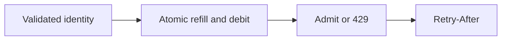

# Reverse proxies and `X-Forwarded-For` (`trustProxy`)

History: see [CHANGELOG.md](../CHANGELOG.md) or run `pnpm docs:history`

Area: API · Status: ✅ built in repository; live AWS acceptance is separate

## 1. In one line

Fastify trusts only the configured proxy boundary: 0 direct, 1 ALB-only, 2 CDN+ALB, with loopback peers never trusted. Wrong hops let clients forge IP/protocol, corrupting rate limits and security assumptions.

## 2. Real-life comparison

Two clerks cannot promise the same last seat: one holds the ledger until the reservation is recorded.

## 3. Picture it

## 4. Where in our code

- Anchor: `apps/api/src/app.ts` — `statusCode`; follow the numbered comments at this boundary.
- Anchor: `apps/api/src/config/trust-proxy.test.ts` — `whoAmI`; follow the numbered comments at this boundary.
- Anchor: `apps/api/src/config/trust-proxy.ts` — `trustProxyHops`; follow the numbered comments at this boundary.

`apps/api/src/queries/rate-limits.ts` stores buckets; `services/rate-limits.ts` chooses policy. `config/trust-proxy.ts` only trusts configured hops/CIDRs. `pnpm demo:sale` verifies shared quotas, spoof resistance and the inventory gate. Redis failure is an explicit failure policy, not a durable quota guarantee.

## 5. See it yourself

Run `pnpm demo:sale` and inspect the asserted outcome described above.

Failure thought experiment: Should auth failures all share one user key? No; unauthenticated identity needs a trusted edge/IP policy. Do not change a live stack to demonstrate it.

## 6. How it connects

Uses the [current system](../00-big-picture.md); gives a concrete decision to the [scenario](../guides/interview-scenarios.md#rate-limits) and [explorer tour](../guides/infra-explorer.html?tour=sale-day).

## 7. Our settings and WHY

Fastify trusts only the configured proxy boundary: 0 direct, 1 ALB-only, 2 CDN+ALB, with loopback peers never trusted. Wrong hops let clients forge IP/protocol, corrupting rate limits and security assumptions. One instance’s memory cannot enforce a shared quota.

## 8. Trade-offs

Fixed windows permit boundary bursts; sliding windows cost more state. IP limits affect NAT users. Redis allkeys-lru can evict quotas; strict financial quotas need durable accounting.

## 9. Alternatives and when to choose them

10x: key cardinality/TTL and fairness. 100x: gateway protections, per-tenant budgets and hot-key partitioning.

## 10. What breaks and how we notice

Should auth failures all share one user key? No; unauthenticated identity needs a trusted edge/IP policy.

## 13. Interview answers at 3 levels

- **Simple:** Fastify trusts only the configured proxy boundary: 0 direct, 1 ALB-only, 2 CDN+ALB, with loopback peers never trusted.
- **Senior:** Token buckets permit a burst then refill at a steady rate. Login limits a trustworthy client IP; booking limits an authenticated user. Redis Lua makes refill and debit atomic across instances. Return 429 and Retry-After. A spoofable forwarded header must not choose someone else’s bucket.
- **Lead:** 10x: key cardinality/TTL and fairness. 100x: gateway protections, per-tenant budgets and hot-key partitioning.

## 14. Follow-up questions with answers

Should auth failures all share one user key? No; unauthenticated identity needs a trusted edge/IP policy.

What makes a bucket update atomic across API tasks? **Redis Lua operation.**

## 15. Say it in 30 seconds

Token buckets permit a burst then refill at a steady rate. Login limits a trustworthy client IP; booking limits an authenticated user. Redis Lua makes refill and debit atomic across instances. Return 429 and Retry-After. A spoofable forwarded header must not choose someone else’s bucket.

## 16. Status and production work

Repository implementation and local evidence are described above. Live AWS/CI execution remains owner acceptance. 10x: key cardinality/TTL and fairness. 100x: gateway protections, per-tenant budgets and hot-key partitioning.

## Where it appears in the story

- [app-story: 9b. A booking reaches its transaction](../app-story.md#9b-a-booking-reaches-its-transaction)
