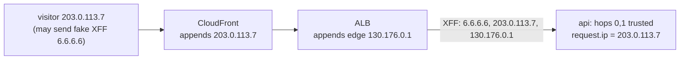

# Reverse proxies and `X-Forwarded-For` (`trustProxy`)

History: see [CHANGELOG.md](../CHANGELOG.md) or run `pnpm docs:history`

Area: API · Status: ✅ built · Step doc: [19 CloudFront](../../19-infra-cloudfront.md)

## 1. In one line

Behind proxies, the connection always comes from the last proxy; `trustProxy` tells Fastify how many
proxy **hops** to trust in `X-Forwarded-For`, so `request.ip` becomes the real visitor and a faked
header can't fool it.

## 2. Real-life comparison

A letter passed through two trusted mail rooms; each writes on the envelope who handed it over. You
trust only the last two notes (your own mail rooms). Anything written before that came from the
sender and could be made up.

## 3. Picture it



## 4. Where in our code

- Anchor: `apps/api/src/config/trust-proxy.ts` · `trustProxyHops`: 0 → `false`; N → `(address, hop) => hop < N`.
- Anchor: `apps/api/src/app.ts` · `trustProxy: trustProxyHops(env.TRUST_PROXY_HOPS)`.
- Anchor: `apps/api/src/config/trust-proxy.test.ts` · `whoAmI`: in-process proof with fake headers.

Step by step:

1. Fastify lists addresses nearest first: hop 0 = who connected (the ALB), hop 1 = last XFF entry
   (the CloudFront edge, written by the ALB), hop 2 = the one before (the visitor, written by
   CloudFront), hop 3+ = whatever the visitor sent.
2. Our function trusts hops 0 and 1 when `TRUST_PROXY_HOPS=2`; `request.ip` is the first untrusted
   address: hop 2, the real visitor.
3. A fake `X-Forwarded-For: 6.6.6.6` from the visitor sits at hop 3, so it is never read.
4. `request.protocol` comes from `X-Forwarded-Proto` of the trusted hop.
5. Locally (`TRUST_PROXY_HOPS` unset → 0) nothing is trusted: `request.ip` is the connecting
   address. In ECS the task definition sets 2 when the entry layer is on (`infra/index.ts`:
   `trustProxyHops: cdn ? 2 : 0`).
6. WHY a function and not the number 2: the comment in `trust-proxy.ts` says Fastify treats a
   plain number as "trust nothing", and counting hops is safe only because the api's security group
   accepts connections only from the ALB ([security-groups](security-groups.md)).

**How CloudFront appends**, verified from AWS docs
([custom origins, "Client IP addresses"](https://docs.aws.amazon.com/AmazonCloudFront/latest/DeveloperGuide/RequestAndResponseBehaviorCustomOrigin.html)):
if the viewer sent `X-Forwarded-For`, CloudFront "appends it to the end of the header"; load
balancers then append the CloudFront edge's address.

## 5. See it yourself

```bash
pnpm test trust-proxy      # 3 tests: 0 hops ignores XFF, 2 hops finds the visitor, fakes ignored
curl -s -o /dev/null -H 'X-Forwarded-For: 6.6.6.6' localhost:4000/health
# the api log line shows "remoteAddress":"127.0.0.1": with 0 hops the header is ignored
```

(The second output was recorded with a local api instance.) On AWS: the api's request logs in
CloudWatch show your real IP, not a `10.0.x.x` ALB address.

**Break it on purpose:** in the test, change hops to 3 for the faked header: `request.ip` becomes
`6.6.6.6`. Trusting one hop too many lets any visitor choose their IP.

## 6. How it connects

- **Uses ←** [cloudfront](cloudfront.md) and [alb](alb.md) (they write the header),
  [security-groups](security-groups.md) (only the ALB can connect).
- **Gives →** real IPs in [structured-logging](structured-logging.md); the key for future rate
  limiting (planned card `rate-limiting`).

## 7. Our settings and WHY

| Environment | Hops | Why |
| ----------- | ---- | --- |
| Laptop, Docker, CI | 0 | Nothing in front; trust nobody. |
| AWS with entry on | 2 | CloudFront, then the ALB. |
| AWS with entry off | 0 | Nothing reaches the api through a proxy. |

## 8. Trade-offs

- **Pros:** correct IPs; spoof-resistant; testable without AWS.
- **Cons:** the hop count must match the real path; adding a proxy (WAF on another layer, a
  service mesh) means changing it, or IPs are wrong.

## 9. Alternatives and when to choose them

- **Trust by address range** (only CloudFront's IP ranges): more robust to path changes, needs the
  list kept current.
- **`CloudFront-Viewer-Address` header:** CloudFront can add the viewer IP in its own header
  (requires an origin request policy; not used).
- **PROXY protocol:** for TCP load balancers (NLB).

## 10. What breaks, and how we'd notice

- Too few hops: every log shows the CloudFront edge or ALB IP; rate limits would hit everyone.
- Too many hops: visitors can spoof their IP. The tests catch both directions.

## 13. Interview answers at 3 levels

- **Simple:** Behind proxies, we read the visitor's real address from a header, but only the
  trusted part of it.
- **Senior:** `TRUST_PROXY_HOPS=2` on AWS; `trustProxyHops` returns a function trusting hops 0 and 1
  (ALB, CloudFront edge), so `request.ip` is the address CloudFront saw. A fake XFF lands at hop 3
  and is ignored. Tests use `app.inject` with a fake remote address.
- **Lead:** Trusting forwarded headers is a security decision tied to network topology: the hop
  count is only safe because the security group allows only the ALB. Any new proxy in the path must
  update it, and rate limiting depends on getting it right.

## 14. Follow-up questions interviewers ask

- *Why not take the first XFF entry?* The client controls it.
- *What else depends on this?* `request.protocol` (`X-Forwarded-Proto`) and future rate limits.

## 15. Say it in 30 seconds

"Behind CloudFront and the ALB, the connection comes from the ALB, so we read X-Forwarded-For. We
trust exactly two hops on AWS, which makes request.ip the address CloudFront saw. Anything the
visitor fakes sits further left and is ignored. Unit tests prove both cases, and locally we trust
nobody."

## 16. Status

✅ built.
