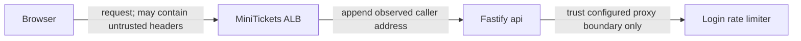

# Reverse proxies and `X-Forwarded-For` (`trustProxy`)

History: see [CHANGELOG.md](../CHANGELOG.md) or run `pnpm docs:history`

Area: API · Status: ✅ built in repository; live AWS acceptance is separate
<!-- interview-card: v2 -->

## 1. What is it?

A reverse proxy forwards requests to our API. Proxy trust decides which forwarded address information the API may believe instead of accepting whatever a caller writes.

## 2. Why do we need it?

MiniTickets login limits depend on the caller address. If anyone could invent a forwarded IP, an attacker could change buckets repeatedly or make innocent visitors appear responsible.

## 3. How does it work?

1. Observe the connection peer and forwarded address chain.
2. Trust only the configured nearest proxy hops.
3. Use the resulting caller identity for logs and limits.

## 4. How do we use it in MiniTickets?

Fastify uses a hop-count function for the active entry topology. Direct local traffic trusts no proxy; loopback Service Connect peers never gain forwarded-header trust. This implementation has no CIDR allow-list inside the trust function.

## 5. Interview-ready answer

“MiniTickets trusts forwarded addresses only across a known proxy boundary. Otherwise a client could choose the identity used by login limits and logs. The configured hop count must match the public route, and private loopback calls stop trust immediately. Network rules must also prevent callers entering through an unexpected shorter path.”

## 6. Important follow-up questions

- **Why not trust every forwarded header?** Callers can write their own values.
- **What if we trust too many hops?** An attacker-controlled value can become the supposed client address.
- **Why exclude loopback peers?** Service Connect calls have no public proxy chain to authenticate those headers.
- **Does an IP identify one person?** No. Shared networks and address changes make IP limits a useful but imperfect control.

## 7. Advanced details

Technical reference

### Source anchors

- Anchor: `apps/api/src/app.ts` — `statusCode`; follow the numbered comments at this boundary.
- Anchor: `apps/api/src/config/trust-proxy.test.ts` — `whoAmI`; follow the numbered comments at this boundary.
- Anchor: `apps/api/src/config/trust-proxy.ts` — `trustProxyHops`; follow the numbered comments at this boundary.

### Exact implementation and assumptions

`apps/api/src/config/trust-proxy.ts` → `trustProxyHops` returns false for zero hops; otherwise it trusts `hop < hops`, except a loopback connection peer at hop zero. Loopback forms include 127.0.0.1, ::ffff:127.0.0.1 and ::1. This is a hop-count policy, not a CIDR allow-list.

Configured topology is 0 for direct local/CI traffic, 1 for current ALB-only public traffic and 2 for optional CloudFront+ALB. Fastify walks nearest addresses first and stops at the first untrusted one. Trust also affects forwarded protocol. Counting is safe only with the expected network entry paths; API source rules and the special Service Connect loopback case matter. Too many trusted hops can expose a caller-written X-Forwarded-For value.

### Limits, checks and trade-offs

Login limits use the trusted client IP; booking limits use authenticated user identity. `apps/api/src/queries/rate-limits.ts` stores shared token buckets and `apps/api/src/services/rate-limits.ts` chooses policy. Redis Lua makes refill/debit atomic across API processes; one process's memory cannot enforce a shared quota. Responses use 429 and Retry-After.

`pnpm demo:sale` is prior local coverage for shared quotas, spoof resistance and inventory; it was not rerun here. Compare direct calls with forged forwarding headers and actual expected proxy paths in isolated tests. IP limits affect shared NAT users; Redis allkeys-lru may evict quota state, so this is not durable financial accounting. Fixed windows permit boundary bursts; sliding windows cost state. At greater scale review key cardinality/TTL, fairness, tenant budgets, gateway admission and hot keys.

### Preserved references

- [current system](../00-big-picture.md)
- [scenario](../guides/interview-scenarios.md#rate-limits)
- [explorer tour](../guides/infra-explorer.html?tour=sale-day)

[Open this piece in the city explorer](../guides/infra-explorer.html?concept=trust-proxy#chapter=8&piece=api-task).

## Where it appears in the story

- [app-story: 9b. A booking reaches its transaction](../app-story.md#9b-a-booking-reaches-its-transaction)

