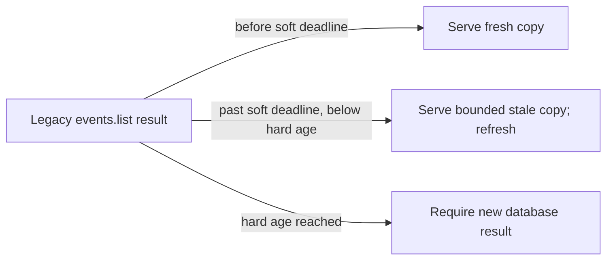

# TTL (time to live)

History: see [CHANGELOG.md](../CHANGELOG.md) or run `pnpm docs:history`

Area: Performance & Caching · Status: ✅ built in repository; live AWS acceptance is separate
<!-- interview-card: v2 -->

## 1. What is it?

Time to live, or TTL, gives stored information an expiry boundary. Different systems use it for different purposes, from exact access checks to eventual cleanup.

## 2. Why do we need it?

A MiniTickets session must not stay valid forever, and a displayed event list must not become indefinitely stale. Those limits need separate policies because they protect different things.

## 3. How does it work?

1. Choose whether the timer governs freshness, authorization or cleanup.
2. Record the original age and apply the relevant boundary.
3. Refresh or reject expired state according to that purpose.

## 4. How do we use it in MiniTickets?

Sessions have fixed expiry. Legacy public lists have soft freshness and a hard stale cap. Browser queries and explicit Next data caching have their own clocks. Current search bypasses the legacy list caches; purchases still recheck Postgres.

## 5. Interview-ready answer

“TTL is a boundary, but its meaning depends on the layer. MiniTickets uses it for session expiry, bounded public-list staleness and eventual dedup-record cleanup. Those timers do not synchronize browser and server caches automatically. A failed refresh must not make old data look new, and stale data must never authorize a booking.”

## 6. Important follow-up questions

- **Does DynamoDB TTL delete exactly on time?** No. It is asynchronous cleanup; enforce exact access rules separately.
- **Does soft-TTL jitter extend the hard cap?** No. Spread refresh timing without extending the maximum allowed age.
- **Does invalidating server data update every open tab?** No. Browser queries follow their own freshness and refetch policy.
- **Why not use one long TTL everywhere?** Different clocks can compound staleness and hide an outdated answer from lower layers.

## 7. Advanced details

Technical reference

### Current implementation

Sessions and cookies use fixed 604800 seconds. Legacy lists have 30–33 second soft freshness and Redis PX hard expiry of 300000 ms. DynamoDB processed-job cleanup is scheduled after 30 days and deletes asynchronously. Next public-data and browser-query freshness are separate; nonce HTML/RSC remains private,no-store. Fake-clock tests and historical demos are evidence sources, not checks rerun by this rewrite.

### Technical limits and diagnosis

Soft freshness jitter spreads refresh demand without extending the original hard age cap. A failed refresh must not reset an old value to fresh. Stale-while-revalidate serves a bounded public stale copy while one refresh runs; stale-if-error uses a previous good value during a bounded failure. A miss has no valid saved copy. Neither stale state may authorize login or sell seats.

The explicit Next public-data helper and legacy useEvents have their own clocks; current catalogue search bypasses the list caches. Invalidation/freshness at one layer does not refresh every open tab. Shared nonce HTML/RSC is private,no-store. DynamoDB dedup TTL is asynchronous cleanup, not exact expiry enforcement.

Long independent TTLs can compound staleness. Expose ages/hit telemetry and define an end-to-end freshness budget before adding overlapping caches. Existing fake-clock SWR/error tests are historical evidence sources, not rerun checks for this rewrite.

### Source anchors

- Anchor: `apps/api/src/procedures/auth.ts` — `module configuration`; follow the numbered comments at this boundary.
- Anchor: `apps/api/src/queries/events-cache.ts` — `setUpcomingInCache`; follow the numbered comments at this boundary.
- Anchor: `apps/api/src/queries/sessions.ts` — `SESSION_TTL_SECONDS`; follow the numbered comments at this boundary.
- Anchor: `apps/api/src/services/auth.ts` — `SESSION_MAX_AGE_SECONDS`; follow the numbered comments at this boundary.
- Anchor: `apps/api/src/services/events.ts` — `SOFT_TTL_MS`; follow the numbered comments at this boundary.

### Related reading

- [current system](../00-big-picture.md)
- [scenario](../guides/interview-scenarios.md#swr-caches)
- [explorer tour](../guides/infra-explorer.html?tour=search)
- [app-story: 10c. Public list caches and freshness](../app-story.md#10c-public-list-caches-and-freshness)

[Open this piece in the city explorer](../guides/infra-explorer.html?concept=ttl#chapter=5&piece=valkey).

## Where it appears in the story

- [app-story: 10c. Public list caches and freshness](../app-story.md#10c-public-list-caches-and-freshness)

